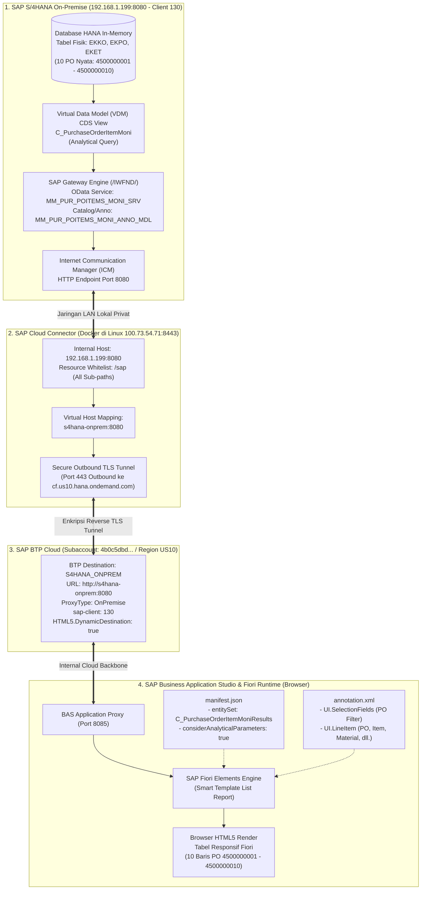

# Panduan Arsitektur Teknis End-to-End: Alur Data S/4HANA On-Premise ke SAP Fiori BTP

**Subproject:** `BTP_HYBRID_INTEGRATION`  
**Target Host Remote:** Linux (`100.73.54.71` / `192.168.254.58`)  
**Target ERP On-Premise:** SAP S/4HANA 1909 (SID `ADB`, Client `130`, IP `192.168.1.199:8080`)  
**Target Cloud:** SAP Business Technology Platform (BTP) Trial (Region `US East (VA) - AWS` / `cf.us10.hana.ondemand.com`)  
**Subaccount ID:** `4b0c5dbd-a7d7-4799-aaf2-08438302d5cd`  
**Dokumentasi Khusus Dibuat Untuk:** Baginda  

---

## 1. Ikhtisar Arsitektur (Executive Technical Overview)

Dalam integrasi *hybrid* modern antara sistem on-premise (*data center internal*) dengan cloud publik (*SAP BTP*), terdapat tantangan mendasar:
1. **Keamanan Jaringan & Firewall:** Server SAP ERP (`192.168.1.199:8080`) berada di dalam jaringan privat LAN perusahaan dan tidak boleh dibuka port *inbound* publiknya ke internet demi mencegah serangan siber.
2. **Konektivitas Tanpa VPN Konvensional:** Penggunaan VPN site-to-site sering kali berat, lambat, dan rumit dalam pengelolaan sertifikat aplikasi cloud.
3. **Solusi SAP Standar Enterprise:** Menggunakan **SAP Cloud Connector (SCC)** yang ditempatkan sebagai kontainer Docker di DMZ / Linux Server (`100.73.54.71:8443`). SCC membuka terowongan keluar (*outbound reverse TLS tunnel*) ke SAP BTP, sehingga traffic hanya mengalir jika ada otorisasi sah dari BTP Destination.

---

## 2. Diagram Alur Data End-to-End (Mermaid Diagram)



---

## 3. Bedah Rinci Setiap Lapisan Teknis (Layer by Layer)

### Lapisan 1: Penyimpanan Data Fisik di S/4HANA (Database & Tables)
Data 10 dokumen Purchase Order yang kita gunakan tersimpan secara fisik pada tabel relasional SAP HANA (Client 130):
* **`EKKO` (Purchasing Document Header):**
  * `EBELN`: Nomor PO (`4500000001` s.d. `4500000010`)
  * `BSART`: Tipe PO (`NB` - Standard PO)
  * `LIFNR`: Vendor / Supplier (`100000` - PT TECH SOLUTIONS INDONESIA)
  * `BEDAT` / `AEDAT`: Tanggal Dokumen (`19.11.2026`)
  * `WAERS`: Mata Uang Asli (`EUR`)
* **`EKPO` (Purchasing Document Item):**
  * `EBELP`: Item PO (`10`)
  * `MATNR`: Kode Material (`SRAJII` - Material keren)
  * `MENGE`: Kuantitas Pemesanan (`5.000` s.d. `50.000 ROL`)
  * `NETPR`: Harga Bersih Satuan (`EUR 3,500.00`)
  * `NETWR`: Nilai Total Bersih (`EUR 17,500.00` s.d. `EUR 175,000.00`)
  * `WERKS`: Plant (`0001`)
* **`EKET` (Schedule Lines):**
  * `EINDT`: Tanggal Pengiriman Terjadwal (`19.11.2026`)

---

### Lapisan 2: Virtual Data Model (CDS Views & Analytical Engine)
Dalam arsitektur S/4HANA modern, UI tidak pernah membaca langsung tabel mentah database `EKKO`/`EKPO`. Sebagai gantinya digunakan **Core Data Services (CDS) View**:
* **CDS View Inti:** `C_PurchaseOrderItemMoni`
* **Kategori View:** *Analytical Query*. View ini secara otomatis melakukan agregasi kuantitas, kalkulasi sisa barang belum terkirim (*Still To Be Delivered*), sisa tagihan belum masuk (*Still To Be Invoiced*), dan konversi mata uang dinamis ke mata uang pelaporan (*Display Currency*).
* **Mekanisme Parameter & Dua Entitas OData:**
  Karena query ini memiliki parameter input wajib (`P_DisplayCurrency`), SAP Gateway secara arsitektural memecahnya menjadi 2 entitas berpasangan:
  1. **`C_PurchaseOrderItemMoni` (Parameter Entity Set):**
     * Memiliki atribut `sap:semantics="parameters"`.
     * Hanya memiliki 1 properti: `P_DisplayCurrency`.
  2. **`C_PurchaseOrderItemMoniResults` (Data Entity Set):**
     * Memiliki navigasi `Results` dari Parameter Entity.
     * Berisi seluruh data 60+ field aktual PO (`PurchaseOrder`, `PurchaseOrderItem`, `Material`, `Supplier`, `OrderQuantity`, `NetAmount`, dll.).
  > [!IMPORTANT]
  > Inilah penyebab mengapa di awal pengujian tabel hanya menampilkan kolom *Display Currency*. Aplikasi Fiori harus diarahkan untuk mengambil data dari `C_PurchaseOrderItemMoniResults` dengan parameter analitis diaktifkan (`considerAnalyticalParameters: true`).

---

### Lapisan 3: SAP Gateway & OData Exposition (`/IWFND/`)
* **OData Service V2:** `MM_PUR_POITEMS_MONI_SRV`
* Diekspos melalui SAP Internet Communication Framework (ICF) pada URL:
  `/sap/opu/odata/sap/MM_PUR_POITEMS_MONI_SRV/`
* **Metadata & Vocabulary Service:** Bersama servis ini, SAP Gateway menyediakan metadata struktur dan model anotasi bawaan:
  `/sap/opu/odata/IWFND/CATALOGSERVICE;v=2/Annotations(TechnicalName='MM_PUR_POITEMS_MONI_ANNO_MDL',Version='0001')/$value`

---

### Lapisan 4: SAP Cloud Connector (Docker Container di `100.73.54.71:8443`)
* **Masalah:** IP `192.168.1.199:8080` adalah IP privat LAN yang tidak dapat dijangkau dari luar.
* **Peran Cloud Connector:**
  * Kontainer Docker Rocky Linux 9 + OpenJDK 21 LTS berjalan di port `8443`.
  * Membuka koneksi keluar (*Outbound Secure TLS*) ke BTP Subaccount `4b0c5dbd-a7d7-4799-aaf2-08438302d5cd` di Region `cf.us10.hana.ondemand.com`.
  * **System Mapping (Abstraksi & Isolasi):**
    * *Internal Host:* `192.168.1.199:8080` (IP asli disembunyikan).
    * *Virtual Host:* `s4hana-onprem:8080` (Hanya nama alias ini yang diketahui oleh BTP).
    * *Whitelisted Resource:* URL `/sap` dengan kebijakan `Path and all sub-paths`.

---

### Lapisan 5: BTP Subaccount & Destination (`S4HANA_ONPREM`)
Di SAP BTP Cockpit, dibuat Destination bernama **`S4HANA_ONPREM`**:
* **URL:** `http://s4hana-onprem:8080`
* **ProxyType:** `OnPremise` $\rightarrow$ Memberitahu BTP bahwa request harus dilewatkan melalui terowongan Cloud Connector, bukan internet publik.
* **Authentication:** `BasicAuthentication` (User: `TRSTABAP`).
* **Additional Properties Kritis:**
  * `HTML5.DynamicDestination = true` $\rightarrow$ Mengizinkan aplikasi HTML5 / BAS untuk memanggil destination ini secara dinamis melalui reverse-proxy.
  * `sap-client = 130` $\rightarrow$ Memastikan request langsung masuk ke Mandant 130 (mencegah error login atau data kosong di client default).
  * `WebIDEUsage = odata_abap,dev_abap` $\rightarrow$ Memberitahu SAP BAS bahwa tujuan ini menyediakan katalog OData ABAP.

---

### Lapisan 6: SAP Business Application Studio (BAS) & Fiori Elements
Proyek Fiori `zpoitems` menggunakan arsitektur **SAP Fiori Elements Smart Template List Report**:
1. **`manifest.json`:**
   * Menghubungkan *data source* ke service `MM_PUR_POITEMS_MONI_SRV`.
   * Menentukan `entitySet`: **`C_PurchaseOrderItemMoniResults`**.
   * Menambahkan konfigurasi template:
     ```json
     "component": {
         "name": "sap.suite.ui.generic.template.ListReport",
         "settings": {
             "considerAnalyticalParameters": true
         }
     }
     ```
2. **`annotation.xml` (Kustomisasi Permanen Tingkat Proyek):**
   * Secara standar SAP, nomor PO tidak diletakkan di kolom tabel utama.
   * File `webapp/annotations/annotation.xml` memotong (*override*) anotasi bawaan backend:
     * **`UI.SelectionFields`**: Memasang input pencarian filter untuk `PurchaseOrder`, `Supplier`, `Material`, dan `Plant`.
     * **`UI.LineItem`**: Memasang urutan kolom tabel tetap: Kolom 1 = `PurchaseOrder`, Kolom 2 = `PurchaseOrderItem`, diikuti `Material`, `Supplier`, `ScheduleLineDeliveryDate`, `ScheduleLineOpenQty`, `OrderQuantity`, `NetPriceAmount`, dan `NetAmount`.

---

## 4. Siklus 1 Detik: Apa yang Terjadi Saat Tombol "Go" Ditekan?

Ketika pengguna membuka aplikasi di browser dan menekan tombol **Go**:

```text
[ Browser ] 
    │  (1) Event: User menekan tombol "Go" dengan parameter EUR
    ▼
[ Fiori Elements Engine ]
    │  (2) Membaca filter & anotasi, membentuk HTTP OData GET Query:
    │      /sap/opu/odata/sap/MM_PUR_POITEMS_MONI_SRV/
    │      C_PurchaseOrderItemMoni(P_DisplayCurrency='EUR')/Results
    │      ?$filter=(ScheduleLineDeliveryDate ge datetime'2026-01-01T00:00:00'...)
    │      &$select=PurchaseOrder,PurchaseOrderItem,Material,Supplier,OrderQuantity,NetPriceAmount,NetAmount...
    ▼
[ BAS App Proxy (Port 8085) ]
    │  (3) Meneruskan request ke Destination BTP "S4HANA_ONPREM"
    ▼
[ SAP BTP Cloud Backbone ]
    │  (4) Memeriksa ProxyType=OnPremise, menyalurkan paket ke Cloud Connector Tunnel
    ▼
[ SAP Cloud Connector (Docker 100.73.54.71) ]
    │  (5) Mendekripsi paket, memvalidasi URL /sap, mengubah Virtual Host 
    │      "s4hana-onprem:8080" menjadi Internal Host asli "192.168.1.199:8080"
    ▼
[ SAP S/4HANA ICM & Gateway (192.168.1.199:8080) ]
    │  (6) Autentikasi user TRSTABAP di Client 130
    │  (7) Menerjemahkan OData Query menjadi SQL Query ke CDS View C_PurchaseOrderItemMoni
    ▼
[ Database HANA In-Memory ]
    │  (8) Membaca baris tabel EKKO, EKPO, EKET yang cocok dengan tanggal 19.11.2026
    │  (9) Menemukan 10 baris PO otentik (4500000001 - 4500000010)
    ▼
[ SAP Gateway (/IWFND/) ]
    │  (10) Membungkus 10 baris data ke format OData JSON payload
    ▼
[ Alur Balik Melewati Tunnel ]
    │  (11) S/4HANA -> Cloud Connector -> BTP -> BAS Proxy -> Browser
    ▼
[ Browser DOM Render ]
    │  (12) Fiori Elements membaca aturan LineItem di annotation.xml, 
    │       menata data ke 10 baris tabel lengkap dengan header & formatting angka.
```

---

## 5. Ringkasan Kunci untuk Replikasi Tim

```text
+------------------------------+---------------------------------------------------------------------------------+
| Komponen                     | Nilai / Konfigurasi Nyata                                                       |
+------------------------------+---------------------------------------------------------------------------------+
| Backend ERP                  | S/4HANA 1909 Client 130 (192.168.1.199:8080)                                    |
| Docker Cloud Connector       | sap-cloud-connector:2.19.2 di 100.73.54.71:8443                                |
| Subaccount Region            | cf.us10.hana.ondemand.com (US East AWS)                                         |
| Virtual Host Mapping         | s4hana-onprem:8080 -> 192.168.1.199:8080 (Resource: /sap)                       |
| BTP Destination              | S4HANA_ONPREM (ProxyType: OnPremise, sap-client: 130)                            |
| OData Service                | MM_PUR_POITEMS_MONI_SRV (OData V2)                                              |
| CDS View                     | C_PurchaseOrderItemMoni (Analytical Query)                                      |
| Fiori EntitySet Target       | C_PurchaseOrderItemMoniResults (dengan considerAnalyticalParameters: true)     |
| Kustomisasi Kolom & Filter   | webapp/annotations/annotation.xml (UI.SelectionFields & UI.LineItem)             |
+------------------------------+---------------------------------------------------------------------------------+
```
