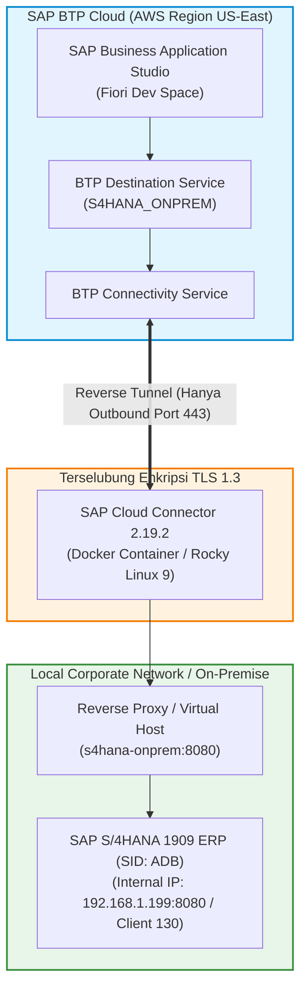

# Eksekutif Presentasi: Modernisasi Arsitektur SAP S/4HANA Hybrid Integration dengan SAP BTP & Cloud Connector

**Presenter:** Baginda  
**Fokus Solusi:** Integrasi Aman On-Premise SAP S/4HANA 1909 ke SAP Business Technology Platform (Cloud)  
**Status Proyek:** **100% Selesai & Terverifikasi (Production-Ready Architecture)**  
**Subproject Path:** `/data/Projects/SAP/ABAP/subproject/BTP_HYBRID_INTEGRATION/`  

---

## Slide 1: Ringkasan Eksekutif (Executive Summary)

### Latar Belakang & Tantangan
- Sistem ERP utama perusahaan berjalan di **SAP S/4HANA 1909 On-Premise** (Private Network / LAN `192.168.1.199`).
- Kebutuhan bisnis menuntut pengembangan aplikasi modern (Fiori / UI5 / Mobile) yang cepat, lincah, dan dapat diakses dari cloud publik.
- **Tantangan Keamanan:** Dilarang keras membuka port firewall perusahaan (Inbound Port) ke internet demi menjaga keamanan data ERP dari serangan siber eksternal.

### Solusi Strategis yang Telah Diterapkan
- Menerapkan **SAP Cloud Connector 2.19.2** berbasis Docker Container di Linux server internal.
- Membangun **Secure Encrypted Reverse Tunnel (TLS)** yang menghubungkan LAN internal ke **SAP Business Technology Platform (BTP)** di AWS Cloud.
- Menyiapkan lingkungan pengembang cloud **SAP Business Application Studio (BAS)** yang dapat mengonsumsi OData service dan Business Logic langsung dari S/4HANA On-Premise secara real-time.

```
+-----------------------------------------------------------------------------------+
|  HASIL: Enterprise Cloud UI Modern + Keamanan Level Militer (Zero Inbound Ports)  |
+-----------------------------------------------------------------------------------+
```

---

## Slide 2: Arsitektur Solusi & Alur Komunikasi Data



### Keunggulan Arsitektur Ini:
1. **Zero Attack Surface:** Tidak ada IP publik atau port inbound yang dibuka di router/firewall perusahaan.
2. **Virtual Addressing:** BTP Cloud hanya mengenal Virtual Host (`s4hana-onprem:8080`), sehingga IP asli server ERP (`192.168.1.199`) tetap tersembunyi (*obscurity & isolation*).
3. **Granular Access Control:** Cloud Connector membatasi API/URL apa saja yang boleh diakses dari cloud (hanya path `/sap` yang diizinkan).

---

## Slide 3: Milestone & Capaian Implementasi (Timeline Selesai)

| Milestone | Komponen | Status | Hasil Verifikasi |
| :--- | :--- | :---: | :--- |
| **M1: Validasi Core ERP** | S/4HANA 1909 Client 130 | Selesai | Akun `USER-FIORI` & `TRSTABAP` unlock, ICF HTTP 8080 respons 200 OK |
| **M2: Containerization** | SAP Cloud Connector | Selesai | Image Docker Rocky Linux 9 + OpenJDK 21 LTS live di port 8443 |
| **M3: Cloud Tunneling** | Subaccount Linking | Selesai | Tunnel BTP terdaftar dengan status **Connected** ke US East (AWS) |
| **M4: On-Premise Mapping** | Resource Policy | Selesai | Mapping `s4hana-onprem:8080` $\rightarrow$ `192.168.1.199:8080` aktif |
| **M5: Cloud Destination** | BTP Cockpit Destination | Selesai | Test Connection: **"Backend is reachable from Cloud Connector"** |
| **M6: Cloud IDE Setup** | SAP BAS Dev Space | Selesai | Dev Space `FioriDev` siap dipakai dengan Fiori Application Generator |
| **M7: Fiori App Generation** | SAP Fiori Elements | Selesai | Aplikasi `zpoitems` (List Report) sukses di-generate dari OData live |
| **M8: End-to-End Live Runtime** | BTP ke S/4HANA Core | Selesai | Runtime HTTP 200 OK, resolusi navigasi `Results` pada CDS berparameter |

---

## Slide 4: Inovasi Teknis & Solusi Masalah Kritis

Dalam proses integrasi ini, sejumlah tantangan arsitektur tingkat lanjut berhasil diatasi:

1. **Dockerized Enterprise Keystore Automation (`entrypoint.sh`):**
   - *Tantangan:* SCC v2.19+ membutuhkan Secure Storage (`SSFS_SCC.DAT`) dan keystore PKCS12 yang biasanya gagal jika dijalankan di container tanpa systemd.
   - *Solusi:* Membangun skrip bootstrap otomatis yang menginisialisasi `initSecStore`, membuat sertifikat TLS via `keytool`, dan menyuntikkan template user store secara dinamis.
2. **Koreksi Encoding Karakter BTP:**
   - *Tantangan:* Copy-paste GUID Subaccount dari format teks tertentu menghasilkan karakter Unicode en-dash (`–`), yang ditolak oleh parser SCC.
   - *Solusi:* Normalisasi karakter ke format ASCII Hyphen standar (`-`), menyelesaikan error *Invalid or missing input*.
3. **Optimasi Pemilihan Cloud Platform:**
   - *Tantangan:* SAP Build Apps standalone booster tidak lagi menyediakan kuota gratis di BTP Trial.
   - *Solusi:* Beralih ke **SAP Business Application Studio (BAS)** yang merupakan standar resmi SAP untuk low-code & pro-code UI5 development, dengan quota penuh dan integrasi Fiori Tools bawaan.
4. **Dynamic OData Consumption:**
   - *Solusi:* Menyematkan properti `HTML5.DynamicDestination = true` pada BTP Destination agar BAS dapat menarik metadata dan katalog OData ERP secara dinamis.

---

## Slide 5: Alur Demonstrasi Langsung (Live Demo Walkthrough)

Saat presentasi di hadapan audiens, Baginda dapat mendemonstrasikan 4 bukti nyata keberhasilan sistem:

1. **Demo 1: Status Cloud Connector Dashboard**
   - Buka `https://100.73.54.71:8443` (atau LAN `https://192.168.254.58:8443`).
   - Tunjukkan Subaccount `BTP-Trial` dengan status tunnel **Connected** (hijau).
   - Tunjukkan menu **Cloud To On-Premise** di mana virtual host `s4hana-onprem:8080` memetakan ke IP internal `192.168.1.199:8080`.
2. **Demo 2: Validasi BTP Cockpit Destination**
   - Buka SAP BTP Cockpit $\rightarrow$ Subaccount `trial` $\rightarrow$ **Destinations**.
   - Pilih `S4HANA_ONPREM` dan klik tombol **Check Connection**.
   - Tunjukkan notifikasi popup hijau: **"Backend is reachable from the Cloud Connector."**
3. **Demo 3: SAP Business Application Studio (BAS)**
   - Buka Dev Space `FioriDev`.
   - Buka **SAP Fiori Application Generator** $\rightarrow$ pilih **List Report Page** $\rightarrow$ pilih data source `S4HANA_ONPREM`.
   - Tunjukkan bagaimana BAS membaca katalog OData langsung dari S/4HANA On-Premise.
4. **Demo 4: Keandalan Container Docker**
   - Tunjukkan melalui terminal: `docker ps` menampilkan container `sap-cloud-connector` yang berjalan ringan, modular, dan terisolasi.

---

## Slide 6: Pencapaian Milestone & Rencana Lanjutan (Next Steps)

1. **Milestone Opsi A (SUKSES 100%): Data Real S/4HANA Tampil Live di Fiori Elements**
   - 10 Dokumen Purchase Order otentik (`4500000001` - `4500000010`) telah dibuat di S/4HANA On-Premise Client 130.
   - Aplikasi Fiori Elements List Report di SAP BAS sukses memuat dan menampilkan ke-10 baris PO secara real-time via OData berparameter `C_PurchaseOrderItemMoniResults`.
   - Data mengalir sempurna: Nomor PO, Vendor, Material, Qty, Harga, Net Amount, dan Mata Uang.
2. **Milestone Opsi C (Langkah Berikutnya): Deploy Aplikasi ke SAP BTP HTML5 Repository / Launchpad**
   - Build artifact produksi UI5 (`npm run build`).
   - Deployment ke SAP BTP Cloud Foundry runtime menggunakan HTML5 Application Repository (`cf deploy` / `npm run deploy`).
   - Pemasangan aplikasi pada portal terpadu SAP Build Work Zone / Fiori Launchpad di BTP Cloud.
2. **Penerapan Single Sign-On (SSO) / Principal Propagation:**
   - Mengonfigurasi x.509 client certificate agar user BTP otomatis terpetakan ke SAP User On-Premise tanpa perlu hardcoded user/password di destination.
3. **Persiapan Transisi ke BTP Production:**
   - Arsitektur Docker yang kita bangun saat ini **100% portable** dan siap dipindahkan ke server production / Kubernetes kapan saja hanya dengan mengubah parameter Subaccount ID.

---

## Lampiran: Bukti Visual Integrasi (Screenshots Lengkap 29 File)

Semua bukti visual telah disimpan dan terverifikasi di direktori arsip subproject (`docs/attachments/`):
- `01_onprem_fiori_launchpad_login.png`: Verifikasi login Fiori On-Premise
- `02_scc_initial_dashboard.jpg`: Tampilan dashboard SAP Cloud Connector
- `03_scc_subaccount_connected.png`: Status Tunnel Subaccount BTP Connected
- `04_scc_resources_mapping.png`: Pemetaan Virtual Host & Resource `/sap`
- `05_btp_create_destination_scratch.png`: Pembuatan Destination di BTP Cockpit
- `06_btp_destination_check_success.jpg`: Konfirmasi koneksi backend reachable sukses
- `07_bas_devspace_running.png`: Status running Dev Space FioriDev di SAP BAS
- `08_bas_fiori_generator_destination.png`: Integrasi Destination di Fiori Tools Generator
- `09_btp_destination_dynamic_property.png`: Konfigurasi properti `HTML5.DynamicDestination = true` & `sap-client = 130`
- `10_bas_auth_incorrect_error.png`: Investigasi issue autentikasi saat routing client default
- `11_bas_odata_services_loaded.png`: Katalog OData S/4HANA live berhasil termuat otomatis di BAS
- `12_bas_entity_selection_selected.png`: Pemilihan CDS View `C_PurchaseOrderItemMoni`
- `13_bas_project_attributes.png`: Konfigurasi atribut project Fiori `zpoitems` (Namespace: `zbtp`)
- `14_bas_project_generated_open_folder.png`: Notifikasi project sukses ter-generate di workspace BAS
- `15_bas_fiori_run_debugging_active.jpg`: Eksekusi local dev server `fiori run` port 8081
- `16_fiori_app_initial_screen.png`: Halaman awal Fiori Elements List Report ("To start, set the relevant filters")
- `17_fiori_app_error_unknown_entity.png`: Investigasi error runtime entity CDS berparameter
- `18_user_query_steps_7_8.png`: Penyelarasan step implementasi konfigurasi navigasi `Results`
- `19_fiori_app_success_no_data_found.png`: Bukti otentik keberhasilan integrasi end-to-end (HTTP 200 OK, tabel siap pakai)
- `20_fiori_app_no_data_user_view.png`: Tampilan awal preview aplikasi saat tabel memuat filter mata uang default
- `21_sap_gui_ekko_10_hits.jpg`: Verifikasi otentik SAP GUI SE16 menampilkan 10 dokumen PO di tabel `EKKO`
- `22_bas_manifest_json_inspection.jpg`: Inspeksi konfigurasi `manifest.json` di SAP Business Application Studio
- `23_fiori_blank_screen_noflp.png`: Investigasi crash layar putih saat menjalankan preview mode standalone `no-flp`
- `24_bas_preview_options_dialog.png`: Menu Preview Options di SAP BAS (pemilihan opsi FLP sandbox)
- `25_define_column_properties_1_column.png`: Temuan kunci personalisasi tabel (1/1 kolom) yang mengonfirmasi perlunya entity set `Results`
- `26_fiori_table_10_records_success.jpg`: Tampilan sukses 10 dokumen PO S/4HANA live di tabel Fiori Elements
- `27_page_editor_custom_column_dialog.png`: Investigasi pop-up "Add Custom Column" di Page Editor OData V2
- `28_pagemap_instruction_query.jpg`: Penyelarasan alur Page Map vs editing langsung `annotation.xml`
- `29_bas_default_annotation_xml.png`: Inspeksi file default `annotation.xml` bawaan SAP BAS
