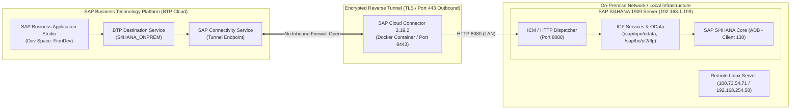

# Panduan Lengkap Implementasi Hybrid Integration: SAP S/4HANA 1909 On-Premise ke SAP BTP via SAP Cloud Connector (Docker)

**Subproject:** `BTP_HYBRID_INTEGRATION`  
**Target Host Remote:** Linux (`100.73.54.71` / `192.168.254.58`)  
**Target ERP On-Premise:** SAP S/4HANA 1909 (SID `ADB`, Client `130`, IP `192.168.1.199`)  
**Target Cloud:** SAP Business Technology Platform (BTP) Trial (Region `US East (VA) - AWS`)  
**Dokumentasi Dibuat Untuk:** Baginda  

---

## 1. Arsitektur Solusi & Topologi Jaringan

Integrasi hybrid ini menghubungkan sistem SAP S/4HANA On-Premise yang berada di dalam Local Area Network (LAN) privat dengan SAP Business Technology Platform (BTP) di cloud publik tanpa membuka port inbound apa pun pada firewall perusahaan.



### Parameter Utama Sistem

| Parameter | Nilai / Konfigurasi | Deskripsi |
| :--- | :--- | :--- |
| **S/4HANA Host & Port** | `192.168.1.199:8080` (Internal) | Port HTTP ICM S/4HANA 1909 |
| **S/4HANA Client** | `130` | Client target data & Fiori |
| **S/4HANA User** | `TRSTABAP` / `USER-FIORI` | User otentikasi RFC / ICF / OData |
| **Virtual Host (SCC)** | `s4hana-onprem:8080` | Virtual host yang diekspos ke BTP |
| **Cloud Connector Host** | `100.73.54.71:8443` (Tailscale) / `192.168.254.58:8443` (LAN) | Server Docker penampung SCC |
| **SCC Version & Runtime** | `2.19.2` pada Rocky Linux 9 + OpenJDK 21 LTS | Containerized Cloud Connector |
| **BTP Subaccount ID** | `4b0c5dbd-a7d7-4799-aaf2-08438302d5cd` | Subaccount BTP Trial |
| **BTP Region Host** | `cf.us10.hana.ondemand.com` | Region US East (VA) - AWS |
| **BTP Destination Name** | `S4HANA_ONPREM` | Destination HTTP OnPremise |
| **BAS Dev Space** | `FioriDev` (SAP Fiori Template) | Lingkungan pengembang UI5 / Fiori |

---

## 2. Tahap 1: Verifikasi & Persiapan S/4HANA On-Premise

Sebelum menghubungkan Cloud Connector, seluruh layanan ICF dan user access di S/4HANA 1909 diverifikasi.

### 2.1 Pengecekan User & Unlock Account
- Di Client `130`, akun `USER-FIORI` dan `TRSTABAP` diperiksa status lock-nya.
- Menggunakan RFC `BAPI_USER_CHANGE` atau `SU01`, status lock diubah menjadi terbuka (`UFLAG = 0`) dan password diatur ke standar aman (`Trias123!`).

### 2.2 Pengecekan Endpoint ICF (HTTP 8080)
- URL Fiori Launchpad lokal:
  `http://192.168.1.199:8080/sap/bc/ui2/flp?sap-client=130`
- Hasil verifikasi: HTTP `200 OK`. Halaman login SAP Fiori Launchpad On-Premise terbuka normal.
- Layanan ICF esensial yang aktif di SICF:
  - `/sap/bc/ui2/flp`
  - `/sap/bc/ui5_ui5`
  - `/sap/opu/odata` (Katalog OData Gateway)

---

## 3. Tahap 2: Deployment SAP Cloud Connector Berbasis Docker

Untuk memastikan portabilitas, kemudahan maintenance, dan isolasi dependensi OS, SAP Cloud Connector dideploy menggunakan Docker container berbasis **Rocky Linux 9** dengan **OpenJDK 21 LTS**.

### 3.1 Lokasi File Skrip di Subproject
File telah diarsipkan di:
`/data/Projects/SAP/ABAP/subproject/BTP_HYBRID_INTEGRATION/scripts/`
- `Dockerfile`
- `docker-compose.yml`
- `entrypoint.sh`

### 3.2 Detail Konfigurasi Dockerfile
```dockerfile
FROM rockylinux:9

RUN dnf install -y java-21-openjdk-headless procps-ng which && dnf clean all

RUN groupadd -r -g 1001 sccgroup && \
    useradd -r -u 1001 -d /opt/sap/scc -s /bin/bash -g sccgroup sccadmin

WORKDIR /tmp
COPY com.sap.scc-ui-2.19.2-8.x86_64.rpm /tmp/
RUN rpm -ivh --nodeps --noscripts /tmp/com.sap.scc-ui-2.19.2-8.x86_64.rpm && \
    rm -f /tmp/com.sap.scc-ui-2.19.2-8.x86_64.rpm && \
    chown -R sccadmin:sccgroup /opt/sap/scc

ENV JAVA_HOME=/usr/lib/jvm/jre-21-openjdk
ENV PATH=$JAVA_HOME/bin:$PATH

COPY entrypoint.sh /opt/sap/scc/entrypoint.sh
RUN chmod +x /opt/sap/scc/entrypoint.sh

WORKDIR /opt/sap/scc

EXPOSE 8443

ENTRYPOINT ["/opt/sap/scc/entrypoint.sh"]
```

### 3.3 Penanganan Masalah Secure Store & User Store (`entrypoint.sh`)
Salah satu rintangan teknis utama pada Cloud Connector versi 2.19+ adalah persyaratan Secure Storage (`SSFS_SCC.DAT`) dan keystore PKCS12 yang harus diinisialisasi sebelum Apache Tomcat berjalan.

Skrip `entrypoint.sh` dirancang otomatis untuk:
1. Memeriksa keberadaan `SSFS_SCC.DAT`. Jika belum ada, memanggil binary bawaan `/opt/sap/scc/lib/native/initSecStore` dengan random secret.
2. Men-generate PKCS12 Keystore (`ks.p12`) menggunakan `keytool`.
3. Memulihkan user admin default `Administrator / manage` jika file `users.xml` tertimpa volume mount kosong.
4. Menjalankan proses dengan user non-root `sccadmin`.

```bash
#!/bin/bash
set -e

mkdir -p /opt/sap/scc/scc_config /opt/sap/scc/config /opt/sap/scc/log /opt/sap/scc/work /opt/sap/scc/temp

if [ ! -f /opt/sap/scc/scc_config/SSFS_SCC.DAT ]; then
    echo "Generating initial Secure Storage and Keystore..."
    PASS=$(head -c 32 /dev/urandom | base64 | tr -dc 'a-zA-Z0-9' | head -c 16)
    export LD_LIBRARY_PATH=/opt/sap/scc/lib/native:$LD_LIBRARY_PATH
    
    /opt/sap/scc/lib/native/initSecStore "$PASS" /opt/sap/scc/scc_config
    
    keytool -genkey -v -keyalg RSA -keysize 2048 -sigalg SHA256withRSA -alias tomcat \
        -validity 842 -storetype PKCS12 -storepass "$PASS" \
        -keystore /opt/sap/scc/config/ks.p12 \
        -dname "CN=SCC, OU=Connectivity, O=SAP SE, C=DE"
    keytool -export -alias tomcat -keystore /opt/sap/scc/config/ks.p12 -storepass "$PASS" \
        -storetype PKCS12 -file /opt/sap/scc/config/tmp.cert
    keytool -import -alias tomcattrust -file /opt/sap/scc/config/tmp.cert -keystore /opt/sap/scc/config/ks.p12 \
        -storepass "$PASS" -storetype PKCS12 -noprompt
    rm -f /opt/sap/scc/config/tmp.cert
    echo "Secure storage and keystore created successfully."
fi

if [ ! -f /opt/sap/scc/config/users.xml ]; then
    echo "Restoring initial users.xml..."
    cat << 'EOF' > /opt/sap/scc/config/users.xml
<?xml version="1.0" encoding="UTF-8"?>
<tomcat-users>
  <role rolename="admin"/>
  <user username="Administrator" password="181229424893BB65D94A74C2132B8B9E5ADFE851464FDB5CB9F49E8A8204BE7B" roles="admin" groups="initial"/>
</tomcat-users>
EOF
    chmod 640 /opt/sap/scc/config/users.xml
fi

chown -R sccadmin:sccgroup /opt/sap/scc/scc_config /opt/sap/scc/config /opt/sap/scc/log /opt/sap/scc/work /opt/sap/scc/temp

cd /opt/sap/scc
echo "Launching SAP Cloud Connector..."
exec su -s /bin/bash sccadmin -c /opt/sap/scc/go.sh
```

### 3.4 Menjalankan Layanan Docker
```bash
cd /data/Projects/sap-cloud-connector
docker compose up -d
```
Verifikasi status: `docker ps` menampilkan container `sap-cloud-connector` status `Up`, port `0.0.0.0:8443->8443/tcp`.

---

## 4. Tahap 3: Konfigurasi Subaccount Tunnel di Cloud Connector UI

1. **Akses Web UI:**
   - URL: `https://100.73.54.71:8443` atau `https://192.168.254.58:8443`
   - *Catatan:* Wajib menyertakan protokol `https://`. Jika menggunakan `http://`, Apache Tomcat menolak koneksi dengan pesan `Bad Request: This combination of host and port requires TLS`.
2. **First Login:**
   - Username: `Administrator`
   - Initial Password: `manage`
   - Konfigurasi password baru dan Master Instance role.
3. **Menghubungkan BTP Subaccount (`Add Subaccount`):**
   - **Region:** `cf.us10.hana.ondemand.com` (US East (VA) - AWS)
   - **Subaccount ID:** `4b0c5dbd-a7d7-4799-aaf2-08438302d5cd` *(Wajib menggunakan karakter hyphen ASCII biasa `-`)*
   - **Display Name:** `BTP-Trial`
   - **Login E-Mail & Password:** Akun SAP Universal ID / BTP Admin Baginda.
4. **Hasil Verifikasi:**
   - Status Tunnel di Cloud Connector berubah menjadi **Connected** (indikator hijau).

---

## 5. Tahap 4: Pemetaan Sistem On-Premise (Cloud To On-Premise)

Pada menu **Cloud To On-Premise** di Cloud Connector:

### 5.1 Mapping System
1. Klik tanda **+** (Add System Mapping):
   - **Back-end Type:** `ABAP System`
   - **Protocol:** `HTTP`
   - **Internal Host:** `192.168.1.199`
   - **Internal Port:** `8080`
   - **Virtual Host:** `s4hana-onprem`
   - **Virtual Port:** `8080`
   - **Principal Type:** `None`
   - **Host In Request Header:** `Use Virtual Host`

### 5.2 Mapping Accessible Resources
1. Pada tabel bawah (**Resources Accessible On s4hana-onprem:8080**), klik **+**:
   - **URL Path:** `/sap`
   - **Access Policy:** `Path and all sub-paths` (Mengizinkan akses penuh ke seluruh OData catalog `/sap/opu/odata/` dan Fiori runtime `/sap/bc/`).

---

## 6. Tahap 5: Pembuatan BTP Destination (`S4HANA_ONPREM`)

Pada BTP Cockpit $\rightarrow$ Subaccount `trial` $\rightarrow$ **Connectivity** $\rightarrow$ **Destinations**:

### 6.1 Parameter Utama Destination
- **Name:** `S4HANA_ONPREM`
- **Type:** `HTTP`
- **Description:** `S4HANA 1909 On-Premise via Cloud Connector`
- **URL:** `http://s4hana-onprem:8080`
- **Proxy Type:** `OnPremise`
- **Authentication:** `BasicAuthentication`
- **User:** `TRSTABAP`
- **Password:** `Trias123!`

### 6.2 Additional Properties (Sangat Krusial untuk BAS / Fiori)
Klik **New Property** dan tambahkan baris-baris berikut:
| Property | Value | Fungsi |
| :--- | :--- | :--- |
| `HTML5.DynamicDestination` | `true` | Memungkinkan SAP Fiori Tools / BAS membaca katalog OData dinamis |
| `WebIDEUsage` | `odata_abap,bsp_execute_abap,dev_abap` | Menandai destination untuk Fiori Generator |
| `WebIDESystem` | `ADB` | System ID On-Premise |
| `sap-client` | `130` | Default client routing |

### 6.3 Verifikasi Koneksi
- Klik tombol **Check Connection**.
- Hasil: **`Backend is reachable from the Cloud Connector.`** (HTTP 200/302).

---

## 7. Tahap 6: Pengembangan Aplikasi di SAP Business Application Studio (BAS)

1. **Akses BAS:** BTP Cockpit $\rightarrow$ Services $\rightarrow$ SAP Business Application Studio.
2. **Buat Dev Space:**
   - Name: `FioriDev`
   - Type: `SAP Fiori`
   - Status: `RUNNING`
3. **Generate Fiori App:**
   - Template: `SAP Fiori application` $\rightarrow$ `List Report Page`
   - Data source: `Connect to an SAP System`
   - System: `S4HANA_ONPREM`
   - Service: Pilih OData service yang tersedia di katalog `/sap/opu/odata/` (misalnya EPM OData atau custom service).
   - Main Entity: Pilih Entity Set target.
4. **Local Run & Preview:**
   - Aplikasi siap di-run langsung di BAS dengan live backend connection ke SAP S/4HANA 1909 On-Premise.

---

## 8. Matriks Troubleshooting & Solusi

| Gejala Error | Akar Masalah | Solusi & Tindakan |
| :--- | :--- | :--- |
| **"User authentication failed" (Administrator / manage)** | Mount volume host `./data/config` menimpa file `users.xml` default Tomcat. | Menyuntikkan template `users.xml` dengan SHA-256 password hash di `entrypoint.sh`. |
| **"SSFS-4182: Data file ... SSFS_SCC.DAT does not exist"** | Cloud Connector 2.19+ membutuhkan inisialisasi SSFS sebelum service aktif. | Memanggil `/opt/sap/scc/lib/native/initSecStore` dan `keytool` secara otomatis sebelum Tomcat start. |
| **"Invalid or missing input" saat Add Subaccount** | String Subaccount ID mengandung karakter Unicode en-dash (`–`, U+2013) akibat format copy-paste KaTeX. | Menggunakan format teks murni dengan hyphen ASCII standar (`-`, ASCII 45). |
| **"Tunnel certificate failed: 404 Not Found"** | Menggunakan Instance GUID service Steampunk, bukan Subaccount GUID BTP. | Mengambil Subaccount ID resmi `4b0c5dbd-a7d7-4799-aaf2-08438302d5cd` dari halaman Overview BTP Cockpit. |
| **"Bad Request: This combination of host and port requires TLS"** | Mengakses port 8443 menggunakan protokol `http://`. | Mengakses menggunakan `https://<IP>:8443`. |
| **Build Apps Booster: "insufficient quota"** | SAP BTP Trial telah menghentikan plan mandiri SAP Build Apps untuk trial gratis. | Berpindah ke **SAP Business Application Studio (BAS)** yang memiliki quota trial aktif penuh. |
| **Fiori Generator: "HTML5.DynamicDestination is missing"** | BTP Destination belum memiliki flag dinamis OData. | Menambahkan properti `HTML5.DynamicDestination = true` pada Additional Properties Destination. |

---

*Panduan ini disusun untuk Baginda sebagai referensi teknis permanen dalam proyek BTP Hybrid Integration.*
