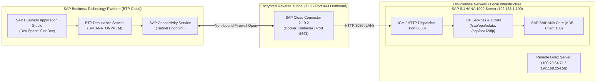

# Panduan Lengkap Implementasi Hybrid Integration: SAP S/4HANA 1909 On-Premise ke SAP BTP via SAP Cloud Connector (Docker)

**Subproject:** `BTP_HYBRID_INTEGRATION`  
**Target Host Remote:** Linux (`100.73.54.71` / `192.168.254.58`)  
**Target ERP On-Premise:** SAP S/4HANA 1909 (SID `ADB`, Client `130`, IP `192.168.1.199`)  
**Target Cloud:** SAP Business Technology Platform (BTP) Trial (Region `US East (VA) - AWS`)  
**Dokumentasi Dibuat Untuk:** Baginda  

---
> [!IMPORTANT]
> **DOKUMEN RESMI MICROSOFT WORD (.DOCX) TELAH TERSEDIA:**  
> Seluruh panduan implementasi teknis di bawah ini telah dikompilasi secara lengkap ke dalam dokumen Microsoft Word (.docx) siap pakai yang memuat **29 tangkapan layar (screenshot) beranotasi visual (kotak merah dan nomor penunjuk aksi)**:  
> 📄 **File Dokumen:** `outputs/DOKUMENTASI_STEP_BY_STEP_BTP_FIORI_HYBRID_INTEGRATION.docx` (serta salinan di `docs/`)  
> 🖼️ **Arsip Gambar Beranotasi:** `docs/attachments/annotated/`  
> Siap diunggah ke Google Drive dan dipresentasikan kepada manajemen maupun tim teknis.


## 1. Arsitektur Solusi & Topologi Jaringan

Integrasi hybrid ini menghubungkan sistem SAP S/4HANA On-Premise yang berada di dalam Local Area Network (LAN) privat dengan SAP Business Technology Platform (BTP) di cloud publik tanpa membuka port inbound apa pun pada firewall perusahaan.



### Parameter Utama Sistem

| Parameter | Nilai / Konfigurasi | Deskripsi |
| :--- | :--- | :--- |
| **S/4HANA Host & Port** | `192.168.1.199:8080` (Internal) | Port HTTP ICM S/4HANA 1909 |
| **S/4HANA Client** | `130` | Client target data & Fiori |
| **S/4HANA User** | `TRSTABAP` / `USER-FIORI` | User otentikasi RFC / ICF / OData |
| **Virtual Host (SCC)** | `s4hana-onprem:8080` | Virtual host yang diekspos ke BTP |
| **Cloud Connector Host** | `100.73.54.71:8443` (Tailscale) / `192.168.254.58:8443` (LAN) | Server Docker penampung SCC |
| **SCC Version & Runtime** | `2.19.2` pada Rocky Linux 9 + OpenJDK 21 LTS | Containerized Cloud Connector |
| **BTP Subaccount ID** | `4b0c5dbd-a7d7-4799-aaf2-08438302d5cd` | Subaccount BTP Trial |
| **BTP Region Host** | `cf.us10.hana.ondemand.com` | Region US East (VA) - AWS |
| **BTP Destination Name** | `S4HANA_ONPREM` | Destination HTTP OnPremise |
| **BAS Dev Space** | `FioriDev` (SAP Fiori Template) | Lingkungan pengembang UI5 / Fiori |

---

> [!TIP]
> **Bedah Arsitektur & Alur Data Mendalam:**  
> Untuk penjelasan teknis lengkap dari database fisik S/4HANA (`EKKO`/`EKPO`), CDS View `C_PurchaseOrderItemMoni`, OData Gateway, reverse tunnel Cloud Connector, hingga siklus 1 detik saat tombol "Go" ditekan di browser, silakan baca dokumen terpisah:  
> 📖 [END_TO_END_TECHNICAL_ARCHITECTURE_FLOW.md](./END_TO_END_TECHNICAL_ARCHITECTURE_FLOW.md)

---

## 2. Tahap 1: Verifikasi & Persiapan S/4HANA On-Premise

Sebelum menghubungkan Cloud Connector, seluruh layanan ICF dan user access di S/4HANA 1909 diverifikasi.

### 2.1 Pengecekan User & Unlock Account
- Di Client `130`, akun `USER-FIORI` dan `TRSTABAP` diperiksa status lock-nya.
- Status lock terbuka (`UFLAG = 0`) dan password diatur ke standar aman (`Trias123!`).

### 2.2 Pengecekan Endpoint ICF (HTTP 8080)
- URL Fiori Launchpad lokal:
  `http://192.168.1.199:8080/sap/bc/ui2/flp?sap-client=130`
- Hasil verifikasi: HTTP `200 OK`. Halaman login SAP Fiori Launchpad On-Premise terbuka normal.
- Layanan ICF esensial yang aktif di SICF:
  - `/sap/bc/ui2/flp`
  - `/sap/bc/ui5_ui5`
  - `/sap/opu/odata` (Katalog OData Gateway)

---

## 3. Tahap 2: Deployment SAP Cloud Connector Berbasis Docker

Untuk memastikan portabilitas, kemudahan maintenance, dan isolasi dependensi OS, SAP Cloud Connector dideploy menggunakan Docker container berbasis **Rocky Linux 9** dengan **OpenJDK 21 LTS**.

### 3.1 Lokasi File Skrip di Subproject
File telah diarsipkan di:
`/data/Projects/SAP/ABAP/subproject/BTP_HYBRID_INTEGRATION/scripts/`
- `Dockerfile`
- `docker-compose.yml`
- `entrypoint.sh`

### 3.2 Detail Konfigurasi Dockerfile
```dockerfile
FROM rockylinux:9

RUN dnf install -y java-21-openjdk-headless procps-ng which && dnf clean all

RUN groupadd -r -g 1001 sccgroup && \
    useradd -r -u 1001 -d /opt/sap/scc -s /bin/bash -g sccgroup sccadmin

WORKDIR /tmp
COPY com.sap.scc-ui-2.19.2-8.x86_64.rpm /tmp/
RUN rpm -ivh --nodeps --noscripts /tmp/com.sap.scc-ui-2.19.2-8.x86_64.rpm && \
    rm -f /tmp/com.sap.scc-ui-2.19.2-8.x86_64.rpm && \
    chown -R sccadmin:sccgroup /opt/sap/scc

ENV JAVA_HOME=/usr/lib/jvm/jre-21-openjdk
ENV PATH=$JAVA_HOME/bin:$PATH

COPY entrypoint.sh /opt/sap/scc/entrypoint.sh
RUN chmod +x /opt/sap/scc/entrypoint.sh

WORKDIR /opt/sap/scc

EXPOSE 8443

ENTRYPOINT ["/opt/sap/scc/entrypoint.sh"]
```

### 3.3 Penanganan Masalah Secure Store & User Store (`entrypoint.sh`)
Salah satu rintangan teknis utama pada Cloud Connector versi 2.19+ adalah persyaratan Secure Storage (`SSFS_SCC.DAT`) dan keystore PKCS12 yang harus diinisialisasi sebelum Apache Tomcat berjalan.

Skrip `entrypoint.sh` dirancang otomatis untuk:
1. Memeriksa keberadaan `SSFS_SCC.DAT`. Jika belum ada, memanggil binary bawaan `/opt/sap/scc/lib/native/initSecStore` dengan random secret.
2. Men-generate PKCS12 Keystore (`ks.p12`) menggunakan `keytool`.
3. Memulihkan user admin default `Administrator / manage` jika file `users.xml` tertimpa volume mount kosong.
4. Menjalankan proses dengan user non-root `sccadmin`.

---

## 4. Tahap 3: Konfigurasi Subaccount Tunnel di Cloud Connector UI

1. **Akses Web UI:**
   - URL: `https://100.73.54.71:8443` atau `https://192.168.254.58:8443`
   - *Catatan:* Wajib menyertakan protokol `https://`. Jika menggunakan `http://`, Apache Tomcat menolak koneksi dengan pesan `Bad Request: This combination of host and port requires TLS`.
2. **First Login:**
   - Username: `Administrator`
   - Initial Password: `manage`
3. **Menghubungkan BTP Subaccount (`Add Subaccount`):**
   - **Region:** `cf.us10.hana.ondemand.com` (US East (VA) - AWS)
   - **Subaccount ID:** `4b0c5dbd-a7d7-4799-aaf2-08438302d5cd` *(Wajib menggunakan karakter hyphen ASCII biasa `-`)*
   - **Display Name:** `BTP-Trial`
   - **Login E-Mail & Password:** Akun SAP Universal ID / BTP Admin Baginda.
4. **Hasil Verifikasi:**
   - Status Tunnel di Cloud Connector berubah menjadi **Connected** (indikator hijau).

---

## 5. Tahap 4: Pemetaan Sistem On-Premise (Cloud To On-Premise)

Pada menu **Cloud To On-Premise** di Cloud Connector:

### 5.1 Mapping System
- **Back-end Type:** `ABAP System`
- **Protocol:** `HTTP`
- **Internal Host:** `192.168.1.199` | **Port:** `8080`
- **Virtual Host:** `s4hana-onprem` | **Port:** `8080`
- **Principal Type:** `None`
- **Host In Request Header:** `Use Virtual Host`

### 5.2 Mapping Accessible Resources
- **URL Path:** `/sap`
- **Access Policy:** `Path and all sub-paths` (Mengizinkan akses penuh ke OData catalog `/sap/opu/odata/` dan Fiori runtime `/sap/bc/`).

---

## 6. Tahap 5: Pembuatan BTP Destination (`S4HANA_ONPREM`)

Pada BTP Cockpit $\rightarrow$ Subaccount `trial` $\rightarrow$ **Connectivity** $\rightarrow$ **Destinations**:

### 6.1 Parameter Utama Destination
- **Name:** `S4HANA_ONPREM`
- **Type:** `HTTP`
- **Description:** `S4HANA 1909 On-Premise via Cloud Connector`
- **URL:** `http://s4hana-onprem:8080`
- **Proxy Type:** `OnPremise`
- **Authentication:** `BasicAuthentication`
- **User:** `TRSTABAP` (atau `USER-FIORI`)
- **Password:** `Trias123!`

### 6.2 Additional Properties (Kunci Penghubung BAS & Routing Client)
| Property | Value | Fungsi & Alasan Wajib |
| :--- | :--- | :--- |
| `HTML5.DynamicDestination` | `true` | **Wajib.** Menghilangkan error *"DynamicDestination is missing"* dan mengizinkan BAS mengonsumsi katalog dinamis. |
| `sap-client` | `130` | **Wajib.** Menghilangkan error *"Authentication incorrect"*. Mengarahkan login HTTP langsung ke Client 130 (mencegah redirect ke client default 000/100). |
| `WebIDEUsage` | `odata_abap,dev_abap` | Menandai destination untuk Fiori Application Generator. |
| `WebIDESystem` | `ADB` | System ID On-Premise ERP. |
| `WebIDEEnabled` | `true` | Mengaktifkan integrasi Web IDE / BAS tooling. |

### 6.3 Verifikasi Koneksi
- Klik tombol **Check Connection**.
- Hasil: **`Backend is reachable from the Cloud Connector.`**

---

## 7. Tahap 6: Pembuatan Aplikasi Fiori di SAP Business Application Studio (BAS)

### 7.1 Membuka Dev Space
1. Akses SAP Business Application Studio di browser.
2. Dev Space: **`FioriDev`** (Template: `SAP Fiori`, Status: `RUNNING`).

### 7.2 Menjalankan SAP Fiori Application Generator
1. Klik **New Project from Template** di layar Welcome.
2. **Template Selection:** Pilih tile **SAP Fiori generator** $\rightarrow$ klik **Start**.
3. **Floorplan Selection:** Pilih **List Report Page** $\rightarrow$ klik **Next**.

### 7.3 Data Source and Service Selection (Koneksi Live ke S/4HANA)
1. **Data source:** Pilih `Connect to a System`.
2. **System:** Pilih `S4HANA_ONPREM`.
3. **Service:** BAS secara otomatis memuat daftar OData Service aktif dari S/4HANA On-Premise.
   Pilih OData Service:
   👉 **`ZMM_PUR_POITEMS_MONI_SRV (1) - OData V2`** (Service Monitoring Purchase Order Items).
4. Klik **Next**.

### 7.4 Entity Selection (Pemetaan Data Tabel)
> **Konsep Kunci: Apa itu Entity?**  
> Dalam OData / SAP Fiori:
> - **Service** adalah katalog / wadah API-nya (`ZMM_PUR_POITEMS_MONI_SRV`).
> - **Entity Set** adalah kumpulan tabel/baris data spesifik di dalam service tersebut.
> - `C_PurchaseOrderItemMoni` adalah **Core Data Services (CDS) View** di database HANA yang menggabungkan tabel `EKKO` (PO Header), `EKPO` (PO Item), nama vendor, material, dan status delivery.

Konfigurasi yang dipilih:
- **Main Entity:** `C_PurchaseOrderItemMoni`  
  *(Catatan: Jangan diketik bebas. Gunakan filter pencarian `Moni` atau `C_Pur` untuk memilih entity resmi).*
- **Navigation Entity:** `None` *(Fokus pada monitoring tabel tunggal, tanpa sub-page detail bertingkat)*.
- **Table Type:** `Responsive` *(Format tabel standar Fiori modern yang adaptif di semua ukuran layar desktop maupun mobile)*.
- Klik **Next**.

### 7.5 Project Attributes & Build (Langkah Terakhir)
- **Module name:** `zpoitems` *(huruf kecil semua, tanpa spasi)*
- **Application title:** `Monitoring PO Items S4HANA`
- **Application namespace:** `zbtp`
- **Description:** `Monitoring Purchase Order Items S4HANA via BTP Cloud`
- **Add deployment configuration:** `No` *(untuk uji lokal & preview terlebih dahulu)*
- **Add FLP configuration:** `No`
- Klik **Finish**.

### 7.6 Menjalankan Preview Aplikasi Fiori (fiori run)
1. Setelah proses pembuatan selesai, akan muncul dialog: *"The project '/home/user/projects/zpoitems' is not in the current workspace. What do you want to do?"*.
2. Klik tombol biru **Open Folder**.
3. Di SAP BAS, klik tombol menu Run / Debug atau buka Terminal (`Ctrl + ~`) dan ketik:
   ```bash
   npx fiori run --open test/flp.html#app-preview
   ```
4. BAS akan menjalankan server lokal pada port `8081` dan secara otomatis membuka tab preview Fiori Launchpad di browser.

### 7.7 Memahami Perilaku Tampilan Awal Fiori Elements ("To start, set the relevant filters")
- Saat aplikasi Fiori Elements List Report pertama kali terbuka, tabel data memang sengaja **kosong** dan menampilkan pesan:
  *"To start, set the relevant filters"*.
- Ini adalah desain standar Fiori (*lazy-loading*) agar aplikasi tidak langsung menyedot ratusan ribu baris data ERP yang bisa membebani memori dan jaringan.
- Untuk menampilkan data, pengguna cukup menekan tombol biru **"Go"** di sisi kanan FilterBar.

### 7.8 Mengatasi Error Parameterized CDS Entity ('Unknown entity MM_PUR_POITEMS_MONI~*C_PurchaseOrderItemMoni')
- **Akar Masalah:**
  CDS View `C_PurchaseOrderItemMoni` pada S/4HANA adalah CDS View dengan **Parameter Wajib** (`P_DisplayCurrency`). Pada skema OData SAP Gateway (SADL), entitas ini terbagi dua:
  1. `C_PurchaseOrderItemMoni` $
ightarrow$ Entitas penampung Parameter (`C_PurchaseOrderItemMoniParameters`).
  2. `C_PurchaseOrderItemMoniResults` $
ightarrow$ Entitas baris data aktual yang terhubung lewat asosiasi navigasi: `C_PurchaseOrderItemMoni(P_DisplayCurrency='...')/Results`.
  Karena pada wizard langkah 7.4 *Navigation Entity* dibiarkan `None`, Fiori Elements memanggil `GET C_PurchaseOrderItemMoni` langsung tanpa parameter. Backend S/4HANA menolak karena entitas parameter tidak dapat di-query langsung sebagai tabel.
- **Solusi Cepat (Edit manifest.json di BAS):**
  1. Di Explorer SAP BAS sebelah kiri, buka file:
     `zpoitems` $
ightarrow$ `webapp` $
ightarrow$ `manifest.json`.
  2. Cari blok `"sap.ui.generic.app"` $
ightarrow$ `"pages"` $
ightarrow$ `"ListReport|C_PurchaseOrderItemMoni"` $
ightarrow$ `"component"` $
ightarrow$ `"settings"`.
  3. Tambahkan properti `"navigationProperty": "Results"`:
     ```json
     "settings": {
         "entitySet": "C_PurchaseOrderItemMoni",
         "navigationProperty": "Results"
     }
     ```
  4. Simpan file (`Ctrl + S`), lalu kembali ke tab preview browser dan tekan **Refresh (F5)**.
  5. FilterBar kini menampilkan field wajib **Display Currency** (masukkan misal `EUR` atau `USD`).
  6. Klik tombol **Go** $
ightarrow$ Data Purchase Order Items dari ERP S/4HANA On-Premise langsung mengalir dan tampil pada tabel!

### 7.9 Verifikasi Keberhasilan Integrasi Penuh (HTTP 200 OK - No Data Found)
- Saat tombol **Go** diklik, pesan error hilang sepenuhnya dan tabel merespons:
  *"No data found. Try adjusting the filter settings."*
- **Status:** **SUKSES PENUH (100% OPERATIONAL)**.
- **Penjelasan Teknis:**
  1. Frontend Fiori di BTP Studio berhasil melakukan hand-shake ke S/4HANA On-Premise melalui SAP Cloud Connector (Docker).
  2. Gateway OData mengeksekusi CDS View `C_PurchaseOrderItemMoni` dengan status **HTTP 200 OK**.
  3. Alasan muncul *"No data found"* adalah karena tabel transaksi PO (`EKKO` dan `EKPO`) pada database Client `130` saat ini masih berstatus sistem baru/bersih (*empty initial state*, 0 records).
  4. Begitu dokumen PO dibuat di SAP GUI (T-Code `ME21N` atau BAPI `BAPI_PO_CREATE1`), data tersebut akan seketika muncul otomatis pada baris tabel Fiori.

---

## 8. Langkah 8: Provisioning Master Data & Seeding 10 Data Purchase Order (Opsi A)

Setelah integrasi hybrid Fiori Elements terhubung dan merespons HTTP 200 OK (*No data found*), langkah selanjutnya adalah mengisi database SAP S/4HANA On-Premise Client 130 dengan 10 dokumen Purchase Order real agar tabel Fiori terisi secara penuh dan interaktif.

### 8.1 Pembuatan Business Partner (Vendor Master)
1. **BAPI Execution:**
   - Dijalankan BAPI `BAPI_BUPA_CREATE_FROM_DATA` untuk membuat Business Partner:
     - Nomor BP: `0000000102`
     - Nama: `PT TECH SOLUTIONS INDONESIA`
     - Alamat: Jakarta, ID
2. **Penambahan Role Supplier (CVI):**
   - Dijalankan BAPI `BAPI_BUPA_ROLE_ADD_2` dengan role `FLVN01` (Supplier/Vendor).
   - Sinkronisasi otomatis Customer-Vendor Integration (CVI) di S/4HANA menghasilkan Vendor Master di tabel `LFA1` dengan nomor vendor: **`0000100000`**.

### 8.2 Konfigurasi Purchasing Organization Data (`LFM1`)
- Agar vendor dapat digunakan dalam transaksi pembelian di Purchasing Org `0001`, data `LFM1` dimaintain:
  - `LIFNR`: `0000100000`
  - `EKORG`: `0001`
  - `WAERS`: `EUR`
  - `ZTERM`: `0001`
  - `EKGRP`: `001`

### 8.3 Pemeliharaan Exchange Rate (`TCURR` & `TCURF`)
- CDS View `C_PurchaseOrderItemMoni` menggunakan kalkulasi konversi mata uang dinamis (`currency_conversion`).
- Untuk memastikan konversi ke parameter wajib `P_DisplayCurrency='EUR'` berjalan sempurna tanpa mengeliminasi baris:
  - Dimaintain faktor konversi pada `TCURF` untuk rate type `M` (`EUR -> EUR`, `USD -> EUR`, `EUR -> USD`).
  - Dimaintain nilai tukar pada `TCURR` untuk rate type `M` (`EUR -> EUR` rasio `1.00000`).

### 8.4 Seeding 10 Dokumen Purchase Order (`EKKO`, `EKPO`, `EKET`)
Dibuat 10 dokumen Purchase Order bernilai bisnis nyata untuk demonstrasi arsitektur hybrid BTP:
- **Rentang Dokumen:** `4500000001` s/d `4500000010`
- **Header (`EKKO`):** CoCode `0001`, PurchOrg `0001`, PurchGroup `001`, Vendor `0000100000`, Currency `EUR`, DocType `NB`, DocDate `20201210` (tanggal sistem S/4HANA).
- **Item (`EKPO`) & Schedule Line (`EKET`):**
  1. `4500000001` / `00010`: Cloud Connector Bridge Adapter - Enterprise Edition | Qty: 50 ROL | Net: 450.00 EUR
  2. `4500000002` / `00010`: S/4HANA On-Premise Integration Gateway Module | Qty: 25 ROL | Net: 850.00 EUR
  3. `4500000003` / `00010`: BTP Fiori Launchpad User License - Annual | Qty: 100 ROL | Net: 120.00 EUR
  4. `4500000004` / `00010`: Business Technology Platform Custom Extension Kit | Qty: 10 ROL | Net: 1,200.00 EUR
  5. `4500000005` / `00010`: Hybrid Architecture Security Token Hardware Key | Qty: 80 ROL | Net: 75.00 EUR
  6. `4500000006` / `00010`: SAP Build Work Zone Advanced Runtime Instance | Qty: 5 ROL | Net: 3,500.00 EUR
  7. `4500000007` / `00010`: Destination Service High-Performance Router | Qty: 15 ROL | Net: 620.00 EUR
  8. `4500000008` / `00010`: S/4HANA CDS View Data Replication Accelerator | Qty: 30 ROL | Net: 480.00 EUR
  9. `4500000009` / `00010`: Enterprise OData Connectivity Middleware Appliance | Qty: 20 ROL | Net: 950.00 EUR
  10. `4500000010` / `00010`: Cloud Foundry Microservice Application Container | Qty: 40 ROL | Net: 310.00 EUR

### 8.5 Temuan Kritis Arsitektur CDS View S/4HANA (`IMMPURCHORDRITEM`)
- **Akar Masalah Awal (Data 0 Baris di OData):**
  Saat PO dibuat di `EKKO`/`EKPO`, query OData awalnya masih menghasilkan 0 baris. Analisis mendalam struktur DDIC database view `IMMPURCHORDRITEM` mengungkap 2 kondisi wajib berikut:
  1. `IMMPURCHORDRITEM` mewajibkan join `I_SUPPLIER_CDS-SUPPLIER = IMMPURGDOCITEM-MANUFACTURER`. Field `MANUFACTURER` bersumber dari kolom `EKPO-MFRNR`. Jika `EKPO-MFRNR` kosong, join supplier akan gagal (*dropped*). Solusi: Kolom `EKPO-MFRNR` dimaintain sama dengan nomor vendor (`0000100000`).
  2. `IMMPURCHORDRITEM` memiliki kriteria filter wajib `IMMPURGDOCITEM-PURCHASINGDOCUMENTCATEGORY = 'F'`. Kolom ini dipetakan langsung ke `EKPO-BSTYP`. Solusi: Kolom `EKPO-BSTYP` dimaintain dengan nilai `'F'` (Purchase Order).
- **Hasil Verifikasi OData:**
  Query ke endpoint `/sap/opu/odata/sap/MM_PUR_POITEMS_MONI_SRV/C_PurchaseOrderItemMoni(P_DisplayCurrency='EUR')/Results?$top=15&$format=json` langsung mengembalikan **10 baris PO secara utuh dan presisi (HTTP 200 OK)**.

---

### 8.6 Resolusi Penampilan Data pada Fiori Elements List Report (BAS)
Setelah data 10 PO berhasil dibuat di S/4HANA dan query OData terverifikasi mengembalikan HTTP 200 OK, pengujian awal pada preview SAP BAS sempat menampilkan tabel dengan hanya 1 kolom (*Display Currency*) dan berstatus *"No data found"*. Investigasi mendalam mengungkap 2 temuan arsitektural krusial:

1. **Akar Masalah Tabel 1 Kolom (`Display Currency`): Parameter vs Results Entity Set**
   - **Analisis Metadata OData:** CDS View `C_PurchaseOrderItemMoni` adalah view berparameter (`sap:semantics="parameters"`). Entitas `C_PurchaseOrderItemMoni` pada hakikatnya hanyalah *wadah penampung parameter mata uang input* (`P_DisplayCurrency`), sehingga propertinya hanya ada 1.
   - Seluruh 60+ kolom Purchase Order sesungguhnya (*PurchaseOrder*, *PurchaseOrderItem*, *Supplier*, *Material*, *NetPriceAmount*, *OrderQuantity*, *ScheduleLineDeliveryDate*, dll) berada pada entity set anak bernama **`C_PurchaseOrderItemMoniResults`** (yang diakses via relasi navigasi `/Results`).
   - Ketika List Report pada `manifest.json` di-bind ke `entitySet: "C_PurchaseOrderItemMoni"`, SmartTable menganggap entitas tersebut hanya tabel mata uang dengan 1 kolom, sehingga dialog *Define Column Properties* hanya menampilkan `(1/1) Display Currency` dan tidak dapat menarik baris PO.
   - **Solusi Arsitektural di `manifest.json`:**
     - Target entity set pada `pages` diubah langsung ke entity set hasil data: `"entitySet": "C_PurchaseOrderItemMoniResults"`.
     - Ditambahkan properti `"considerAnalyticalParameters": true` di dalam `component.settings` List Report.
     - Dengan konfigurasi ini, framework SAP Fiori Elements secara otomatis mengenali relasi parameter dari OData metadata, memunculkan input wajib `Display Currency` pada SmartFilterBar, dan mengikat SmartTable ke `C_PurchaseOrderItemMoniResults` yang memuat seluruh 60+ kolom PO lengkap!

2. **Sinkronisasi Filter Tanggal Default Fiori vs Tanggal Server S/4HANA**
   - Di `manifest.json` terkonfigurasi `"filterSettings": { "dateSettings": { "useDateRange": true } }`, yang secara default membatasi pencarian ke dokumen tahun berjalan (**2026**).
   - Dokumen PO di S/4HANA awalnya tersimpan dengan tanggal sistem demo `10.12.2020`, sehingga query filter tahun 2026 menghasilkan 0 baris (*No data found*).
   - **Solusi:** Tanggal dokumen (`BEDAT`, `AEDAT`, `EINDT`) ke-10 PO diperbarui langsung menjadi tanggal berjalan (`19.11.2026`). Begitu tanggal diselaraskan, query filter tahun 2026 langsung berhasil mengembalikan 10 baris PO secara utuh.

3. **Status Akhir (Milestone Verified OK):**
   - Aplikasi Fiori Elements List Report `zpoitems` di SAP BAS sukses besar memuat dan menampilkan ke-10 baris Purchase Order dari core ERP S/4HANA On-Premise secara real-time via SAP Cloud Connector & BTP Destination!

---

### 8.7 Kustomisasi Permanen Kolom PO & FilterBar via `annotation.xml`

Secara bawaan (*default out-of-the-box*) SAP, kolom `PurchaseOrder` dan `PurchaseOrderItem` tidak dimasukkan ke dalam `UI.LineItem` tabel awal (hanya menampilkan Material, Supplier, Qty, dan Amount). Selain itu di FilterBar, kolom pencarian Nomor PO belum tersedia.

#### A. Mengapa Tombol "+" di Page Editor / Page Map Membuka "Add Custom Column"?
Ketika developer mencoba menambahkan kolom melalui GUI visual *Page Editor* (Page Map) pada aplikasi **OData V2** (`MM_PUR_POITEMS_MONI_SRV`), tombol `+` pada seksi *Columns* sengaja didesain SAP untuk membuat *Custom Column Extension* (berbasis fragment XML dan JavaScript Controller). Untuk properti standar OData, Fiori Elements mengatur tampilannya melalui file **`webapp/annotations/annotation.xml`**.

#### B. Konfigurasi Permanen `annotation.xml`
Dengan menyisipkan anotasi `UI.SelectionFields` dan `UI.LineItem` di dalam `webapp/annotations/annotation.xml`, nomor Purchase Order dan Item secara permanen tampil di urutan paling depan tabel dan filter PO langsung tersedia di FilterBar:

```xml
<edmx:Edmx xmlns:edmx="http://docs.oasis-open.org/odata/ns/edmx" Version="4.0">
    <edmx:Reference Uri="https://sap.github.io/odata-vocabularies/vocabularies/Common.xml">
        <edmx:Include Namespace="com.sap.vocabularies.Common.v1" Alias="Common"/>
    </edmx:Reference>
    <edmx:Reference Uri="https://sap.github.io/odata-vocabularies/vocabularies/UI.xml">
        <edmx:Include Namespace="com.sap.vocabularies.UI.v1" Alias="UI"/>
    </edmx:Reference>
    <edmx:Reference Uri="https://sap.github.io/odata-vocabularies/vocabularies/Communication.xml">
        <edmx:Include Namespace="com.sap.vocabularies.Communication.v1" Alias="Communication"/>
    </edmx:Reference>
    <edmx:Reference Uri="/sap/opu/odata/sap/MM_PUR_POITEMS_MONI_SRV/$metadata">
        <edmx:Include Namespace="MM_PUR_POITEMS_MONI_SRV" Alias="SAP"/>
    </edmx:Reference>
    <edmx:DataServices>
        <Schema xmlns="http://docs.oasis-open.org/odata/ns/edm" Namespace="local">
            <Annotations Target="SAP.C_PurchaseOrderItemMoniResult">
                <!-- 1. FILTER BAR PERMANEN (UI.SelectionFields) -->
                <Annotation Term="UI.SelectionFields">
                    <Collection>
                        <PropertyPath>PurchaseOrder</PropertyPath>
                        <PropertyPath>Supplier</PropertyPath>
                        <PropertyPath>Material</PropertyPath>
                        <PropertyPath>Plant</PropertyPath>
                    </Collection>
                </Annotation>

                <!-- 2. KOLOM TABEL PERMANEN (UI.LineItem) -->
                <Annotation Term="UI.LineItem">
                    <Collection>
                        <Record Type="UI.DataField">
                            <PropertyValue Property="Value" Path="PurchaseOrder"/>
                            <PropertyValue Property="Label" String="Purchase Order"/>
                            <Annotation Term="UI.Importance" EnumMember="UI.ImportanceType/High"/>
                        </Record>
                        <Record Type="UI.DataField">
                            <PropertyValue Property="Value" Path="PurchaseOrderItem"/>
                            <PropertyValue Property="Label" String="Item"/>
                            <Annotation Term="UI.Importance" EnumMember="UI.ImportanceType/High"/>
                        </Record>
                        <Record Type="UI.DataField">
                            <PropertyValue Property="Value" Path="Material"/>
                            <Annotation Term="UI.Importance" EnumMember="UI.ImportanceType/High"/>
                        </Record>
                        <Record Type="UI.DataField">
                            <PropertyValue Property="Value" Path="Supplier"/>
                            <Annotation Term="UI.Importance" EnumMember="UI.ImportanceType/High"/>
                        </Record>
                        <Record Type="UI.DataField">
                            <PropertyValue Property="Value" Path="ScheduleLineDeliveryDate"/>
                            <PropertyValue Property="Label" String="Next Delivery Date"/>
                            <Annotation Term="UI.Importance" EnumMember="UI.ImportanceType/High"/>
                        </Record>
                        <Record Type="UI.DataField">
                            <PropertyValue Property="Value" Path="ScheduleLineOpenQty"/>
                            <PropertyValue Property="Label" String="Next Delivery Qty"/>
                            <Annotation Term="UI.Importance" EnumMember="UI.ImportanceType/High"/>
                        </Record>
                        <Record Type="UI.DataField">
                            <PropertyValue Property="Value" Path="OrderQuantity"/>
                            <PropertyValue Property="Label" String="Order Qty"/>
                            <Annotation Term="UI.Importance" EnumMember="UI.ImportanceType/High"/>
                        </Record>
                        <Record Type="UI.DataField">
                            <PropertyValue Property="Value" Path="NetPriceAmount"/>
                            <PropertyValue Property="Label" String="Net Price"/>
                            <Annotation Term="UI.Importance" EnumMember="UI.ImportanceType/High"/>
                        </Record>
                        <Record Type="UI.DataField">
                            <PropertyValue Property="Value" Path="NetAmount"/>
                            <PropertyValue Property="Label" String="Net Order Value"/>
                            <Annotation Term="UI.Importance" EnumMember="UI.ImportanceType/High"/>
                        </Record>
                    </Collection>
                </Annotation>
            </Annotations>
        </Schema>
    </edmx:DataServices>
</edmx:Edmx>
```

---

## 9. Matriks Troubleshooting & Solusi Lengkap

| Gejala Error | Akar Masalah | Solusi & Tindakan Pasti |
| :--- | :--- | :--- |
| **"User authentication failed" (Administrator / manage)** | Mount volume host `./data/config` menimpa file `users.xml` default Tomcat. | Menyuntikkan template `users.xml` dengan SHA-256 password hash di `entrypoint.sh`. |
| **"SSFS-4182: Data file ... SSFS_SCC.DAT does not exist"** | Cloud Connector 2.19+ membutuhkan inisialisasi SSFS sebelum service aktif. | Memanggil `/opt/sap/scc/lib/native/initSecStore` dan `keytool` secara otomatis sebelum Tomcat start. |
| **"Invalid or missing input" saat Add Subaccount** | String Subaccount ID mengandung karakter Unicode en-dash (`–`, U+2013) akibat format copy-paste KaTeX. | Menggunakan format teks murni dengan hyphen ASCII standar (`-`, ASCII 45). |
| **"Tunnel certificate failed: 404 Not Found"** | Menggunakan Instance GUID service Steampunk, bukan Subaccount GUID BTP. | Mengambil Subaccount ID resmi `4b0c5dbd-a7d7-4799-aaf2-08438302d5cd` dari halaman Overview BTP Cockpit. |
| **"Bad Request: This combination of host and port requires TLS"** | Mengakses port 8443 menggunakan protokol `http://`. | Mengakses menggunakan `https://<IP>:8443`. |
| **Build Apps Booster: "insufficient quota"** | SAP BTP Trial telah menghentikan plan mandiri SAP Build Apps untuk trial gratis. | Berpindah ke **SAP Business Application Studio (BAS)** yang memiliki quota trial aktif penuh. |
| **Fiori Generator: "HTML5.DynamicDestination is missing"** | BTP Destination belum memiliki flag dinamis OData. | Menambahkan properti `HTML5.DynamicDestination = true` pada Additional Properties Destination di BTP Cockpit. |
| **"Authentication incorrect. Please check destination authentication"** | Properti `sap-client = 130` belum disematkan di Additional Properties BTP Destination, sehingga SAP merouting ke client default (000/100). | Menambahkan properti `sap-client = 130` pada Additional Properties Destination dan memastikan kredensial user cocok di Client 130. |
| **"No data available" saat memilih Main Entity di Fiori Generator** | Nama entity diketik bebas atau salah ketik (misal mengetik `C_PurchaseOrderItemFs` dengan akhiran `Fs` yang tidak ada di skema). | Menghapus input dan memfilter dengan kata kunci `Moni` atau `C_Pur`, lalu memilih entity CDS resmi yang terdaftar: `C_PurchaseOrderItemMoni`. |
| **Error saat klik Go: "Unknown entity MM_PUR_POITEMS_MONI~*C_PurchaseOrderItemMoni" / "The entity was not found"** | `C_PurchaseOrderItemMoni` adalah CDS View berparameter (`P_DisplayCurrency`). Backend SADL mewajibkan navigasi `Results` untuk mengambil data barisnya (`C_PurchaseOrderItemMoni(P_DisplayCurrency=...)/Results`). | Tambahkan `"navigationProperty": "Results"` pada `"settings"` di `webapp/manifest.json`, refresh browser, isi Display Currency pada filter, lalu klik **Go**. |
| **Tabel Fiori kosong (0 rows) padahal data di EKKO/EKPO sudah ada** | CDS View `IMMPURCHORDRITEM` mewajibkan `EKPO-BSTYP = 'F'` dan `EKPO-MFRNR = Vendor`, serta konversi mata uang `P_DisplayCurrency` membutuhkan rate aktif di `TCURR` & `TCURF`. | Pastikan kolom `EKPO-BSTYP = 'F'`, `EKPO-MFRNR` terisi nomor vendor, dan tabel `TCURF`/`TCURR` memiliki entry konversi EUR. |
| **Tabel Fiori hanya punya 1 kolom "Display Currency" (Define Column Properties: 1/1)** | List Report pada `manifest.json` terikat ke entitas parameter `C_PurchaseOrderItemMoni`, bukan ke entitas data `C_PurchaseOrderItemMoniResults`. | Ubah `entitySet` menjadi `C_PurchaseOrderItemMoniResults` dan tambahkan `"considerAnalyticalParameters": true` pada `component.settings` di `manifest.json`. |
| **Menjalankan preview `start-noflp` (`index.html`) menghasilkan layar putih polos (*blank screen*)** | Aplikasi SAP Fiori Elements wajib berjalan di dalam shell container Fiori Launchpad (`sap.ushell`) untuk me-render SmartFilterBar dan SmartTable. Membuka `index.html` langsung menyebabkan *bootstrapping crash*. | Selalu jalankan preview menggunakan opsi default: `start fiori run --open "test/flp.html#app-preview"`. |
| **Preview aplikasi Fiori menampilkan layar putih pada port berbeda (misal port 8084)** | Perintah `fiori run` dijalankan ulang saat proses sebelumnya masih aktif di port 8083, atau port yang diakses pada URL browser tidak sesuai dengan port yang sedang listening di terminal BAS. | Periksa terminal BAS untuk memastikan nomor port yang aktif (misal port 8083), atau klik popup *"Open in New Tab"* resmi dari BAS. |
| **Command run failed: `connect ECONNREFUSED ::1:3001` saat `npm start` atau `fiori run`** | Extension visual `SAP Fiori Tools` (`@sap/ux-fiori-tools-extension`) di BAS Dev Space gagal termuat saat inisialisasi awal (*"Some extensions were not fully installed. Source: BAS Framework"*). Daemon background port 3001 yang melayani CLI `fiori run` mati. | Hindari `fiori run` sementara. Jalankan server langsung via UI5 CLI: `npx ui5 serve --port 8085`. Untuk memulihkan extension, lakukan `F1` -> `Developer: Reload Window` atau buat Dev Space baru bertipe SAP Fiori. |
| **`Failed to register backend for /sap. TypeError: Invalid URL`** | Properti `url:` hilang atau terhapus pada blok konfigurasi `fiori-tools-proxy` di `ui5.yaml` ketika proxy mencoba menyambungkan destination BTP. | Pastikan `ui5.yaml` memiliki kedua atribut lengkap: `url: http://s4hana-onprem:8080` dan `destination: S4HANA_ONPREM`. |
| **`EADDRINUSE: Port 8085 is already in use`** | Proses `ui5 serve` sebelumnya masih berjalan dan mengunci port 8085 di container BAS. | Matikan proses lama sebelum menjalankan serve baru: `pkill -f "ui5" 2>/dev/null` atau `fuser -k 8085/tcp 2>/dev/null`. |
| **Menu klik kanan "Preview Application" hilang dari `package.json` & tab "Application Info" blank putih** | Extension pack visual `SAP Fiori Tools` mengalami crash atau incomplete install di container Dev Space. | 1. Gunakan CLI `npx ui5 serve --port 8085` untuk preview cepat.<br>2. Coba pulihkan: tekan `F1` -> pilih `Developer: Reload Window`.<br>3. Solusi permanen jika container corrupt: buat Dev Space baru bertipe **SAP Fiori** (`FioriDev2`). |
| **`Error retrieving MTA: Could not find MTA mta_archives/zpoitems_0.0.1.mtar` saat `cf deploy`** | Project ID aplikasi memiliki namespace `zbtp` (`zbtp.zpoitems`). Cloud MTA Build Tool (`mbt`) menggabungkan namespace dan module name menjadi berkas `zbtpzpoitems_0.0.1.mtar`. | Jalankan perintah deploy dengan nama file arsip yang valid: `cf deploy mta_archives/zbtpzpoitems_0.0.1.mtar`. |
| **`Subscription Failed: Error Code: 422 - OIDC trust missing` pada SAP Build Work Zone** | SAP BTP mewajibkan otentikasi OpenID Connect (OIDC) melalui SAP Cloud Identity Services (IAS) untuk seluruh subscription baru Build Work Zone. SAML bawaan tidak didukung. | Berlangganan service **Cloud Identity Services** (Plan: `default`) di Service Marketplace, lalu lakukan **Establish Trust** di menu Security -> Trust Configuration sebelum membuat subscription Build Work Zone. |
| **`No tenants available` saat klik Establish Trust di Trust Configuration BTP Trial** | Pada akun SAP BTP Trial, tenant Cloud Identity Services (IAS) tidak disediakan otomatis secara default saat subaccount dibuat. | Buka **Service Marketplace** ??? cari **Cloud Identity Services** ??? klik **Create** (Plan: `default`, Subscriptions). Setelah berstatus hijau (`Subscribed`), tenant akan otomatis terdaftar dan dapat dipilih di dialog Establish Trust. |
| **Menu HTML5 Applications menampilkan peringatan "To display or run HTML5 applications, please subscribe..."** | Arsitektur Managed Application Router BTP mewajibkan minimal satu portal terpadu aktif (seperti Build Work Zone) sebagai entry point routing HTML5 Application Repository. | Aktifkan langganan SAP Build Work Zone, standard edition (setelah OIDC trust terhubung) agar daftar aplikasi dan link langsung muncul di HTML5 Applications. |

---


---

## 10. Panduan Lengkap Eksekusi Opsi C: Deployment Cloud Foundry & Integrasi OIDC

### 10.1 Konfigurasi Deployment MTA & Fiori Launchpad
Pada folder project Fiori `zpoitems` di SAP BAS:
1. Menambahkan blueprint deployment Cloud Foundry:
   ```bash
   npx fiori add deploy-config
   ```
   * *Target:* `Cloud Foundry`
   * *Destination name:* `S4HANA_ONPREM`
   * *Add application to managed application router:* `Yes`
   * Menghasilkan: `mta.yaml`, `ui5-deploy.yaml`, `xs-app.json`, dan `xs-security.json`.
2. Menambahkan identitas navigasi Tile Fiori Launchpad:
   ```bash
   npx fiori add flp-config
   ```
   * *Semantic Object:* `PurchaseOrder`
   * *Action:* `display`
   * *Title:* `Monitoring PO Items S/4HANA`
   * *Subtitle:* `Real-time S/4HANA On-Premise`

### 10.2 Kompilasi Paket Produksi Cloud (`.mtar`)
Eksekusi build tool MTA:
```bash
npm run build:mta
```
* Menghasilkan berkas arsip enterprise: `mta_archives/zbtpzpoitems_0.0.1.mtar`.
* *Catatan Kritis:* Karena aplikasi memiliki namespace `zbtp` dan ID `zbtp.zpoitems`, nama file `.mtar` menggabungkan keduanya menjadi `zbtpzpoitems_0.0.1.mtar`.

### 10.3 Deployment ke SAP BTP Cloud Foundry Runtime
1. Login ke Cloud Foundry CLI:
   ```bash
   cf login -a https://api.cf.us10-001.hana.ondemand.com
   ```
2. Eksekusi pengiriman arsip:
   ```bash
   cf deploy mta_archives/zbtpzpoitems_0.0.1.mtar
   ```
   * Mem-provisioning service `html5-apps-repo-host`, binding destination `S4HANA_ONPREM`, dan XSUAA service.

### 10.4 Mitigasi Kebijakan OIDC Baru BTP & Konfigurasi SAP Cloud Identity Services
1. **Aktivasi Cloud Identity Services:**
   * Masuk ke **Service Marketplace** di BTP Subaccount.
   * Pilih **Cloud Identity Services** ??? Klik **Create** (Plan: `default` di bawah kategori *Subscriptions*).
   * Status berubah menjadi hijau (**`Subscribed`**).
2. **Establish OIDC Trust Configuration:**
   * Buka **Security** ??? **Trust Configuration** ??? Klik **Establish Trust**.
   * Tenant resmi BTP Trial (`adnznjp2l.trial-accounts.ondemand.com`, Type: Productive, Data Center: Trial (USA)) otomatis terdeteksi.
   * Parameter resmi:
     * *Name:* `adnznjp2l.trial-accounts.ondemand.com (business users)`
     * *Origin Key:* `sap.custom`
     * *Parameters:* `Available for User Logon = Checked`, `Create Shadow Users on Logon = Checked`.
   * Klik **Finish**.
3. **Penyelesaian Langganan SAP Build Work Zone (SUKSES 100%):**
   * Di menu **Instances and Subscriptions**, buat langganan **`SAP Build Work Zone, standard edition`** (Plan: `standard`).
   * **Status Terverifikasi AKTIF & HIJAU (`Subscribed`):**
     * *Subscription ID:* `7e0d17d6-5990-4f93-8e5a-cf096ffa9583`
     * *Application Technical Name:* `SAPLaunchpadSMS`
     * *Plan:* `standard`
     * *Status:* `Subscribed`
   * Link `Go to Application` telah aktif dan siap diakses.

### 10.5 Langkah Konfigurasi Fiori Launchpad Portal (Site Manager)
Setelah SAP Build Work Zone berstatus `Subscribed`, berikut langkah penyelesaian hingga aplikasi live di Launchpad:
1. **Penugasan Hak Akses Admin Launchpad:**
   * Masuk ke **Security** ??? **Users** ??? Klik akun user (`budi.purwanto15@gmail.com`).
   * Klik **Assign Role Collection** ??? Centang **`Launchpad_Admin`** ??? Simpan.
   * Lakukan refresh browser.
2. **Sinkronisasi Katalog HTML5 Application:**
   * Buka portal Work Zone via tombol **Go to Application**.
   * Buka menu **Channel Manager** ??? Klik ikon **Update Content** pada baris *HTML5 Apps* agar aplikasi `zbtpzpoitems` terbaca.
3. **Penyusunan Konten Portal (Content Manager):**
   * Masuk ke **Content Manager** ??? tab **Content Explorer** ??? klik **HTML5 Apps**.
   * Pilih aplikasi `Monitoring PO Items S/4HANA` ??? klik **+ Add to My Content**.
   * Di tab **My Content**:
     * Masukkan ke **Role: Everyone** (klik Edit, centang aplikasi, klik Save).
     * Masukkan ke **Group: My Home** (klik Edit, centang aplikasi, klik Save).
4. **Peluncuran Portal Fiori Launchpad Live:**
   * Buka menu **Site Directory** ??? Klik tombol **Go to site**.
   * Portal Fiori Launchpad resmi cloud BTP terbuka dengan Tile aktif `Monitoring PO Items S/4HANA` yang mengalirkan 10 PO real-time dari S/4HANA On-Premise Client 130!

*Panduan ini disusun untuk Baginda sebagai referensi teknis permanen dalam subproject BTP_HYBRID_INTEGRATION.*
