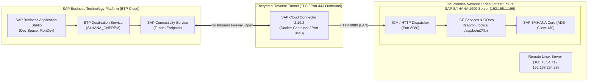

# Panduan Lengkap Implementasi Hybrid Integration: SAP S/4HANA 1909 On-Premise ke SAP BTP via SAP Cloud Connector (Docker)

**Subproject:** `BTP_HYBRID_INTEGRATION`  
**Target Host Remote:** Linux (`100.73.54.71` / `192.168.254.58`)  
**Target ERP On-Premise:** SAP S/4HANA 1909 (SID `ADB`, Client `130`, IP `192.168.1.199`)  
**Target Cloud:** SAP Business Technology Platform (BTP) Trial (Region `US East (VA) - AWS`)  
**Dokumentasi Dibuat Untuk:** Baginda  

---

## 1. Arsitektur Solusi & Topologi Jaringan

Integrasi hybrid ini menghubungkan sistem SAP S/4HANA On-Premise yang berada di dalam Local Area Network (LAN) privat dengan SAP Business Technology Platform (BTP) di cloud publik tanpa membuka port inbound apa pun pada firewall perusahaan.



### Parameter Utama Sistem

| Parameter | Nilai / Konfigurasi | Deskripsi |
| :--- | :--- | :--- |
| **S/4HANA Host & Port** | `192.168.1.199:8080` (Internal) | Port HTTP ICM S/4HANA 1909 |
| **S/4HANA Client** | `130` | Client target data & Fiori |
| **S/4HANA User** | `TRSTABAP` / `USER-FIORI` | User otentikasi RFC / ICF / OData |
| **Virtual Host (SCC)** | `s4hana-onprem:8080` | Virtual host yang diekspos ke BTP |
| **Cloud Connector Host** | `100.73.54.71:8443` (Tailscale) / `192.168.254.58:8443` (LAN) | Server Docker penampung SCC |
| **SCC Version & Runtime** | `2.19.2` pada Rocky Linux 9 + OpenJDK 21 LTS | Containerized Cloud Connector |
| **BTP Subaccount ID** | `4b0c5dbd-a7d7-4799-aaf2-08438302d5cd` | Subaccount BTP Trial |
| **BTP Region Host** | `cf.us10.hana.ondemand.com` | Region US East (VA) - AWS |
| **BTP Destination Name** | `S4HANA_ONPREM` | Destination HTTP OnPremise |
| **BAS Dev Space** | `FioriDev` (SAP Fiori Template) | Lingkungan pengembang UI5 / Fiori |

---

## 2. Tahap 1: Verifikasi & Persiapan S/4HANA On-Premise

Sebelum menghubungkan Cloud Connector, seluruh layanan ICF dan user access di S/4HANA 1909 diverifikasi.

### 2.1 Pengecekan User & Unlock Account
- Di Client `130`, akun `USER-FIORI` dan `TRSTABAP` diperiksa status lock-nya.
- Status lock terbuka (`UFLAG = 0`) dan password diatur ke standar aman (`Trias123!`).

### 2.2 Pengecekan Endpoint ICF (HTTP 8080)
- URL Fiori Launchpad lokal:
  `http://192.168.1.199:8080/sap/bc/ui2/flp?sap-client=130`
- Hasil verifikasi: HTTP `200 OK`. Halaman login SAP Fiori Launchpad On-Premise terbuka normal.
- Layanan ICF esensial yang aktif di SICF:
  - `/sap/bc/ui2/flp`
  - `/sap/bc/ui5_ui5`
  - `/sap/opu/odata` (Katalog OData Gateway)

---

## 3. Tahap 2: Deployment SAP Cloud Connector Berbasis Docker

Untuk memastikan portabilitas, kemudahan maintenance, dan isolasi dependensi OS, SAP Cloud Connector dideploy menggunakan Docker container berbasis **Rocky Linux 9** dengan **OpenJDK 21 LTS**.

### 3.1 Lokasi File Skrip di Subproject
File telah diarsipkan di:
`/data/Projects/SAP/ABAP/subproject/BTP_HYBRID_INTEGRATION/scripts/`
- `Dockerfile`
- `docker-compose.yml`
- `entrypoint.sh`

### 3.2 Detail Konfigurasi Dockerfile
```dockerfile
FROM rockylinux:9

RUN dnf install -y java-21-openjdk-headless procps-ng which && dnf clean all

RUN groupadd -r -g 1001 sccgroup && \
    useradd -r -u 1001 -d /opt/sap/scc -s /bin/bash -g sccgroup sccadmin

WORKDIR /tmp
COPY com.sap.scc-ui-2.19.2-8.x86_64.rpm /tmp/
RUN rpm -ivh --nodeps --noscripts /tmp/com.sap.scc-ui-2.19.2-8.x86_64.rpm && \
    rm -f /tmp/com.sap.scc-ui-2.19.2-8.x86_64.rpm && \
    chown -R sccadmin:sccgroup /opt/sap/scc

ENV JAVA_HOME=/usr/lib/jvm/jre-21-openjdk
ENV PATH=$JAVA_HOME/bin:$PATH

COPY entrypoint.sh /opt/sap/scc/entrypoint.sh
RUN chmod +x /opt/sap/scc/entrypoint.sh

WORKDIR /opt/sap/scc

EXPOSE 8443

ENTRYPOINT ["/opt/sap/scc/entrypoint.sh"]
```

### 3.3 Penanganan Masalah Secure Store & User Store (`entrypoint.sh`)
Salah satu rintangan teknis utama pada Cloud Connector versi 2.19+ adalah persyaratan Secure Storage (`SSFS_SCC.DAT`) dan keystore PKCS12 yang harus diinisialisasi sebelum Apache Tomcat berjalan.

Skrip `entrypoint.sh` dirancang otomatis untuk:
1. Memeriksa keberadaan `SSFS_SCC.DAT`. Jika belum ada, memanggil binary bawaan `/opt/sap/scc/lib/native/initSecStore` dengan random secret.
2. Men-generate PKCS12 Keystore (`ks.p12`) menggunakan `keytool`.
3. Memulihkan user admin default `Administrator / manage` jika file `users.xml` tertimpa volume mount kosong.
4. Menjalankan proses dengan user non-root `sccadmin`.

---

## 4. Tahap 3: Konfigurasi Subaccount Tunnel di Cloud Connector UI

1. **Akses Web UI:**
   - URL: `https://100.73.54.71:8443` atau `https://192.168.254.58:8443`
   - *Catatan:* Wajib menyertakan protokol `https://`. Jika menggunakan `http://`, Apache Tomcat menolak koneksi dengan pesan `Bad Request: This combination of host and port requires TLS`.
2. **First Login:**
   - Username: `Administrator`
   - Initial Password: `manage`
3. **Menghubungkan BTP Subaccount (`Add Subaccount`):**
   - **Region:** `cf.us10.hana.ondemand.com` (US East (VA) - AWS)
   - **Subaccount ID:** `4b0c5dbd-a7d7-4799-aaf2-08438302d5cd` *(Wajib menggunakan karakter hyphen ASCII biasa `-`)*
   - **Display Name:** `BTP-Trial`
   - **Login E-Mail & Password:** Akun SAP Universal ID / BTP Admin Baginda.
4. **Hasil Verifikasi:**
   - Status Tunnel di Cloud Connector berubah menjadi **Connected** (indikator hijau).

---

## 5. Tahap 4: Pemetaan Sistem On-Premise (Cloud To On-Premise)

Pada menu **Cloud To On-Premise** di Cloud Connector:

### 5.1 Mapping System
- **Back-end Type:** `ABAP System`
- **Protocol:** `HTTP`
- **Internal Host:** `192.168.1.199` | **Port:** `8080`
- **Virtual Host:** `s4hana-onprem` | **Port:** `8080`
- **Principal Type:** `None`
- **Host In Request Header:** `Use Virtual Host`

### 5.2 Mapping Accessible Resources
- **URL Path:** `/sap`
- **Access Policy:** `Path and all sub-paths` (Mengizinkan akses penuh ke OData catalog `/sap/opu/odata/` dan Fiori runtime `/sap/bc/`).

---

## 6. Tahap 5: Pembuatan BTP Destination (`S4HANA_ONPREM`)

Pada BTP Cockpit $\rightarrow$ Subaccount `trial` $\rightarrow$ **Connectivity** $\rightarrow$ **Destinations**:

### 6.1 Parameter Utama Destination
- **Name:** `S4HANA_ONPREM`
- **Type:** `HTTP`
- **Description:** `S4HANA 1909 On-Premise via Cloud Connector`
- **URL:** `http://s4hana-onprem:8080`
- **Proxy Type:** `OnPremise`
- **Authentication:** `BasicAuthentication`
- **User:** `TRSTABAP` (atau `USER-FIORI`)
- **Password:** `Trias123!`

### 6.2 Additional Properties (Kunci Penghubung BAS & Routing Client)
| Property | Value | Fungsi & Alasan Wajib |
| :--- | :--- | :--- |
| `HTML5.DynamicDestination` | `true` | **Wajib.** Menghilangkan error *"DynamicDestination is missing"* dan mengizinkan BAS mengonsumsi katalog dinamis. |
| `sap-client` | `130` | **Wajib.** Menghilangkan error *"Authentication incorrect"*. Mengarahkan login HTTP langsung ke Client 130 (mencegah redirect ke client default 000/100). |
| `WebIDEUsage` | `odata_abap,dev_abap` | Menandai destination untuk Fiori Application Generator. |
| `WebIDESystem` | `ADB` | System ID On-Premise ERP. |
| `WebIDEEnabled` | `true` | Mengaktifkan integrasi Web IDE / BAS tooling. |

### 6.3 Verifikasi Koneksi
- Klik tombol **Check Connection**.
- Hasil: **`Backend is reachable from the Cloud Connector.`**

---

## 7. Tahap 6: Pembuatan Aplikasi Fiori di SAP Business Application Studio (BAS)

### 7.1 Membuka Dev Space
1. Akses SAP Business Application Studio di browser.
2. Dev Space: **`FioriDev`** (Template: `SAP Fiori`, Status: `RUNNING`).

### 7.2 Menjalankan SAP Fiori Application Generator
1. Klik **New Project from Template** di layar Welcome.
2. **Template Selection:** Pilih tile **SAP Fiori generator** $\rightarrow$ klik **Start**.
3. **Floorplan Selection:** Pilih **List Report Page** $\rightarrow$ klik **Next**.

### 7.3 Data Source and Service Selection (Koneksi Live ke S/4HANA)
1. **Data source:** Pilih `Connect to a System`.
2. **System:** Pilih `S4HANA_ONPREM`.
3. **Service:** BAS secara otomatis memuat daftar OData Service aktif dari S/4HANA On-Premise.
   Pilih OData Service:
   👉 **`ZMM_PUR_POITEMS_MONI_SRV (1) - OData V2`** (Service Monitoring Purchase Order Items).
4. Klik **Next**.

### 7.4 Entity Selection (Pemetaan Data Tabel)
> **Konsep Kunci: Apa itu Entity?**  
> Dalam OData / SAP Fiori:
> - **Service** adalah katalog / wadah API-nya (`ZMM_PUR_POITEMS_MONI_SRV`).
> - **Entity Set** adalah kumpulan tabel/baris data spesifik di dalam service tersebut.
> - `C_PurchaseOrderItemMoni` adalah **Core Data Services (CDS) View** di database HANA yang menggabungkan tabel `EKKO` (PO Header), `EKPO` (PO Item), nama vendor, material, dan status delivery.

Konfigurasi yang dipilih:
- **Main Entity:** `C_PurchaseOrderItemMoni`  
  *(Catatan: Jangan diketik bebas. Gunakan filter pencarian `Moni` atau `C_Pur` untuk memilih entity resmi).*
- **Navigation Entity:** `None` *(Fokus pada monitoring tabel tunggal, tanpa sub-page detail bertingkat)*.
- **Table Type:** `Responsive` *(Format tabel standar Fiori modern yang adaptif di semua ukuran layar desktop maupun mobile)*.
- Klik **Next**.

### 7.5 Project Attributes & Build (Langkah Terakhir)
- **Module name:** `zpoitems` *(huruf kecil semua, tanpa spasi)*
- **Application title:** `Monitoring PO Items S4HANA`
- **Application namespace:** `zbtp`
- **Description:** `Monitoring Purchase Order Items S4HANA via BTP Cloud`
- **Add deployment configuration:** `No` *(untuk uji lokal & preview terlebih dahulu)*
- **Add FLP configuration:** `No`
- Klik **Finish**.

### 7.6 Menjalankan Preview Aplikasi Fiori (fiori run)
1. Setelah proses pembuatan selesai, akan muncul dialog: *"The project '/home/user/projects/zpoitems' is not in the current workspace. What do you want to do?"*.
2. Klik tombol biru **Open Folder**.
3. Di SAP BAS, klik tombol menu Run / Debug atau buka Terminal (`Ctrl + ~`) dan ketik:
   ```bash
   npx fiori run --open test/flp.html#app-preview
   ```
4. BAS akan menjalankan server lokal pada port `8081` dan secara otomatis membuka tab preview Fiori Launchpad di browser.

### 7.7 Memahami Perilaku Tampilan Awal Fiori Elements ("To start, set the relevant filters")
- Saat aplikasi Fiori Elements List Report pertama kali terbuka, tabel data memang sengaja **kosong** dan menampilkan pesan:
  *"To start, set the relevant filters"*.
- Ini adalah desain standar Fiori (*lazy-loading*) agar aplikasi tidak langsung menyedot ratusan ribu baris data ERP yang bisa membebani memori dan jaringan.
- Untuk menampilkan data, pengguna cukup menekan tombol biru **"Go"** di sisi kanan FilterBar.

### 7.8 Mengatasi Error Parameterized CDS Entity ('Unknown entity MM_PUR_POITEMS_MONI~*C_PurchaseOrderItemMoni')
- **Akar Masalah:**
  CDS View `C_PurchaseOrderItemMoni` pada S/4HANA adalah CDS View dengan **Parameter Wajib** (`P_DisplayCurrency`). Pada skema OData SAP Gateway (SADL), entitas ini terbagi dua:
  1. `C_PurchaseOrderItemMoni` $
ightarrow$ Entitas penampung Parameter (`C_PurchaseOrderItemMoniParameters`).
  2. `C_PurchaseOrderItemMoniResults` $
ightarrow$ Entitas baris data aktual yang terhubung lewat asosiasi navigasi: `C_PurchaseOrderItemMoni(P_DisplayCurrency='...')/Results`.
  Karena pada wizard langkah 7.4 *Navigation Entity* dibiarkan `None`, Fiori Elements memanggil `GET C_PurchaseOrderItemMoni` langsung tanpa parameter. Backend S/4HANA menolak karena entitas parameter tidak dapat di-query langsung sebagai tabel.
- **Solusi Cepat (Edit manifest.json di BAS):**
  1. Di Explorer SAP BAS sebelah kiri, buka file:
     `zpoitems` $
ightarrow$ `webapp` $
ightarrow$ `manifest.json`.
  2. Cari blok `"sap.ui.generic.app"` $
ightarrow$ `"pages"` $
ightarrow$ `"ListReport|C_PurchaseOrderItemMoni"` $
ightarrow$ `"component"` $
ightarrow$ `"settings"`.
  3. Tambahkan properti `"navigationProperty": "Results"`:
     ```json
     "settings": {
         "entitySet": "C_PurchaseOrderItemMoni",
         "navigationProperty": "Results"
     }
     ```
  4. Simpan file (`Ctrl + S`), lalu kembali ke tab preview browser dan tekan **Refresh (F5)**.
  5. FilterBar kini menampilkan field wajib **Display Currency** (masukkan misal `EUR` atau `USD`).
  6. Klik tombol **Go** $
ightarrow$ Data Purchase Order Items dari ERP S/4HANA On-Premise langsung mengalir dan tampil pada tabel!

---

## 8. Matriks Troubleshooting & Solusi Lengkap

| Gejala Error | Akar Masalah | Solusi & Tindakan Pasti |
| :--- | :--- | :--- |
| **"User authentication failed" (Administrator / manage)** | Mount volume host `./data/config` menimpa file `users.xml` default Tomcat. | Menyuntikkan template `users.xml` dengan SHA-256 password hash di `entrypoint.sh`. |
| **"SSFS-4182: Data file ... SSFS_SCC.DAT does not exist"** | Cloud Connector 2.19+ membutuhkan inisialisasi SSFS sebelum service aktif. | Memanggil `/opt/sap/scc/lib/native/initSecStore` dan `keytool` secara otomatis sebelum Tomcat start. |
| **"Invalid or missing input" saat Add Subaccount** | String Subaccount ID mengandung karakter Unicode en-dash (`–`, U+2013) akibat format copy-paste KaTeX. | Menggunakan format teks murni dengan hyphen ASCII standar (`-`, ASCII 45). |
| **"Tunnel certificate failed: 404 Not Found"** | Menggunakan Instance GUID service Steampunk, bukan Subaccount GUID BTP. | Mengambil Subaccount ID resmi `4b0c5dbd-a7d7-4799-aaf2-08438302d5cd` dari halaman Overview BTP Cockpit. |
| **"Bad Request: This combination of host and port requires TLS"** | Mengakses port 8443 menggunakan protokol `http://`. | Mengakses menggunakan `https://<IP>:8443`. |
| **Build Apps Booster: "insufficient quota"** | SAP BTP Trial telah menghentikan plan mandiri SAP Build Apps untuk trial gratis. | Berpindah ke **SAP Business Application Studio (BAS)** yang memiliki quota trial aktif penuh. |
| **Fiori Generator: "HTML5.DynamicDestination is missing"** | BTP Destination belum memiliki flag dinamis OData. | Menambahkan properti `HTML5.DynamicDestination = true` pada Additional Properties Destination di BTP Cockpit. |
| **"Authentication incorrect. Please check destination authentication"** | Properti `sap-client = 130` belum disematkan di Additional Properties BTP Destination, sehingga SAP merouting ke client default (000/100). | Menambahkan properti `sap-client = 130` pada Additional Properties Destination dan memastikan kredensial user cocok di Client 130. |
| **"No data available" saat memilih Main Entity di Fiori Generator** | Nama entity diketik bebas atau salah ketik (misal mengetik `C_PurchaseOrderItemFs` dengan akhiran `Fs` yang tidak ada di skema). | Menghapus input dan memfilter dengan kata kunci `Moni` atau `C_Pur`, lalu memilih entity CDS resmi yang terdaftar: `C_PurchaseOrderItemMoni`. |
| **Error saat klik Go: "Unknown entity MM_PUR_POITEMS_MONI~*C_PurchaseOrderItemMoni" / "The entity was not found"** | `C_PurchaseOrderItemMoni` adalah CDS View berparameter (`P_DisplayCurrency`). Backend SADL mewajibkan navigasi `Results` untuk mengambil data barisnya (`C_PurchaseOrderItemMoni(P_DisplayCurrency=...)/Results`). | Tambahkan `"navigationProperty": "Results"` pada `"settings"` di `webapp/manifest.json`, refresh browser, isi Display Currency pada filter, lalu klik **Go**. |

---

*Panduan ini disusun untuk Baginda sebagai referensi teknis permanen dalam subproject BTP_HYBRID_INTEGRATION.*
