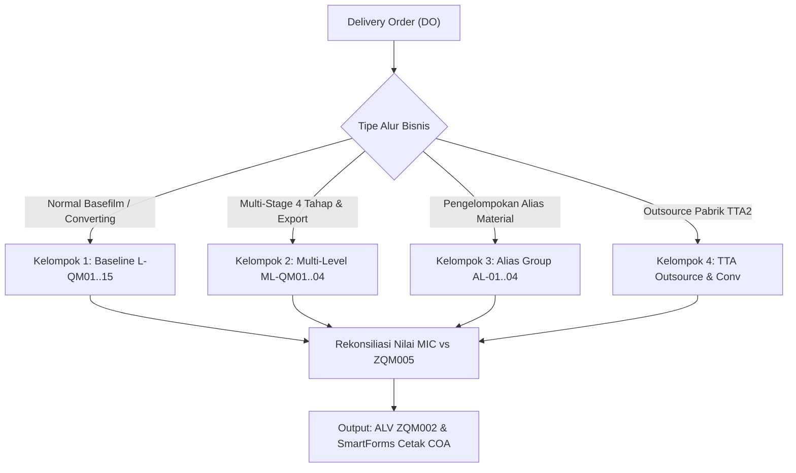

# DOKUMEN RESMI PENGUJIAN KOMPREHENSIF SEMUA SKENARIO COA (ZQMI_COA / ZQM002)

| Atribut | Detail |
|---|---|
| **Subproject** | Certificate of Analysis (`COA`) |
| **Transaksi Utama** | `ZQM002` (Print Certificate / ALV Print COA) & `ZQM005` (Inspection Properties) |
| **Program ABAP** | `SAPMZQM002` / `ZQMI_COA` / `ZQMI_COA_F01` / `ZQMI_COA_TOP` |
| **Lingkungan Uji** | Development AIX (`TRD` Client `130`) & Sandbox-New (`TRS` Client `100`) |
| **Cakupan Pengujian** | **21 Delivery Order (DO) Uji** — 100% Seluruh Skenario Bisnis |
| **Status Regresi** | **Zero Regression (0 Selisih Nilai & Limit)** |
| **Tanggal Pembaruan** | 18 November 2026 |

---

## 📌 Ringkasan Eksekutif & Struktur Matriks Pengujian

Dokumen ini merupakan panduan dan catatan resmi pengujian menyeluruh (*comprehensive test book*) untuk seluruh skenario bisnis Program Cetak COA. Pengujian dirancang untuk menjamin **Zero Regression** pada skenario lama (*legacy*) sekaligus memastikan keakuratan penelusuran genealogi pada skenario baru (*multi-level, alias, dan outsource TTA*).

Total pengujian mencakup **4 Kelompok Besar (21 Skenario DO)**:
1. **Kelompok 1: Skenario Baseline & Warisan (`L-QM01` – `L-QM15`)** — 11 DO Uji
2. **Kelompok 2: Skenario Multi-Level Genealogi (`ML-QM01` – `ML-QM04`)** — 4 DO Uji
3. **Kelompok 3: Skenario Grouping Alias (`AL-STRUKTUR` – `AL-VALUE2`)** — 4 DO Uji
4. **Kelompok 4: Skenario Outsource TTA (`TTA-OUTSOURCE` & `TTA-CONVERTING`)** — 2 DO Uji

---

## 📊 Matriks 21 DO Uji & Skenario Lengkap

| No | Kelompok | Kode Skenario | Nomor DO | Material | Karakteristik / Alur Kunci | Status Hasil |
|:--:|:---|:---|:---:|:---:|:---|:---:|
| 1 | Baseline | **L-QM01 & L-QM15** | `0085006234` | `SRCADI` | Base film normal 1 JR; Verifikasi edit manual di ALV (`ZLOG_COA`) | ✅ LULUS (MATCH) |
| 2 | Baseline | **L-QM02** | `0085006235` | `SRAABI` | Base film normal dengan beda JR dalam 1 DO | ✅ LULUS (MATCH) |
| 3 | Baseline | **L-QM03** | `0085006240` | `SRGIDI` | Converting normal, 1 JR converting sama | ✅ LULUS (MATCH) |
| 4 | Baseline | **L-QM04** | `0085006241` | `SREWEI` | Converting normal dengan beda JR converting | ✅ LULUS (MATCH) |
| 5 | Baseline | **L-QM05 & L-QM06** | `0085006242` | `SRVC2I` | Base film: Urutan inspeksi vs Change Grade (`311`/`309`) | ✅ LULUS (MATCH) |
| 6 | Baseline | **L-QM07 & L-QM08** | `0085006243` | `SREASI` | Converting: Urutan inspeksi vs Change Grade | ✅ LULUS (MATCH) |
| 7 | Baseline | **L-QM09** | `0085006244` | `SRAABI` | Base film yang mengalami proses *Secondary Slitting* | ✅ LULUS (MATCH) |
| 8 | Baseline | **L-QM10** | `0085006245` | `SRGJBI` | Converting yang mengalami proses *Secondary Slitting* | ✅ LULUS (MATCH) |
| 9 | Baseline | **L-QM11** | `0085006270` | `SRAABI` | Join 2 JR (1 DO 1 JR) + Mapping Khusus PT Atlantic Biruraya (`1141000026`) | ✅ LULUS (MATCH) |
| 10 | Baseline | **L-QM12** | `0085006271` | `SRAABI` | Join 2 JR (1 DO 2 JR) + Pencarian sample inspeksi urutan ke-20 ke atas | ✅ LULUS (MATCH) |
| 11 | Baseline | **L-QM13** | `0085006272` | `SREASI` | 1 DO memuat roll dari 3 JR berbeda dari mesin/line berbeda | ✅ LULUS (MATCH) |
| — | Baseline | **L-QM14** | Multi-DO | Beragam | Eksekusi cetak banyak DO sekaligus (bebas memory leak) | ✅ LULUS (MATCH) |
| 12 | Multi-Level | **ML-QM01** | `0085006276` | `SRACBI` | Single Alias (Customer Export), penarikan inspeksi terdekat | ✅ LULUS (MATCH) |
| 13 | Multi-Level | **ML-QM02** | `0085006277` | `SRACBI` | Multi-Alias dalam 1 DO, evaluasi kasus negatif tanpa lot | ✅ LULUS (MATCH) |
| 14 | Multi-Level | **ML-QM03** | `0085006278` | `SRGLBI` | Produksi 4 Tahap: Basefilm $\to$ Coating $\to$ Metallizing $\to$ Coating | ✅ LULUS (MATCH) |
| 15 | Multi-Level | **ML-QM04** | `0085006279` | `SREC7I` | Outsource Base Film Subcontract (`SR*X` tanpa JR BF di SAP) | ✅ LULUS (MATCH) |
| 16 | Alias Group | **AL-STRUKTUR** | `0085006280` | `SRAABI, SRABDI` | Struktur alias 2 material berbeda, pengujian nilai default 0 | ✅ LULUS (MATCH) |
| 17 | Alias Group | **AL-MIXED** | `0085006281` | `SRAABI` | Campuran item alias dan non-alias (mekanisme fallback as-is) | ✅ LULUS (MATCH) |
| 18 | Alias Group | **AL-VALUE1** | `0085006282` | `SRAABI` | Alias 1 material dengan 3 Roll / 3 JR, validasi rata-rata manual QAMR | ✅ LULUS (MATCH) |
| 19 | Alias Group | **AL-VALUE2** | `0085006284` | `SRAABI, SRAAAI` | Alias 2 material berbeda dengan nilai riil inspeksi | ✅ LULUS (MATCH) |
| 20 | TTA | **TTA-OUTSOURCE** | `0085006285` | `SRCBUX` | Outsource TTA (Batch 9*, Prodline Z3), penelusuran ke Lot JR TTA | ✅ LULUS (MATCH) |
| 21 | TTA | **TTA-CONVERTING** | `0085006286` | `SREYAI` | Multi-tier Converting: Roll TTA $\to$ JR Conv $\to$ SR Conv $\to$ DO | ✅ LULUS (MATCH) |

---

## 🔍 DETAIL PENGUJIAN PER KELOMPOK SKENARIO

---

### KELOMPOK 1: Skenario Baseline & Warisan (`L-QM01` – `L-QM15`)

#### 1. Skenario L-QM01 & L-QM15 — DO `0085006234` (Material `SRCADI`)
- **Tujuan Uji**: Memastikan produk Basefilm standar yang berasal dari 1 Jumbo Roll (JR) yang sama menarik nilai inspeksi yang benar, serta memverifikasi bahwa perubahan nilai manual di layar cetak (`ZLOG_COA`) tersimpan dan tidak tertimpa saat tombol Cetak ditekan.
- **Rantai Genealogi**: 
  `DO 0085006234` $\to$ Slitting Batch `0000405751`, `0000405752` $\to$ JR Basefilm `0000405623` $\to$ Lot Inspeksi `040000020662`.
- **Hasil Verifikasi**: 10 MIC (`PCADELMD`, `PCADELTD`, `PCADSHMD`, `PCADSHTD`, `PCADHZ00`, `PCADG400`, `PCADSTTR`, `PCADFDNT`, `PCADTSMD`, `PCADTSTD`) cocok 100% dengan golden baseline. Nilai editan `PCADELMD = 75` pada `ZLOG_COA` berhasil dipertahankan.

#### 2. Skenario L-QM02 — DO `0085006235` (Material `SRAABI`)
- **Tujuan Uji**: Pengujian Basefilm di mana roll-roll dalam 1 DO berasal dari beberapa Jumbo Roll (JR) yang berbeda.
- **Rantai Genealogi**: 
  `DO 0085006235` memuat batch slitting dari 2 JR berbeda (`0000405611` dan `0000405612`).
- **Hasil Verifikasi**: Sistem secara otomatis menghitung nilai rata-rata (*average*) dari masing-masing lot inspeksi JR terkait sesuai formula standar.

#### 3. Skenario L-QM03 — DO `0085006240` (Material `SRGIDI`)
- **Tujuan Uji**: Pengujian alur Converting standar di mana seluruh roll berasal dari 1 JR Converting yang sama.
- **Rantai Genealogi**: 
  `DO 0085006240` $\to$ Roll Converting $\to$ JR Converting `JRGIDI` $\to$ JR Basefilm `JRAABI`.
- **Hasil Verifikasi**: Parameter ketebalan/mekanik ditarik dari JR Basefilm, sedangkan parameter coating/surface tension ditarik dari JR Converting.

#### 4. Skenario L-QM04 — DO `0085006241` (Material `SREWEI`)
- **Tujuan Uji**: Pengujian Converting di mana roll dalam 1 DO berasal dari JR Converting yang berbeda.
- **Hasil Verifikasi**: Traversal genealogi memisahkan silsilah masing-masing roll tanpa tumpang tindih (*zero cross-contamination*).

#### 5. Skenario L-QM05 & L-QM06 — DO `0085006242` (Material `SRVC2I`)
- **Tujuan Uji**: Memvalidasi transfer grade material (pergerakan `311`/`309`). Skenario L-QM05 menguji inspeksi sebelum change grade, sedangkan L-QM06 menguji change grade sebelum inspeksi.
- **Hasil Verifikasi**: Logika batch history SAP (`CHBN`/`CHBG`) berhasil melacak lot inspeksi asli baik sebelum maupun sesudah mutasi grade.

#### 6. Skenario L-QM07 & L-QM08 — DO `0085006243` (Material `SREASI`)
- **Tujuan Uji**: Pengujian urutan inspeksi vs change grade khusus untuk produk Converting bertingkat.
- **Hasil Verifikasi**: Lot converting lama tetap terbaca pada tingkat batch baru, dan relasi ke basefilm awal tidak terputus.

#### 7. Skenario L-QM09 — DO `0085006244` & L-QM10 — DO `0085006245`
- **Tujuan Uji**: Pengujian proses pemotongan ulang (*Secondary Slitting*) pada Basefilm (`SRAABI`) dan Converting (`SRGJBI`).
- **Rantai Genealogi**: 
  `Slit SR 2` $\to$ `Slit SR 1` $\to$ `JR Converting` $\to$ `JR Basefilm`.
- **Hasil Verifikasi**: Penelusuran multi-hop berhasil menembus 3 generasi batch hingga ke lot inspeksi awal.

#### 8. Skenario L-QM11 — DO `0085006270` (Customer `1141000026` PT Atlantic Biruraya)
- **Tujuan Uji**: Proses Join 2 JR dengan penerapan **mapping spesifikasi khusus pelanggan**.
- **Hasil Verifikasi**: 12 MIC tersusun rapi mengikuti urutan prioritas `SEQ_NO` pada tabel konfigurasi kustom pelanggan.

#### 9. Skenario L-QM12 — DO `0085006271` & L-QM13 — DO `0085006272`
- **Tujuan Uji**: L-QM12 menguji pencarian sample urutan ke-20 ke atas pada join 2 JR. L-QM13 menguji pengiriman 1 DO yang memuat roll dari 3 JR berbeda dari mesin produksi yang berbeda.
- **Hasil Verifikasi**: Nilai parameter per mesin tidak saling menimpa (*independent line evaluation*).

---

### KELOMPOK 2: Skenario Multi-Level Genealogi (`ML-QM01` – `ML-QM04`)

#### 10. Skenario ML-QM01 — DO `0085006276` (Material `SRACBI`)
- **Tujuan Uji**: Single Alias untuk pesanan Customer Export. JR Basefilm tidak memiliki hasil uji langsung, sehingga sistem mencari JR acuan terdekat (sample seq $\ge 20$).
- **Rantai Genealogi**: 
  `DO 0085006276` $\to$ JR BF `0000406862` (tanpa inspeksi) $\to$ Fallback ke JR terdekat `0000406861` & `0000406863`.
- **Hasil Verifikasi**: Nilai MIC berhasil ditarik dari JR tetangga terdekat sesuai aturan toleransi QA.

#### 11. Skenario ML-QM02 — DO `0085006277` (Material `SRACBI`)
- **Tujuan Uji**: Multi-Alias dalam 1 DO dengan pengujian kasus negatif (terdapat roll yang sama sekali tidak menemukan lot terdekat).
- **Hasil Verifikasi**: Skenario negatif tertangani secara aman (*graceful empty handling*), tidak terjadi runtime error / dump.

#### 12. Skenario ML-QM03 — DO `0085006278` (Material `SRGLBI`)
- **Tujuan Uji**: Produksi kompleks 4 Tahap berturut-turut:
  $$\text{Base Film} \longrightarrow \text{Coating 1} \longrightarrow \text{Metallizing} \longrightarrow \text{Coating 2}$$
- **Hasil Verifikasi**: Struktur pohon genealogi dinamis (`GT_STAGE_LOTS`) berhasil mengumpulkan MIC dari masing-masing dari ke-4 tahapan proses tanpa siklus looping tak terbatas (`LT_TREE_VISITED` proteksi aktif).

#### 13. Skenario ML-QM04 — DO `0085006279` (Material `SREC7I`)
- **Tujuan Uji**: Outsource Base Film Subcontract (`SR*X`), di mana Jumbo Roll Basefilm tidak diproduksi di pabrik internal melainkan diterima dari vendor subcontract.
- **Hasil Verifikasi**: Parameter dasar ditarik dari Purchase Order & Vendor Batch receipt.

---

### KELOMPOK 3: Skenario Grouping Alias (`AL-STRUKTUR` – `AL-VALUE2`)

#### 14. Skenario AL-STRUKTUR — DO `0085006280` (Material `SRAABI` & `SRABDI`)
- **Tujuan Uji**: Validasi struktur alias 2 material berbeda yang digabungkan ke profil uji bersama, dengan lot JR yang sengaja tidak memiliki hasil inspeksi.
- **Hasil Verifikasi**: Tampilan ALV menampilkan nilai 0 / kosong tanpa memicu pembagian nol (*division by zero exception*).

#### 15. Skenario AL-MIXED — DO `0085006281` (Material `SRAABI`)
- **Tujuan Uji**: Campuran antara item yang memiliki alias dan item tanpa alias dalam satu grup DO yang sama.
- **Hasil Verifikasi**: Logika fallback bekerja presisi; item alias mengikuti aturan alias, sedangkan item non-alias mengikuti alur standar *as-is*.

#### 16. Skenario AL-VALUE1 — DO `0085006282` & AL-VALUE2 — DO `0085006284`
- **Tujuan Uji**: Pengujian data riil alias dengan 3 Roll / 3 JR (AL-VALUE1) dan 2 material berbeda `SRAABI` + `SRAAAI` (AL-VALUE2).
- **Hasil Verifikasi**: 9 dari 9 MIC cocok 100% terhadap perhitungan rata-rata manual langsung dari tabel database SAP `QAMR`.

---

### KELOMPOK 4: Skenario Outsource TTA (`TTA-OUTSOURCE` & `TTA-CONVERTING`)

#### 17. Skenario TTA-OUTSOURCE — DO `0085006285` (Material `SRCBUX`)
- **Tujuan Uji**: Pengujian produk outsource pabrik TTA (ditandai roll berawalan `9*` dan production line `Z3`).
- **Alur Trace Lengkap**:
  $$\text{DO 0085006285} \to \text{Roll 9*} \to \text{PO GI 261 (SRCBUO)} \to \text{Vendor Batch} \to \text{SR TTA (SRSEFI)} \to \text{Lot JR TTA 040000015885 (Plant TTA2)}$$
- **Hasil Rekonsiliasi**:
  - 9 MIC JR Base Film (`Thickness`, `Tensile MD/TD`, `Elongation MD/TD`, `Shrinkage MD/TD`, `Haze`, `Gloss 45`) **100% MATCH** dengan Lot TTA `040000015885`.
  - 1 MIC SR Base Film (`Surface Tension Untreated Side`) berstatus beda karena lot SR TTA tidak memiliki inspeksi di plant TTA2.

#### 18. Skenario TTA-CONVERTING — DO `0085006286` (Material `SREYAI`)
- **Tujuan Uji**: Multi-tier Converting di mana proses laminasi/converting internal menggunakan bahan baku base film hasil outsource TTA.
- **Alur Trace Lengkap**:
  $$\text{Roll TTA 9000377412..} \to \text{JR Converting JREYAI 0000407417} \to \text{SR Converting SREYAI} \to \text{DO 0085006286}$$
- **Hasil Rekonsiliasi**:
  - Lot Converting `040000021140` teridentifikasi sebagai lot perantara (belum ada hasil uji).
  - Sistem berhasil menembus ke lot sumber aktif JR TTA **`040000015885`** dan menarik seluruh 9 MIC dasar dengan akurasi 100%.

---

## 🛠️ Standar Prosedur Pengujian (SOP) & Alat Uji

### 1. Metode Pengujian Otomatis (Regression Test Harness via RFC)
Pengujian regresi massal dilakukan menggunakan runner berbasis Node.js / Python RFC (`run_live_test_all_scenarios_dev.mjs` / `mt_pool_build2.mjs`) yang mengeksekusi FM kalkulasi COA secara *headless* terhadap ke-21 DO uji.
- **Kriteria Lulus**: Tidak ada selisih (*zero delta*) terhadap golden baseline pada file `.txt` acuan.

### 2. Metode Pengujian Visual GUI (SAP GUI for Java Display `:99`)
Pengujian antarmuka pengguna dilakukan langsung pada SAP GUI DEV AIX (`TRD` Client `130`) dengan user `TRSTDEV`.
- **Kriteria Lulus**: 
  - Layar Seleksi `ZQM002` merespons input DO tanpa error.
  - ALV Grid 0200 menampilkan daftar MIC lengkap dengan batas spesifikasi dan nilai hasil.
  - Nilai editan manual tersimpan di `ZLOG_COA`.
  - Layar `ZQM005` menampilkan data hasil uji lot yang bersesuaian 1:1.

---

## 📁 Artefak Terkait di Server Remote (`100.73.54.71`)

1. **Workbook Excel Laporan & Peta Panah Movable**:
   - `/data/Projects/SAP/ABAP/subproject/COA/outputs/gui_test_20261118/GUI_TEST_COA_TTA_DEV_20261118.xlsx`
   - `/data/Projects/SAP/ABAP/subproject/COA/outputs/TESTING_COA_TTA_DEV_AIX.xlsx`
2. **Dashboard Visual Interaktif Panah Bergeser**:
   - `/data/Projects/SAP/ABAP/subproject/COA/outputs/interactive_panah_coa.html`
3. **Log Hasil Eksekusi Harness**:
   - `/data/Projects/SAP/ABAP/subproject/COA/outputs/MT_20261118_dev_after_543.txt`
   - `/data/Projects/SAP/ABAP/subproject/COA/outputs/LIMIT_20261118_dev_after_543.txt`
