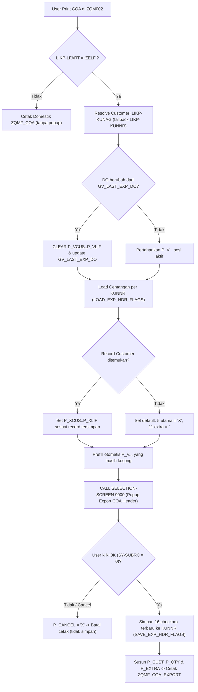

# Rancangan Fitur: Penyimpanan Centangan Header COA Export per Customer

| Atribut | Isi |
|---|---|
| Tanggal | 2026-11-26 |
| Subproject | COA (`ZQMI_COA` / TCode `ZQM002`) |
| Objek Terkait | `ZQMI_COA_TOP`, `ZQMI_COA_F01` (`FORM PREPARE_EXPORT_HEADER`), `SELECTION-SCREEN 9000`, Smart Form `ZQMF_COA_EXPORT` |
| Cakupan | **Per Customer (`KUNNR`)** — shared lintas user QA |
| Status | Draft Rancangan (Menunggu Persetujuan Baginda) |

---

## 1. Latar Belakang & Tujuan

Saat user mencetak COA untuk Delivery Export (`LIKP-LFART = 'ZELF'`) melalui `ZQM002`, program menampilkan popup **`SELECTION-SCREEN 9000` (`Export COA Header`)** berisi 16 field header (5 field utama + 11 field tambahan).

**Kondisi saat ini:**
- Setiap kali membuka sesi baru, popup selalu kembali ke default awal (5 field utama tercentang, 11 field tambahan kosong).
- User harus mencentang ulang field tambahan yang dibutuhkan secara manual untuk setiap customer yang punya format header khusus.
- Dalam satu sesi yang sama, nilai teks (`P_V...`) dari DO sebelumnya tidak otomatis di-clear saat ganti DO.

**Tujuan perubahan:**
1. Menyimpan **pilihan centangan (16 checkbox `P_X...`) per Customer (`KUNNR`)** setiap kali user mengonfirmasi cetak (Execute/OK) pada popup `9000`.
2. Saat cetak berikutnya untuk customer yang sama (baik di sesi yang sama, sesi baru, maupun oleh user QA lain), seluruh 16 checkbox otomatis terisi mengikuti **centangan terakhir customer tersebut**.
3. Memastikan nilai teks (`P_V...`) tetap bersih dan di-prefill dinamis sesuai DO yang sedang dicetak (tidak terbawa dari DO sebelumnya).

---

## 2. Aturan Bisnis (Business Rules)

1. **Basis Penyimpanan — Per Customer (`KUNNR`), Shared Lintas User:**
   - Identitas customer diambil dari Delivery Header: **`LIKP-KUNAG` (Sold-To Party)**, dengan fallback **`LIKP-KUNNR` (Ship-To Party)** jika `KUNAG` kosong.
   - Pola ini 100% konsisten dengan resolusi customer pada `FORM GET_BATCH_COL_CFG` (`ZMAP_COA_GRP_CST`).
   - Bersifat *shared* antar user karena kebutuhan field header COA ditentukan oleh standar/permintaan customer, bukan preferensi pribadi user.
2. **Hanya Menyimpan Status Centangan (`P_X...`), Bukan Nilai Teks (`P_V...`):**
   - Nilai seperti `PO Number`, `PI Number`, `Quantity`, `Delivery Date`, `Container Number`, `LC Number`, dll. bersifat transaksional per DO sehingga **tidak boleh** ikut tersimpan lintas DO.
   - Nilai teks tetap di-prefill otomatis dari data DO/SO/Batch yang aktif (atau dikosongkan untuk field manual).
3. **Trigger Simpan:**
   - Centangan **hanya disimpan** apabila user menekan **Execute / OK** (`SY-SUBRC = 0`) pada popup `9000`.
   - Apabila user menekan **Cancel / ESC** (`SY-SUBRC <> 0`), proses cetak dibatalkan dan centangan tersimpan sebelumnya **tidak diubah**.
4. **Default untuk Customer Baru:**
   - Jika customer belum pernah memiliki record tersimpan, sistem mengembalikan default standar:
     - 5 field utama (`Customer Name`, `PO Number`, `PI Number`, `Product`, `Quantity`) = `'X'` (tercentang).
     - 11 field tambahan = `''` (tidak tercentang).
5. **Reset Nilai Teks Antar DO:**
   - Disimpan variabel memori sesi `GV_LAST_EXP_DO` (`LIKP-VBELN`). Jika DO yang dicetak berbeda dari `GV_LAST_EXP_DO`, seluruh `P_V...` di-`CLEAR` dulu sebelum proses prefill, agar data DO lama tidak nyangkut.
6. **Tidak Memengaruhi COA Domestik:**
   - Popup `9000` dan mekanisme simpan/load hanya aktif saat `LIKP-LFART = 'ZELF'`. DO non-export tidak terpengaruh sama sekali.

---

## 3. Daftar 16 Field Header yang Disimpan

| No | Label di Popup | Checkbox (Disimpan) | Input Value (Dinamis) | Default Baru | Sumber Prefill Otomatis |
|---|---|---|---|---|---|
| 1 | Customer Name | `P_XCUS` | `P_VCUS` | `'X'` | `NAME1` |
| 2 | PO Number | `P_XPO` | `P_VPO` | `'X'` | `VBAK-BSTNK` / fallback `VBKD-BSTKD` |
| 3 | PI Number | `P_XPI` | `P_VPI` | `'X'` | SO Header Text `Z101` (`VBBK`) baris 1 |
| 4 | Product | `P_XPRD` | `P_VPRD` | `'X'` | `PRODUCT` (prioritas `ZZALIAS`, lalu `ZZCODE-ATWTB`) |
| 5 | Quantity | `P_XQTY` | `P_VQTY` | `'X'` | `QUANTITY` |
| 6 | Container Number | `P_XCONT` | `P_VCONT` | `''` | Input manual |
| 7 | Delivery Date | `P_XDDAT` | `P_VDDAT` | `''` | `LIKP-LFDAT` (`DD/MM/YYYY`) |
| 8 | Thickness | `P_XTHK` | `P_VTHK` | `''` | Karakteristik batch (jika seragam di semua batch) |
| 9 | Grammage | `P_XGRM` | `P_VGRM` | `''` | Karakteristik batch (jika seragam di semua batch) |
| 10 | Raw Material Code | `P_XRAW` | `P_VRAW` | `''` | Input manual |
| 11 | LC Number | `P_XLC` | `P_VLC` | `''` | Input manual |
| 12 | Width | `P_XWID` | `P_VWID` | `''` | `WIDTH` |
| 13 | Date Goods Shipped | `P_XSHP` | `P_VSHP` | `''` | Input manual |
| 14 | #Part | `P_XPRT` | `P_VPRT` | `''` | Input manual |
| 15 | Manufacturer | `P_XMFR` | `P_VMFR` | `''` | Default `'PT. Trias Sentosa Tbk'` |
| 16 | Shelf Life | `P_XLIF` | `P_VLIF` | `''` | `EXP_DATE` batch pertama di `GT_DATE_CACHE` |

---

## 4. Arsitektur Penyimpanan (Pilihan Opsi)

### Opsi 1 (Rekomendasi): Tabel Z Transparan `ZMAP_COA_EXP_HDR`

Selaras dengan keluarga tabel mapping COA yang sudah ada (`ZMAP_COA`, `ZMAP_COA_GRP_CST`, `ZMAP_COA_GRP_COL`), transparan di `SE16N`, aman dari job housekeeping, dan siap untuk S/4HANA.

**Spesifikasi DDIC (`SE11`):**
- **Nama Tabel**: `ZMAP_COA_EXP_HDR`
- **Short Description**: `COA Export Header Checkbox Mapping per Customer`
- **Delivery Class**: `A` (Application table - master and transaction data)
- **Data Browser/Table View Maint.**: `Display/Maintenance Allowed`
- **Data Class / Size Category**: `APPL0` / `0`

| Field | Key | Data Element / Type | Panjang | Keterangan |
|---|---|---|---|---|
| `MANDT` | X | `MANDT` | 3 | Client |
| `KUNNR` | X | `KUNNR` | 10 | Customer Number (`LIKP-KUNAG` / fallback `LIKP-KUNNR`) |
| `XCUS` | | `FLAG` (`CHAR1`) | 1 | Centang Customer Name |
| `XPO` | | `FLAG` (`CHAR1`) | 1 | Centang PO Number |
| `XPI` | | `FLAG` (`CHAR1`) | 1 | Centang PI Number |
| `XPRD` | | `FLAG` (`CHAR1`) | 1 | Centang Product |
| `XQTY` | | `FLAG` (`CHAR1`) | 1 | Centang Quantity |
| `XCONT` | | `FLAG` (`CHAR1`) | 1 | Centang Container Number |
| `XDDAT` | | `FLAG` (`CHAR1`) | 1 | Centang Delivery Date |
| `XTHK` | | `FLAG` (`CHAR1`) | 1 | Centang Thickness |
| `XGRM` | | `FLAG` (`CHAR1`) | 1 | Centang Grammage |
| `XRAW` | | `FLAG` (`CHAR1`) | 1 | Centang Raw Material Code |
| `XLC` | | `FLAG` (`CHAR1`) | 1 | Centang LC Number |
| `XWID` | | `FLAG` (`CHAR1`) | 1 | Centang Width |
| `XSHP` | | `FLAG` (`CHAR1`) | 1 | Centang Date Goods Shipped |
| `XPRT` | | `FLAG` (`CHAR1`) | 1 | Centang #Part |
| `XMFR` | | `FLAG` (`CHAR1`) | 1 | Centang Manufacturer |
| `XLIF` | | `FLAG` (`CHAR1`) | 1 | Centang Shelf Life |
| `AENAM` | | `AENAM` | 12 | Last Changed By (`SY-UNAME`) |
| `AEDAT` | | `AEDAT` | 8 | Last Changed Date (`SY-DATUM`) |
| `AEZET` | | `AEZET` | 6 | Last Changed Time (`SY-UZEIT`) |

### Opsi 2 (Alternatif Tanpa Tabel DDIC Baru): Cluster `INDX`

Jika ingin tanpa objek DDIC baru (hanya ubah program `ZQMI_COA`):
- **Area (`RELID`)**: `ZC`
- **Key (`SRTFD`)**: `'COAEXP_' && LV_KUNNR` (17 karakter, muat di `INDX-SRTFD` 22 karakter)
- **Header Audit**: `LS_INDX-USERA = SY-UNAME`, `LS_INDX-AEDAT = SY-DATUM`, `LS_INDX-PGMID = SY-REPID`
- **Proteksi Struktur**: Gunakan `IGNORING STRUCTURE BOUNDARIES` saat `IMPORT`
- **Catatan Risiko**: Tidak bisa dilihat/diedit isinya di `SE16N`, dan perlu dipastikan tidak terkena job pembersihan `INDX` dari Basis.

---

## 5. Alur Proses (Flowchart)



---

## 6. Rancangan Perubahan Kode ABAP

### 6.1 `ZQMI_COA_TOP`
Tambahkan 1 variabel global untuk deteksi pergantian DO dalam satu sesi:
```abap
DATA: GV_LAST_EXP_DO TYPE LIKP-VBELN.
```

### 6.2 `ZQMI_COA_F01`
Modularisasi menjadi 2 sub-form kecil agar `PREPARE_EXPORT_HEADER` tetap bersih dan mudah dirawat:
1. **`FORM LOAD_EXP_HDR_FLAGS USING PV_KUNNR TYPE KUNNR`**
   - Membaca centangan terakhir untuk `PV_KUNNR` (dari `ZMAP_COA_EXP_HDR` pada Opsi 1, atau `INDX(ZC)` pada Opsi 2).
   - Jika tidak ditemukan (`SY-SUBRC <> 0`), mengembalikan 5 field utama ke `'X'` dan 11 field extra ke `''`.
2. **`FORM SAVE_EXP_HDR_FLAGS USING PV_KUNNR TYPE KUNNR`**
   - Dipanggil tepat setelah `CALL SELECTION-SCREEN 9000` dengan `SY-SUBRC = 0`.
   - Menyimpan 16 flag `P_X...` + `SY-UNAME` / `SY-DATUM` / `SY-UZEIT` ke `PV_KUNNR` (`MODIFY ZMAP_COA_EXP_HDR` + `COMMIT WORK` atau sesuai LUW cetak, pada Opsi 1; atau `EXPORT ... TO DATABASE INDX(ZC)` pada Opsi 2).
3. **Di dalam `FORM PREPARE_EXPORT_HEADER`**:
   - Ambil `LV_KUNNR` dari `LIKP` (`KUNAG`, fallback `KUNNR`).
   - Jika `GV_LAST_EXP_DO <> P_DELIVERY`: `CLEAR` seluruh `P_VCUS..P_VLIF`, lalu set `GV_LAST_EXP_DO = P_DELIVERY`.
   - Panggil `PERFORM LOAD_EXP_HDR_FLAGS USING LV_KUNNR`.
   - Jalankan prefill `P_V...` seperti biasa.
   - Panggil `CALL SELECTION-SCREEN 9000 ...`.
   - Jika `SY-SUBRC = 0`, panggil `PERFORM SAVE_EXP_HDR_FLAGS USING LV_KUNNR`.

---

## 7. Rencana Pengujian (Test Cases)

| ID | Skenario Uji | Langkah | Hasil Diharapkan |
|---|---|---|---|
| **TC-01** | Customer baru (belum pernah simpan) | Print DO `ZELF` untuk Customer A | Popup `9000` muncul dengan 5 field utama tercentang, 11 extra kosong. |
| **TC-02** | Simpan centangan baru | Centang `Container Number`, `Delivery Date`, `Thickness`, `Manufacturer` -> klik Execute | COA tercetak dengan 4 field tambahan tsb; record Customer A tersimpan di DB. |
| **TC-03** | Load ulang di DO lain / sesi baru / user lain | Login user lain (atau sesi baru), print DO `ZELF` lain milik Customer A | Popup `9000` otomatis mencentang 4 field tsb; isi teks (`PO`, `PI`, `Qty`, `Delivery Date`) sesuai DO baru (bukan DO lama). |
| **TC-04** | Cancel popup tidak menimpa data | Buka popup Customer A, ubah centangan -> klik Cancel | Cetak dibatalkan; buka lagi -> centangan tetap seperti TC-02. |
| **TC-05** | Isolasi antar Customer | Print DO `ZELF` milik Customer B | Muncul default Customer B (tidak ikut centangan Customer A). Ubah & simpan Customer B -> Customer A tetap tidak berubah. |
| **TC-06** | Regresi DO Domestik | Print DO non-`ZELF` | Popup `9000` tidak muncul; cetak `ZQMF_COA` + batch list berjalan normal. |

---

## 8. Keputusan yang Dibutuhkan Sebelum Implementasi

- [ ] Konfirmasi pilihan penyimpanan: **Opsi 1 (`ZMAP_COA_EXP_HDR`)** atau **Opsi 2 (`INDX`)**.
- [ ] Konfirmasi target server implementasi & pengujian awal (mis. Sandbox `TRS` atau DEV AIX `TRD`).
