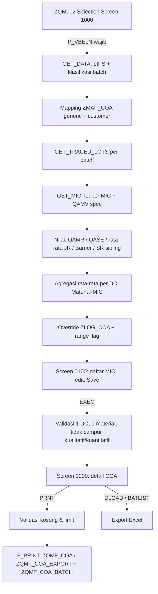

# WRICEF — ZQM002 Certificate of Analysis (COA)

**RICEFW Work Unit:** `RICEFW-QM-ZQMI_COA` — Certificate of Analysis Print Program
**Modul:** Quality Management (QM) — lintas SD (Delivery) / PP (Production Order) / Batch Management
**Status dokumen:** As-Is (didokumentasikan dari source aktif DEV AIX / TRD, snapshot 03 Nov 2026)

---

## 1. Document Information

### 1.1 General Information

| Item | Keterangan |
|---|---|
| Project Name | Certificate of Analysis (COA) Dinamis — Go-Live 23 Nov 2026 |
| Document Name | WRICEF ZQM002 — Certificate of Analysis |
| Version | 1.00 |
| Sumber analisis | Source `ZQMI_COA` + include `ZQMI_COA_TOP`, `ZQMI_COA_F01`, `ZQMI_COA_F02`, `ZQMI_COA_ALV` (DEV AIX / SID TRD, fetch 03.11.2026); DDIC & TCODE dibaca langsung dari TRD |
| Dokumen terkait | `COA.md`, `ARCHITECTURE_COA_DYNAMIC.md`, `ZQMI_COA_Technical_Specification.md`, `STANDAR_SKENARIO_TESTING_COA.md`, `SMARTFORM.md`, `SMARTFORMS_PATCH.md` |

### 1.2 Document History

| Version | Author | Reason for Change | Date |
|---|---|---|---|
| 1.00 | Tim ABAP | Dokumentasi WRICEF as-is ZQM002 | 03 Nov 2026 |

### 1.3 Object Overview

| Attribute | Value |
|---|---|
| WRICEF Type | **F — Form** (utama) dengan komponen **R — Report** (Dynpro selection, Table Control 0100/0200, export Excel) dan **E — Enhancement data** (log override nilai `ZLOG_COA`) |
| Business Process | Penerbitan Certificate of Analysis per Delivery Order (DO) untuk film BOPP/Converting yang dikirim ke customer |
| Object Title | Certificate (COA Print) |
| TCODE | `ZQM002` (TSTCT: *Certificate*) |
| Program | `ZQMI_COA` (Executable, dynpro awal 1000), package `ZTRD` |
| Include | `Z_PROG_INFO`, `ZQMI_COA_TOP`, `ZQMI_COA_F01`, `ZQMI_COA_F02`, `ZQMI_COA_ALV` |
| TCODE saudara | `ZQM003` (*Report COA*, program sama, mode ALV — cabang `SY-TCODE`), `ZQM001` (*Mapping COA*, program `ZMAP_COA`) |
| Smart Forms | `ZQMF_COA` (Domestic, Page 1), `ZQMF_COA_EXPORT` (Export, Page 1), `ZQMF_COA_BATCH` (Lampiran Batch List 1–7 kolom) |
| Custom Table | `ZMAP_COA`, `ZLOG_COA`, `ZQM_COA_CUST_COL`, `ZBATCHISTORY`, `ZMAP_TYPE` |
| Custom FM | `ZQM_GET_BATCH_JR_BY_SR`, `ZQM_GET_BATCH_SR_BY_JR` |
| Struktur DDIC | `ZQM_COA_DYN_ROLL` (COL01–COL14), `ZQM_COA_DYN_HDR` (HDR01–HDR14), `ZQMSAP` (baris roll) |
| Eksekusi | Online (dialog). Tidak dirancang untuk background (`CALL SCREEN`, popup, OLE Excel). |
| Complexity | High (trace silsilah batch multi-level, change grade, agregasi rata-rata, form dinamis) |
| Original Programmer | Hisar Sianturi (28.09.2012); enhancement 2026 oleh tim ABAP (J. Budi dkk.) |
| Last Changed (TRD) | `ZQMI_COA_F01` 22.10.2026; `ZQMI_COA_ALV` 03.11.2026 |

---

## 2. General Requirement

### 2.1 Latar Belakang

Customer mensyaratkan COA untuk setiap pengiriman. COA memuat hasil uji Master Inspection Characteristic (MIC) dari batch yang dikirim. Hasil uji tidak selalu tercatat pada batch delivery. Nilai bisa berasal dari tahap produksi sebelumnya: Jumbo Roll (JR) atau Slit Roll (SR), pada level Base Film atau Converting. Program harus menelusuri silsilah batch untuk menemukan Inspection Lot yang benar, lalu menyajikan dan mencetak COA.

Flow produksi normal:

```
Raw Material -> JR Base Film -> SR Base Film -> JR Converting -> SR Converting -> Packing -> Delivery
```

Change Grade (re-batching via `ZBATCHISTORY`, movement 309/311) dapat memutus rantai batch. Multi-level converting (Coat 1 -> Metz -> Coat 2) dapat menambah tingkat JR/SR.

### 2.2 User Requirement

1. User QA memasukkan nomor DO (wajib) dan filter opsional (Item, Material, Batch, Nomor Roll).
2. Sistem menampilkan daftar MIC per DO/material sesuai mapping `ZMAP_COA` (generic + customer-specific).
3. Nilai MIC diambil dari Inspection Lot sesuai mapping sumber (JR/SR Base Film/Converting), termasuk fallback change grade, sibling, dan rata-rata.
4. User dapat mengoreksi nilai (preview) dan menyimpannya dengan jejak audit (`ZLOG_COA`).
5. User mencetak COA (Smart Form) plus lampiran Batch List dengan kolom dinamis per customer.
6. User dapat export daftar MIC dan Batch List ke Excel.

### 2.3 Lingkup

| Dalam lingkup | Di luar lingkup |
|---|---|
| Pembacaan DO, batch, klasifikasi batch | Pembuatan/perubahan Inspection Lot, result recording, Usage Decision |
| Mapping MIC dan sumber lot | Maintenance mapping (ditangani `ZQM001` / `ZMAP_COA`) |
| Trace silsilah batch dan fallback | Desain layout detail Smart Form (dikelola via `SMARTFORMS`) |
| Override nilai + log audit | Mode report ALV (`ZQM003`) — hanya disinggung |
| Print Domestic/Export + Batch List, export Excel | Pengiriman email/arsip COA |

---

## 3. Functional Design

### 3.1 Alur Proses End-to-End



### 3.2 Selection Screen (Dynpro 1000)

| Field | Referensi | Wajib | Keterangan |
|---|---|---|---|
| `S_ERDAT` | `LIKP-ERDAT` | — | Hanya tampil di `ZQM003`/`SE38` (MODIF ID `R03`). Disembunyikan di `ZQM002`. |
| `P_WERKS` | `LIPS-WERKS` | — | Hanya tampil di `ZQM003`/`SE38`. |
| `P_CHARG` | `LIPS-CHARG` | — | Filter batch. |
| `P_ATWRT` | `AUSP-ATWRT` | — | Filter nomor roll (`ZZNOMORROLL`). Dipakai bila `P_CHARG` kosong. |
| `P_MATNR` | `LIPS-MATNR` | — | Filter material. |
| `P_VBELN` | `LIPS-VBELN` | **Ya** | Nomor DO. `SCREEN-REQUIRED = 1` di luar `ZQM003`. Bila kosong: pesan *"Nomor ODO (Delivery) WAJIB diisi! ..."* untuk mencegah time-out. |
| `P_POSNR` | `LIPS-POSNR` | — | Item utama. Secondary item (`LIPS-UECHA = P_POSNR`) ikut diambil. |
| Tombol `INFO` | — | — | Menampilkan *Program Information* (`F_PROG_INFO`, `Z_PROG_INFO`). |

Item category valid dibaca dari `ZMAP_TYPE` (`PROG = SY-CPROG`, `TYPE = 'ITEM CATEGORY'`). Bila kosong, default `PSTYV = 'ZB'`. Per 03.11.2026 di TRD tidak ada entri untuk `ZQMI_COA`, jadi default `ZB` yang berlaku.

### 3.3 Screen 0100 — Daftar MIC (Table Control `TCERTI`)

Kolom utama: Checkbox, DO, Item/Group (`UECHA`), Batch, Nomor Roll SR, Film Type (`ZZCODE`), Material, Plant, MIC, Deskripsi, UoM, Method, Lower/Upper Limit, Inspection Lot, Value (editable), Range Flag.

Urutan tampil: `VBELN`, `MATNR`, `CHK` desc, `NUMMIC`, `NUM` (= `ZMAP_COA-SEQ_NO`, default `999`), `MIC`. MIC yang ada di mapping otomatis tercentang (`NUMMIC = 1`).

| Function Code | Fungsi |
|---|---|
| `BACK` | Kembali ke selection screen. |
| `XPORT` | Export baris tercentang ke file `.XLS` (TAB-delimited) via `GUI_DOWNLOAD`. |
| `SELALL` / `DESALL` | Centang / hapus centang semua baris. |
| `GRPCHK` | Samakan centang seluruh baris satu DO + `UECHA` sesuai baris di kursor. |
| `SELMAP` | Centang ulang hanya MIC yang ada di mapping. |
| `SAVE` | Simpan perubahan nilai ke `ZLOG_COA` (lihat 3.6). |
| `EXEC` | Lanjut ke detail COA (Screen 0200). |

Validasi `EXEC`:

1. Nilai yang diubah wajib di-Save dulu. Jika tidak: *"Harap Save perubahan nilai (Preview) terlebih dahulu!"* (TYPE E).
2. Hanya 1 DO terpilih. Jika tidak: *"Pilih 1 ODO!"*.
3. Hanya 1 material (tipe film). Jika tidak: *"Tipe film tidak boleh berbeda!"*.
4. Satu MIC tidak boleh campur nilai kualitatif dan kuantitatif. Jika campur: *"Value mic tidak dapat qualitatif dan quantitatif!"*.

Saat `EXEC`, program juga menyusun header:

- **Product:** gabungan unik `ZZALIAS` dari batch material terpilih (dipisah koma). Fallback ke teks `ZZCODE`.
- **Width:** daftar unik `ZZWIDTH` (maks. 40 karakter, dipisah `;`), dibaca via `VB_BATCH_GET_DETAIL`.
- **Customer & Quantity:** `KNA1-NAME1` dan `LIKP-NTGEW` via `LIKP-KUNAG`.
- Nilai kuantitatif yang lebih dari 1 baris per MIC dirata-rata, lalu diformat sesuai decimal MIC.

### 3.4 Screen 0200 — Detail COA (Table Control `TDETAIL`)

Kolom: Properties (MIC Desc), UoM, Testing Method, Lower Limit, Upper Limit, Value (editable), Range Flag.

| Function Code | Fungsi |
|---|---|
| `BACK` | Kembali ke Screen 0100. |
| `DLOAD` | Export detail COA ke `.XLS`. |
| `BATLIST` | Export Batch List ke XLSX via OLE Excel (lihat 3.8). |
| `PRNT` | Cetak COA (lihat 3.7). |

Validasi `PRNT` (blokir cetak):

1. Ada Value kosong / `-` / `0` / `0.00` / `0.000` / `00000000`: *"Ada data MIC yang belum di-record (kosong), tidak bisa cetak COA!"*.
2. Ada value kuantitatif di luar Lower/Upper Limit: *"Ada value MIC yang keluar dari Lower/Upper Limit. Ubah value & Save (kembali ke layar sebelumnya) sebelum Print!"*.

### 3.5 Aturan Mapping MIC (`ZMAP_COA`)

| Aturan | Perilaku |
|---|---|
| Sumber | `ZMAP_COA` dengan `DELETION <> 'X'`. |
| Generic vs customer | Baca generic (`KUNNR` kosong) dan customer (`KUNNR = LIKP-KUNAG`). Merge per MIC. |
| Override customer | `METHOD`, `KUNNR`, `MAPPING`, `UOM`, `MIC_DESC` selalu menimpa. `LOWER_LIMIT`, `UPPER_LIMIT`, `SEQ_NO` menimpa hanya bila terisi. |
| MIC khusus customer | Ditambahkan ke daftar. |
| Mapping kosong | Pesan *"Material belum dimapping di ZMAP_COA..."* lalu `STOP` (seluruh proses berhenti). |
| Limit | `ZMAP_COA-LOWER_LIMIT/UPPER_LIMIT` (CHAR20) menimpa limit QAMV bila terisi. |
| Urutan | `SEQ_NO` menentukan urutan tampil & cetak. |

Nilai `MAPPING` dan lot sumber:

| `ZMAP_COA-MAPPING` | Variabel lot | Jenis lot (`QALS-ART`) |
|---|---|---|
| `SR Converting` | `LOT_SR_CONV` | `Z04` |
| `JR Converting` | `LOT_JR_CONV` | `Z02` / `Z03` |
| `SR Base Film` | `LOT_SR_BASE` | `Z04` |
| `JR Base Film` | `LOT_JR_BASE` | `Z02` / `Z03` |
| (lainnya/kosong) | `LOT_SR_CONV` (default defensif) | — |

### 3.6 Override Nilai & Audit Trail (`ZLOG_COA`)

1. Saat load, nilai aktif `ZLOG_COA` (key `VBELN + PRUEFLOS + MIC + KUNNR`, `DELETION <> 'X'`) menimpa nilai QM. `VALUE2` (teks) diprioritaskan atas `VALUE1` (FLTP).
2. `SAVE` membandingkan nilai layar dengan log aktif, atau dengan nilai QM asli (`ORIG_CMICMIT`) bila belum ada log.
3. Ada perubahan: popup `POPUP_TO_CONFIRM` *"Konfirmasi Simpan"*.
4. Ya: record lama di-flag `DELETION = 'X'` (+ `AEDAT/PSOTM/AENAM/TERM2`), record baru di-INSERT dengan `SEQ = MAX(SEQ) + 1` (+ `CPUDT/CPUTM/USNAM/TERM1`), lalu `COMMIT WORK AND WAIT`.
5. Tidak ada perubahan: *"Tidak ada data yang berubah. Tidak ada yang disimpan."*.

### 3.7 Print (`F_PRINT`)

| Kondisi `LIKP-LFART` | Form halaman 1 | Lampiran Batch List | Header |
|---|---|---|---|
| `ZELF` (Export) | `ZQMF_COA_EXPORT` | Tidak dicetak di spool | Popup Selection Screen 9000 *"Export COA Header"* |
| Selain `ZELF` (Domestic, termasuk `ZDLF`) | `ZQMF_COA` | `ZQMF_COA_BATCH` bila jumlah kolom 1–7 | Customer, DO, Product, Quantity, Width |

- Output: `TDDEST = 'LOCL'`, `TDIMMED = 'X'`, `TDNEWID = 'X'`. Satu spool via `SSF_OPEN` / `SSF_CLOSE` (`NO_OPEN`/`NO_CLOSE`/`NO_DIALOG`).
- Company name: `T001-BUTXT` via `T001K-BWKEY = LIPS-WERKS`.
- Tabel ke form: `IT_QAMV` (baris MIC: `KURZTEXT`, `STEUERKZ`=UoM, `DUMMY40`=Method, `FORMEL1/2`=Limit, `DUMMY20`=Value), `IT_ROLL` (`ZQMSAP`: nomor roll, width, length, berat `LIPS-NTGEW`), `GT_DYN_ROLL` + `GS_DYN_HDR` (kolom dinamis), `IV_COL_COUNT`.

**Popup Export Header (Screen 9000).** 16 baris checkbox + nilai. 5 default tercentang: Customer Name, PO Number, PI Number, Product, Quantity. Opsional: Container Number, Delivery Date, Thickness, Grammage, Raw Material Code, LC Number, Width, Date Goods Shipped, #Part, Manufacturer, Shelf Life. Prefill otomatis:

| Field | Sumber prefill |
|---|---|
| PO Number | `VBAK-BSTNK`, fallback `VBKD-BSTKD` (item lalu header). SO dari `LIPS-VGBEL` atau `VBFA` (`VBTYP_V = 'C'`). |
| PI Number | Baris pertama text SO `Z101` / object `VBBK` (`READ_TEXT`). |
| Delivery Date | `LIKP-LFDAT` (DD/MM/YYYY). |
| Thickness / Grammage | Karakteristik batch; diisi hanya bila semua batch bernilai sama. |
| Shelf Life | Expired Date batch pertama. |
| Manufacturer | Default `PT. Trias Sentosa Tbk`. |

Toolbar 9000 menyembunyikan Check, Save/Get/Delete/Show Variant, Print, Background Job.

### 3.8 Batch List Dinamis (`ZQM_COA_CUST_COL`)

1. Konfigurasi dibaca per `KUNNR = LIKP-KUNAG`, `ACTIVE = 'X'`, urut `SEQ_NO`.
2. Bila kosong: fallback `KUNNR = 'DOMESTIC'` (`ZDLF`/lainnya) atau `'EXPORT'` (`ZELF`).
3. Maksimum 14 kolom. Lebih dari itu: error *"Konfigurasi kolom COA maksimum 14 kolom"*.
4. Header dari `FIELD_LABEL`, data per batch dari `GET_COA_COL_VALUE`.

Field yang didukung `GET_COA_COL_VALUE`:

`DO_NUMBER`, `PO_NUMBER`, `NO_PALET`, `HU_NUMBER`, `TYPE`, `ROLL_NUMBER`, `BATCH_NUMBER`, `WIDTH`, `LENGTH`, `CORE`, `WEIGHT_PER_ROL`, `JOINT`, `LENGTH_OF_SPLICE`, `TOTAL_ROLL`, `TOTAL_WEIGHT_PALET`, `EXPIRED_DATE`, `PRODUCTION_DATE`, `GG_PART_NUMBER` (dari `VBAP/LIPS/KNMT-KDMAT`).

Default TRD per 03.11.2026:

| KUNNR | Kolom aktif (urut SEQ_NO) | Jumlah |
|---|---|---|
| `DOMESTIC` | HU_NUMBER, TYPE, ROLL_NUMBER, WIDTH, LENGTH, WEIGHT_PER_ROL | 6 |
| `EXPORT` | NO_PALET, TYPE, ROLL_NUMBER, WIDTH, LENGTH, CORE, WEIGHT_PER_ROL, TOTAL_ROLL, TOTAL_WEIGHT_PALET | 9 |

**Export XLSX (`BATLIST`).** Pilihan via `POPUP_TO_DECIDE_LIST`, simpan via `FILE_SAVE_DIALOG`, bangun workbook via OLE (`Excel.Application`): judul merge, header, lebar kolom dari `COL_SIZE`, orientasi landscape bila total lebar > 80, `SaveAs` format 51 (XLSX), cek `FILE_EXIST`. Barcode Code39 dapat disisipkan sebagai gambar BMP (`BUILD_CODE39_BMP`).

---

## 4. Technical Design

### 4.1 Struktur Program

```text
ZQMI_COA (REPORT)
 ├─ Z_PROG_INFO   : tombol Program Information
 ├─ ZQMI_COA_TOP  : TABLES, internal table, selection screen 1000 & 9000, cache global
 ├─ ZQMI_COA_F01  : event, ekstraksi data, trace lot, nilai MIC, print, export
 ├─ ZQMI_COA_F02  : PBO/PAI Screen 0100 & 0200, Save log, helper BDC
 └─ ZQMI_COA_ALV  : mode report ZQM003 (RPT_PRESELECT/FILTER/BUILD/DISPLAY)
```

Cabang `START-OF-SELECTION`:

- `SY-TCODE = 'ZQM003'`: `S_ERDAT` wajib, lalu `RPT_PRESELECT` → `GET_DATA` → `RPT_FILTER` → `RPT_BUILD` → `RPT_DISPLAY`.
- Lainnya (`ZQM002`): `P_VBELN` wajib → `GET_DATA` → `CALL SCREEN 0100`.

### 4.2 Daftar FORM Utama

| FORM | Include | Fungsi |
|---|---|---|
| `GET_DATA` | F01 | Baca `LIPS`, klasifikasi batch, mapping, panggil trace & MIC, agregasi, override log, range flag. |
| `GET_TRACED_LOTS` | F01 | Tentukan `LOT_SR_CONV`, `LOT_JR_CONV`, `LOT_SR_BASE`, `LOT_JR_BASE` (+ `LOT_SR_CONV2`). Cache per mother roll (`GT_TRACE_DATA`). |
| `GET_ORIGINAL_BATCH` / `GET_NEWEST_BATCH` | F01 | Telusur `ZBATCHISTORY` mundur (`NCHARG→CHARG`) / maju (`CHARG→NCHARG`), urut `BUDAT`, `UZEIT` desc. |
| `GET_VALID_ORDER_FROM_MSEG` | F01 | GR 101/102 aktif terbaru untuk batch; ambil `MKPF-BKTXT`; resolve collective order via `AFPO-MILL_OC_AUFNR_U`. |
| `GET_VALID_COMPONENT_FROM_MSEG` | F01 | GI 261/262/901/902 aktif per order; filter `BKTXT` sama dengan GR; pilih material berawalan `SR`/`JR`. |
| `GET_JR_SIBLING_LOT` | F01 | Cari lot JR sibling via nomor roll (prefix sama, sequence ±10). |
| `GET_MT_LOTS` | F01 | Multi-level converting: telusur SR→JR→komponen hingga 10 hop, proteksi siklus (`LT_VIS`), isi `GT_MT_LOT` (stage SR/JR). |
| `GET_MIC` | F01 | Tentukan lot per MIC, baca spec `QAMV`, padanan Barrier, MIC tanpa lot (SEQ 99), rata-rata SR sibling (`GT_LOT_AVG`). |
| `GET_JR_AVG` | F01 | Nilai MIC lot JR: langsung dari lot; fallback roll sibling sequence lebih kecil terdekat se-production order. |
| `GET_BAR_AVG` | F01 | MVTR/OTR: rata-rata single result terakhir (`QASE`, `ORDER BY DETAILERG DESC`) lintas lot SR Converting dalam DO. |
| `GET_AVG_KEY` | F01 | Kunci agregasi per DO agar 1 grup JR dihitung 1x (fix QM04). |
| `MICFMT` | F01 | Decimal (`QPMK-STELLEN`) & UoM per MIC + plant, cache `GT_MICFMT`. |
| `PARSE_LIMIT_TO_RAW` | F01 | Konversi limit teks `ZMAP_COA` ke FLTP untuk validasi range. |
| `PREPARE_DYNAMIC_ROLL_COLUMNS` / `GET_COA_COL_VALUE` | F01 | Bangun `GS_DYN_HDR` & `GT_DYN_ROLL` dari `ZQM_COA_CUST_COL`. |
| `PREPARE_HU_CACHE` / `PREPARE_CHAR_CACHE` / `PREPARE_DATE_CACHE` | F01 | Cache HU (VEKP/VEPO), karakteristik batch, tanggal produksi/expired. |
| `F_PRINT` / `PREPARE_EXPORT_HEADER` / `GET_COMPANY_NAME` | F01 | Cetak Smart Form, popup header export, nama perusahaan. |
| `DOWNLOAD` / `DOWNLOAD_DETAIL` / `DOWNLOAD_BATCH_LIST_XLSX` | F01 | Export Excel. |
| `SAVE_ADD_INFO` | F02 | Simpan override nilai ke `ZLOG_COA`. |
| `SET_COA_RANGE_FLAG` | F02 | Tandai nilai di luar limit. |
| `TOGGLE_DO_ITEM_CHECK` | F02 | Centang massal per DO + `UECHA`. |
| `CANCEL_UD` + `BDC_DYNPRO`/`BDC_FIELD` | F02 | BDC `QA12` cancel UD. **Tidak dipanggil di mana pun (dead code).** |

### 4.3 Logic Ekstraksi Data (`GET_DATA`)

1. **Baca delivery.**
   - Filter roll (`P_ATWRT`, tanpa `P_CHARG`): `AUSP` (ATINN `ZZNOMORROLL`, hint index `AUSP~N1`) → `INOB` → batch → `LIPS FOR ALL ENTRIES`.
   - Normal: `LIPS` by `VBELN/POSNR/MATNR/CHARG/PSTYV/WERKS`.
   - `P_POSNR` terisi: tambah secondary item `UECHA IN P_POSNR`.
   - Buang baris tanpa batch.
2. **Klasifikasi bulk.** `INOB` (`OBTAB = 'MCH1'`) + `AUSP` (`KLART = '023'`) untuk `ZZNOMORROLL`, `ZZCODE`, `ZZWIDTH`, `ZZLENGTH`. Sebelumnya `SORT` + `DELETE ADJACENT DUPLICATES`.
3. **Per batch:** baca mapping (3.5) → `GET_TRACED_LOTS` → `GET_MIC`.
4. **Nilai per MIC:**
   1. Lot JR (`Z02/Z03`): `GET_JR_AVG`.
   2. Lainnya: `QAMR-CODE1` (kualitatif).
   3. Kosong + MVTR/WVTR/OTR/O2TR: `GET_BAR_AVG`.
   4. Kosong: rata-rata SR sibling dari cache `GT_LOT_AVG`, atau `QAMR-MITTELWERT`.
   5. Kosong + `ANZWERTG > 0`: `MITTELWERT`. Selain itu: `0` (penanda belum ada result).
   6. Method diambil ulang dari `ZMAP_COA` (customer dulu, lalu generic). UoM fallback dari `QPMK`.
5. **Agregasi.** Unik per `VBELN + MATNR + MIC + INSLOT`. Rata-rata nilai non-nol per `VBELN + MATNR + MIC`. Kunci `GET_AVG_KEY` mencegah 1 grup JR dihitung berulang.
6. **Finalisasi.** Kosong/`-` → `0` diformat sesuai decimal. Tandai MIC mapping (`CHK = 'X'`, `NUM = SEQ_NO`). Timpa limit dari mapping. Override `ZLOG_COA`. Simpan `ORIG_CMICMIT` / `SAVED_CMICMIT`. Hitung `RANGE_FLAG`.

### 4.4 Logic Trace Lot (`GET_TRACED_LOTS`)

```text
Batch DO (SR) --QALS Z04--> LOT_SR_CONV
   | GET_ORIGINAL_BATCH + ZQM_GET_BATCH_JR_BY_SR (fallback: MSEG order->komponen->original)
   v
JR Converting --QALS Z02/Z03 (fallback JR sibling)--> LOT_JR_CONV
   | GET_VALID_ORDER_FROM_MSEG -> GET_VALID_COMPONENT_FROM_MSEG (SR*A/O pakai MCH1-LICHA)
   v
SR Base Film --QALS Z04 (fallback SR sibling via ZQM_GET_BATCH_SR_BY_JR + GET_NEWEST_BATCH)--> LOT_SR_BASE
   | ZQM_GET_BATCH_JR_BY_SR (fallback wrapper sama)
   v
JR Base Film --QALS Z02/Z03 (fallback JR sibling)--> LOT_JR_BASE
```

Aturan khusus:

| Kasus | Perlakuan |
|---|---|
| Lot SR delivery kosong | Cek batch original (change grade). Lalu SR sibling dari JR yang sama (maks. 2 lot: `LOT_SR_CONV`, `LOT_SR_CONV2`). |
| SR→JR gagal | Fallback wrapper: order GR → komponen → `GET_ORIGINAL_BATCH` → panggil ulang FM. |
| JR Conv tanpa komponen SR/JR | Re-label: JR tersebut = JR Base Film, batch DO = SR Base Film. Lot Converting dikosongkan. |
| Multi-level converting | `GET_MT_LOTS` aktif bila JR Base masih punya komponen SR/JR. MIC yang tidak ada di lot 2 tingkat dicari ke lot stage sama yang lebih dalam. |
| Cache | `GT_TRACE_DATA` per mother roll (4 segmen pertama `ZZNOMORROLL`). |

### 4.5 Data Sources

| Tabel | Jenis | Kegunaan |
|---|---|---|
| `LIKP` / `LIPS` | SAP | Header (KUNAG, LFART, LFDAT, NTGEW) & item DO (batch, material, plant, UECHA, VGBEL/VGPOS) |
| `MCH1` / `INOB` / `AUSP` / `CABN` | SAP | Batch, `LICHA`, klasifikasi (ZZNOMORROLL, ZZCODE, ZZWIDTH, ZZLENGTH, ZZALIAS, dll.) |
| `QALS` | SAP | Inspection Lot (`ART` Z02/Z03/Z04) |
| `QAMV` / `QAMR` / `QASE` | SAP | Spec MIC, result rata-rata (`MITTELWERT`, `CODE1`, `ANZWERTG`), single result |
| `QPMK` / `QPMT` | SAP | Master MIC: decimal, UoM, limit default, deskripsi |
| `MSEG` / `MKPF` / `AFPO` | SAP | Trace GR/GI production order, `BKTXT`, collective order |
| `VBAK` / `VBKD` / `VBFA` / `VBAP` / `KNMT` / `STXH` | SAP | PO, PI text, customer material |
| `VEKP` / `VEPO` | SAP | HU pallet/box untuk Batch List |
| `KNA1` / `T001` / `T001K` | SAP | Nama customer, nama perusahaan |
| `ZMAP_COA` | Custom | Mapping MIC (key `MATNR + MIC + KUNNR`) |
| `ZLOG_COA` | Custom | Log override nilai (key `SEQ + VBELN + PRUEFLOS + MIC + KUNNR`) |
| `ZQM_COA_CUST_COL` | Custom | Kolom Batch List (key `MANDT + KUNNR + FIELD_NAME`) |
| `ZBATCHISTORY` | Custom | Histori change grade (`CHARG`, `NCHARG`, `BUDAT`, `UZEIT`) |
| `ZMAP_TYPE` | Custom | Item category valid per program |

### 4.6 Custom Table — Struktur (TRD, 03.11.2026)

**`ZMAP_COA`** (tanpa `MANDT`, client-independent)

| Field | Tipe | Key | Keterangan |
|---|---|---|---|
| MATNR | CHAR18 | X | Material |
| MIC | CHAR8 (`QMERKNR`) | X | MIC |
| KUNNR | CHAR10 | X | Kosong = generic |
| MIC_DESC | CHAR40 | | Override deskripsi |
| LOWER_LIMIT / UPPER_LIMIT | CHAR20 | | Override limit |
| UOM | CHAR20 | | Unit |
| METHOD | CHAR43 | | Testing method |
| MAPPING | CHAR43 | | Sumber lot |
| SEQ_NO | NUMC3 | | Urutan |
| CPUDT, CPUTM, USNAM, TERM1, AEDAT, PSOTM, AENAM, TERM2 | — | | Audit |
| DELETION | CHAR1 | | `X` = non-aktif |

**`ZLOG_COA`** (tanpa `MANDT`, client-independent)

| Field | Tipe | Key |
|---|---|---|
| SEQ | NUMC10 | X |
| VBELN | CHAR10 | X |
| PRUEFLOS | NUMC12 | X |
| MIC | CHAR8 | X |
| KUNNR | CHAR10 | X |
| VALUE1 | FLTP16 (`QMESSWERT`) | |
| VALUE2 | CHAR25 | |
| CPUDT, CPUTM, USNAM, TERM1, AEDAT, PSOTM, AENAM, TERM2, DELETION | — | |

**`ZQM_COA_CUST_COL`**: `MANDT`*, `KUNNR`*, `FIELD_NAME`* (CHAR30), `FIELD_LABEL` (CHAR40), `SEQ_NO` (NUMC2), `COL_SIZE` (CHAR1), `ACTIVE` (CHAR1).

### 4.7 Interface Smart Form

| Parameter | Tipe | `ZQMF_COA` | `ZQMF_COA_EXPORT` | `ZQMF_COA_BATCH` |
|---|---|---|---|---|
| CUSTOMER / DELIVERY / PRODUCT / QUANTITY / WIDTH | CHAR | Nama, DO, Product, Qty, Width | Diisi label export (Cust, PO, PI, Prod, Qty) | Sama dengan Domestic |
| COMPANYTXT | STRING | X | X | X |
| GS_DYN_HDR | `ZQM_COA_DYN_HDR` | X | X | X |
| H_LABEL1..5, EXTRA_LABEL1..11, EXTRA_VALUE1..11 | CHAR | — | X | — |
| IV_COL_COUNT | I | — | — | X |
| IT_QAMV (TABLES) | `QAMV` | X | X | X |
| IT_ROLL (TABLES) | `ZQMSAP` | X | X | X |
| GT_DYN_ROLL (TABLES) | `ZQM_COA_DYN_ROLL` | X | X | X |

### 4.8 Messages Utama

| Pesan | Tipe | Pemicu |
|---|---|---|
| Nomor ODO (Delivery) WAJIB diisi! ... | I | `P_VBELN` kosong |
| DO tidak ditemukan atau tidak ada item sesuai filter. | S/E | `IT_DATA` kosong |
| Material belum dimapping di ZMAP_COA. ... | S/E + STOP | Mapping kosong |
| Harap Save perubahan nilai (Preview) terlebih dahulu! | E | EXEC sebelum Save |
| Pilih 1 ODO! / Tipe film tidak boleh berbeda! | I | EXEC multi DO/material |
| Value mic tidak dapat qualitatif dan quantitatif! | I | MIC campur tipe |
| Ada data MIC yang belum di-record ... | I/E | Print dengan nilai kosong |
| Ada value MIC yang keluar dari Lower/Upper Limit ... | I/E | Print di luar limit |
| Smartform ZQMF_COA belum aktif / ZQMF_COA_BATCH belum aktif | E | FM Smart Form tidak ditemukan |
| Gagal membuka/mencetak/menutup Smart Forms ... | E | Error SSF |
| Konfigurasi kolom COA maksimum 14 kolom | E | `ZQM_COA_CUST_COL` > 14 aktif |

---

## 5. Non-Functional

### 5.1 Authorization

Program tidak memuat `AUTHORITY-CHECK` eksplisit. Kontrol akses saat ini hanya pada level TCODE (`S_TCODE` untuk `ZQM002`). `SAVE` menulis ke `ZLOG_COA` tanpa cek otorisasi Plant (`WERKS`) atau Sales Org. Lihat Gap G-04.

### 5.2 Performance

| Area | Kondisi saat ini |
|---|---|
| Klasifikasi batch | Bulk `FOR ALL ENTRIES` dengan guard `IS NOT INITIAL` dan dedup. Baik. |
| Trace | Cache `GT_TRACE_DATA` per mother roll; `GT_JRAVG`, `GT_BARAVG`, `GT_LOT_AVG`, `GT_MICFMT`. |
| MSEG | Hint `MSEG~Z07` (batch + BWART). `GET_JR_AVG` membaca `MSEG` by `CHARG/AUFNR` tanpa hint. |
| Titik berat | `SELECT SINGLE` dalam loop (LIKP per baris, `ZMAP_COA` METHOD per MIC, `ZLOG_COA` per baris), `SELECT *` `QAMR` per lot SR sibling, `SELECT ... ENDSELECT` `QAMV` untuk Barrier. |
| Proteksi | `P_VBELN` wajib untuk mencegah time-out. |

Analisis lanjut gunakan `ST05` (SQL Trace) dan `SAT`.

### 5.3 Data Integrity

- Read-only terhadap tabel standar QM/PP/SD.
- Reversal 101/102, 261/262, 901/902 disaring (`SMBLN/SJAHR/SMBLP`).
- `ZLOG_COA` memakai pola soft-delete + versi `SEQ`; tidak menimpa record lama.
- **Peringatan:** `SAVE_ADD_INFO` melakukan `MODIFY`/`INSERT` langsung ke `ZLOG_COA` tanpa enqueue. Dua user pada DO/lot/MIC yang sama dapat menghasilkan `SEQ` bentrok (lihat G-05).

---

## 6. Test Scenarios

Acuan resmi: `STANDAR_SKENARIO_TESTING_COA.md`. Ringkasan:

| ID | Skenario | DO acuan | Ekspektasi kunci |
|---|---|---|---|
| QM01 | Normal BF — 1 JR dalam 1 DO | 85006234 | Semua roll ambil lot JR yang sama |
| QM02 | Normal BF — beda JR dalam 1 DO | 85006235 | Rata-rata per JR/multi-lot |
| QM03 | Normal Conv — 1 JR Conv | 85006240 | Base dari root, Conv dari stage antara |
| QM04 | Normal Conv — beda JR Conv | 85006241 | Trace independen per roll; 1 grup JR = 1 kunci rata-rata |
| QM05/QM06 | SR BF inspeksi vs change grade (urutan) | 85006242 | Silsilah tetap terhubung ke JR asal |
| QM07/QM08 | SR Conv inspeksi vs change grade | 85006243 | Lot lama terbaca di batch baru |
| QM09/QM10 | Secondary slitting BF / Conv | 85006244 / 85006245 | Trace SR→SR→JR bertingkat |
| QM11/QM12 | Join 2 JR; cari inspeksi ke-20+ | — | Multi-parent; tidak terpotong limit |
| QM13 | 1 DO 3 JR beda line | — | Nilai tidak saling menimpa |
| QM14 | Banyak DO sekali cetak | — | Refresh variabel global per DO |
| QM15 | Ubah value di Print Certificate | — | Nilai editan tidak tertimpa kalkulasi ulang |
| MT-1..7 | Multi-tier converting (JRAH8I → JRGLBI) | — | Contoh: Optical Density 2.378, Surface Tension Coated 42 / Metz 52 |

Uji layout Smart Form:

| DO | Kolom Batch List | Ekspektasi |
|---|---|---|
| 85004908 | 6 (DOMESTIC default) | `ZQMF_COA` + Batch List portrait |
| 0084000047 | 7 (SRAABI) | `ZQMF_COA` + Batch List portrait |
| 0085000140 | 10 (SRACLI) | Page 1 portrait + Batch List landscape (lihat G-01) |

Uji negatif tambahan:

- `P_VBELN` kosong.
- Material tanpa mapping.
- `EXEC` dengan 2 DO atau 2 material.
- Print dengan nilai 0 atau di luar limit.
- Save tanpa perubahan.
- `ZQM_COA_CUST_COL` > 14 kolom.

---

## 7. Transport & Landscape

| Langkah | Keterangan |
|---|---|
| Analisis | Boleh di DEV AIX (TRD) / server lain, read-only. |
| Perubahan source | Wajib di `sandbox-new` (TRS client 130) via `Z_RFC_PROGRAM_UPDATE`. Smart Form via XML upload (`SMARTFORMS_PATCH.md`). |
| Promosi | Manual: Dev → QAS → PRD via `SE09`/`STMS`. Objek: PROG `ZQMI_COA` + 4 include, SSFO `ZQMF_COA*`, TABL `ZMAP_COA`/`ZLOG_COA`/`ZQM_COA_CUST_COL`, DTEL/structure `ZQM_COA_DYN_*`. |
| Data konfigurasi | `ZMAP_COA` & `ZQM_COA_CUST_COL` adalah data master/konfigurasi. Isi per environment via `ZQM001`/SM30, bukan transport kode. |
| Risiko | `ZMAP_COA`/`ZLOG_COA` client-independent: perubahan di satu client terlihat di semua client sistem yang sama. |

TCODE terkait: `ZQM002`, `ZQM003`, `ZQM001`, `SE38`, `SE80`, `SE11`, `SE16N`, `SMARTFORMS`, `QA03`, `QE51N`, `ST05`, `ST22`, `SM21`.

---

## 8. Gap / Open Issues (Temuan Analisis)

| ID | Temuan | Dampak | Rekomendasi |
|---|---|---|---|
| G-01 | `ARCHITECTURE_COA_DYNAMIC.md` / `AGENTS.md` menyebut `ZQMF_COA_BATCH_POTRAIT` & `ZQMF_COA_BATCH_LANDSCAPE` (tier P1–P8 / L9–L14). Di TRD kedua form **tidak ada**; kode memanggil `ZQMF_COA_BATCH` hanya bila Domestic dan 1–7 kolom. | Batch List 8–14 kolom dan seluruh Export tidak tercetak di spool. Hanya tersedia via XLSX `BATLIST`. | Selaraskan dokumen arsitektur dengan kode, atau lanjutkan implementasi form landscape. |
| G-02 | Mapping kosong untuk 1 material memicu `STOP`. | Seluruh DO tidak tampil walau material lain sudah dimapping. | Pertimbangkan skip material + pesan per material. |
| G-03 | `CANCEL_UD` (BDC `QA12`) ada tetapi tidak dipanggil. | Dead code; risiko bila diaktifkan tanpa kontrol. | Hapus atau dokumentasikan alasan dipertahankan. |
| G-04 | Tidak ada `AUTHORITY-CHECK` (Plant/Sales Org) sebelum tampil & Save. | Override nilai COA bisa dilakukan user dengan akses TCODE saja. | Tambah `AUTHORITY-CHECK` level `WERKS` (auth object standar hasil review SU24, atau custom via SU21). |
| G-05 | `SAVE_ADD_INFO` tanpa enqueue; `SEQ = MAX + 1` rawan race. | Potensi duplicate key / log ganda. | Lock object custom untuk `ZLOG_COA` (VBELN + PRUEFLOS + MIC). |
| G-06 | Pembanding `SAVE` memformat `VALUE1` dengan `DECIMALS 3`, sedangkan tampilan memakai decimal MIC. | Bisa terdeteksi "berubah" padahal sama (bila `VALUE2` kosong). | Gunakan `MICFMT` saat membandingkan. |
| G-07 | `ZMAP_COA` & `ZLOG_COA` tanpa `MANDT`. | Data lintas client bercampur (mis. TRS client 130 vs client lain). | Konfirmasi desain dengan Basis/functional. |
| G-08 | `ZMAP_TYPE` untuk `ZQMI_COA` kosong di TRD; item category hardcode fallback `ZB`. | Item category lain tidak terbaca tanpa konfigurasi. | Isi `ZMAP_TYPE` bila ada PSTYV lain. |
| G-09 | `SELECT SINGLE` berulang dalam loop (LIKP, ZMAP_COA METHOD, ZLOG_COA). | Response time naik pada DO besar. | Pre-load ke internal table + `BINARY SEARCH`. |

---

## 9. Lampiran — Referensi Source

| Objek | Lokasi lokal |
|---|---|
| Source DEV AIX terbaru | `subproject/COA/outputs/seq_check_20261103/ZQMI_COA*_Development AIX.abap` |
| Tech Spec | `subproject/COA/docs/ZQMI_COA_Technical_Specification.md` |
| Proses bisnis | `subproject/COA/docs/COA.md` |
| Arsitektur Smart Form | `subproject/COA/ARCHITECTURE_COA_DYNAMIC.md` |
| Skenario uji | `subproject/COA/docs/STANDAR_SKENARIO_TESTING_COA.md`, `docs/SKENARIO/` |
