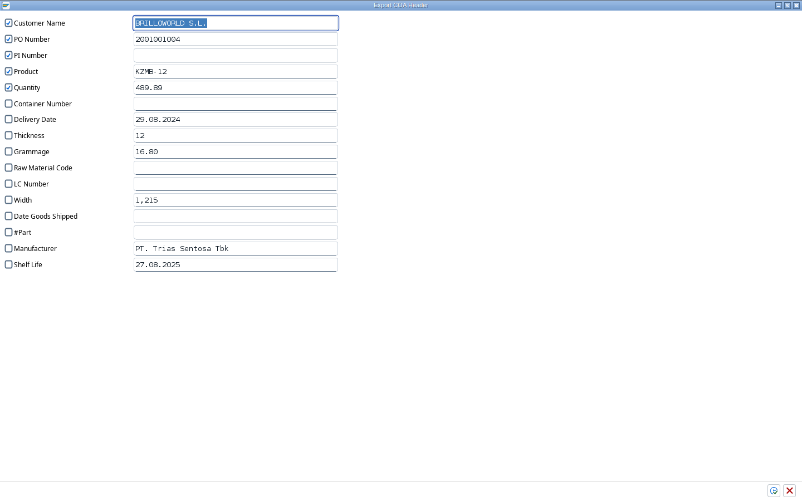

# TC-01 — Customer baru: popup tampil default

- Sistem: Sandbox New Company, client 130, TRSTDEV (27 Nov 2026)
- DO: 0085004567
- Customer (Sold-To): 1141100002 BRILLOWORLD S.L.

## Langkah
1. /nZQM002, Nomor ODO 0085004567, F8
2. Print > lepas centang 5 baris MIC (value 0 di sandbox) > Print COA

## Hasil

| Diharapkan | Hasil | Isi INDX(ZC) | Status |
|---|---|---|---|
| 5 field utama tercentang, 11 field tambahan kosong | Customer Name, PO, PI, Product, Quantity tercentang; 11 field tambahan kosong | `Belum ada record COAEXP_1141100002` | LOLOS |

Urutan pola: CUS PO PI PRD QTY CONT DDAT THK GRM RAW LC WID SHP PRT MFR LIF (X = centang)

## Screenshot

