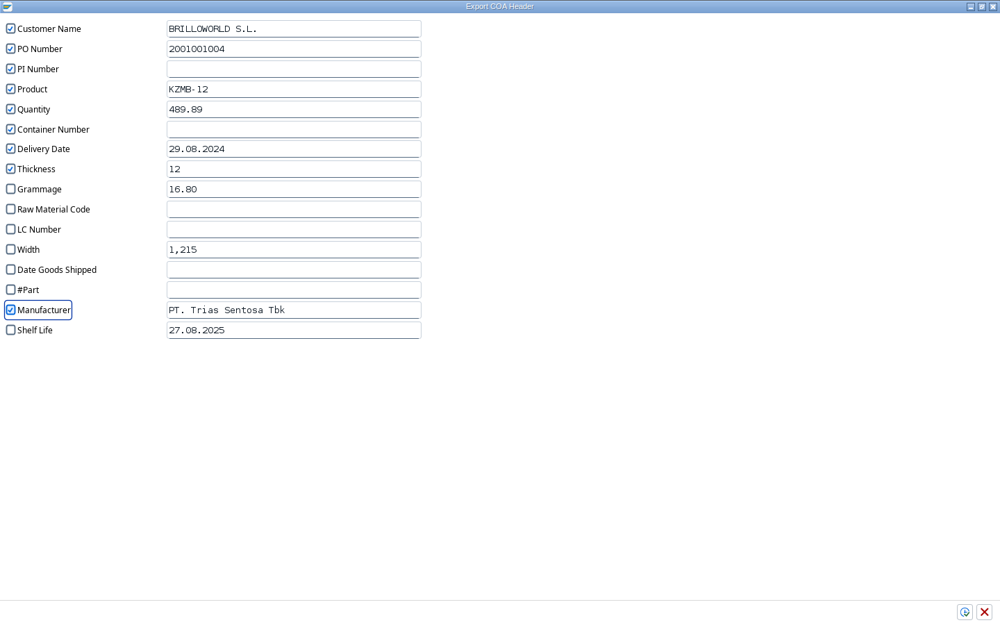
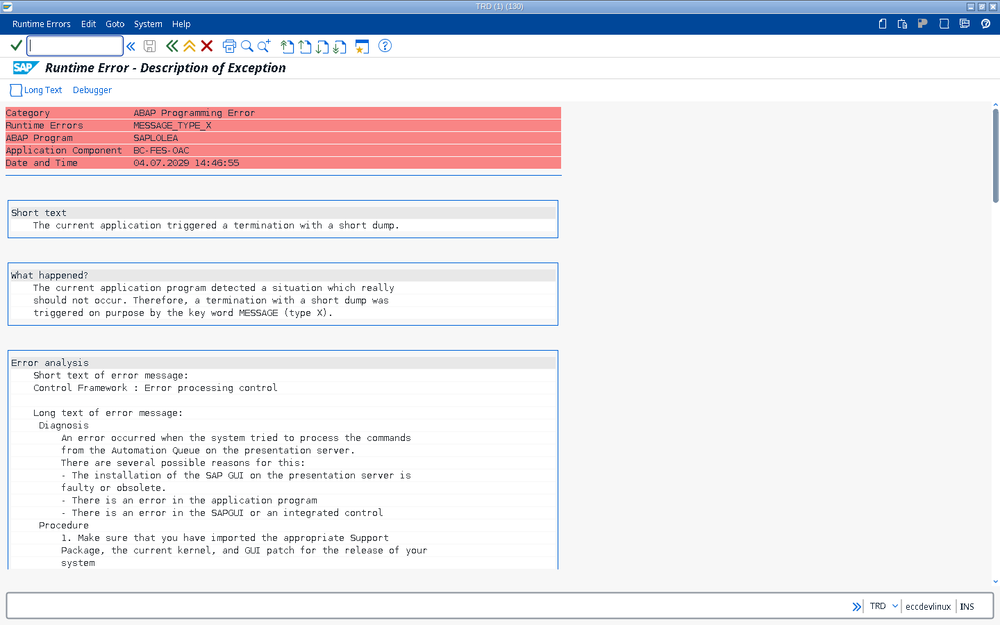

# TC-02 — Simpan centangan saat Execute

- Sistem: Sandbox New Company, client 130, TRSTDEV (27 Nov 2026)
- DO: 0085004567
- Customer (Sold-To): 1141100002 BRILLOWORLD S.L.

## Langkah
1. Di popup centang Container Number, Delivery Date, Thickness, Manufacturer
2. Execute > dialog print muncul > Print preview (GUI Java dump, lihat catatan)

## Hasil

| Diharapkan | Hasil | Isi INDX(ZC) | Status |
|---|---|---|---|
| Record customer A tersimpan dengan 4 field tambahan tsb | INDX(ZC) COAEXP_1141100002 = XXXXXXXX------X-, USERA TRSTDEV, PGMID ZQMI_COA | `XXXXXXXX------X-` | LOLOS |

Urutan pola: CUS PO PI PRD QTY CONT DDAT THK GRM RAW LC WID SHP PRT MFR LIF (X = centang)

## Screenshot

