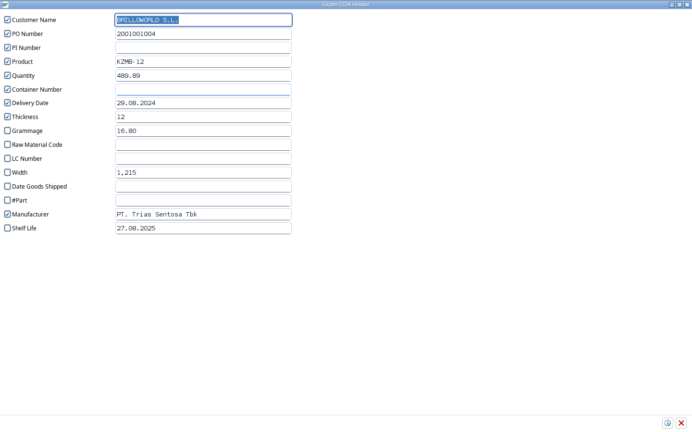

# TC-03a — Load ulang di run program baru (/n)

- Sistem: Sandbox New Company, client 130, TRSTDEV (27 Nov 2026)
- DO: 0085004567
- Customer (Sold-To): 1141100002 BRILLOWORLD S.L.

## Langkah
1. /nZQM002 (run baru, memori program kosong), DO 0085004567, F8
2. Print > lepas centang MIC > Print COA

## Hasil

| Diharapkan | Hasil | Isi INDX(ZC) | Status |
|---|---|---|---|
| Centangan dibaca dari database = hasil TC-02 | Container, Delivery Date, Thickness, Manufacturer tercentang | `XXXXXXXX------X- (tidak berubah)` | LOLOS |

Urutan pola: CUS PO PI PRD QTY CONT DDAT THK GRM RAW LC WID SHP PRT MFR LIF (X = centang)

## Screenshot

