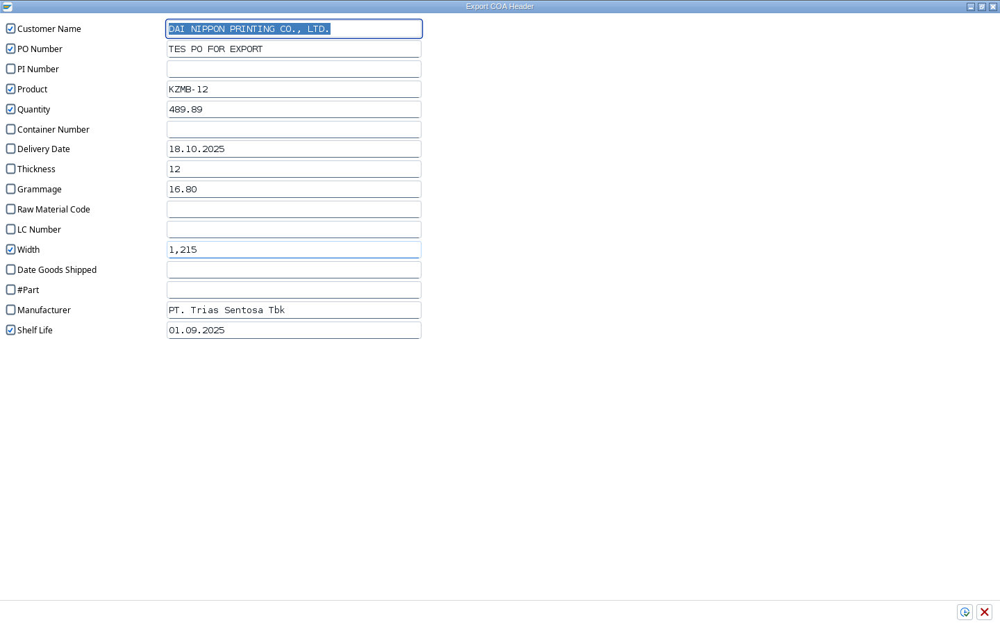

# TC-03b — DO lain customer sama, run program yang sama

- Sistem: Sandbox New Company, client 130, TRSTDEV (27 Nov 2026)
- DO: 0085004665
- Customer (Sold-To): 1141100066 DAI NIPPON PRINTING CO., LTD.

## Langkah
1. F3 dua kali ke selection screen (run sama), DO 0085004665, F8
2. Print > lepas centang MIC > Print COA

## Hasil

| Diharapkan | Hasil | Isi INDX(ZC) | Status |
|---|---|---|---|
| Centangan B ter-load; isian teks dikosongkan lalu diisi dari DO baru | PI kosong, Width & Shelf Life tercentang; Quantity 489.89 (DO sebelumnya 979.78) | `B: XX-XX------X---X (tidak berubah)` | LOLOS |

Urutan pola: CUS PO PI PRD QTY CONT DDAT THK GRM RAW LC WID SHP PRT MFR LIF (X = centang)

## Screenshot

