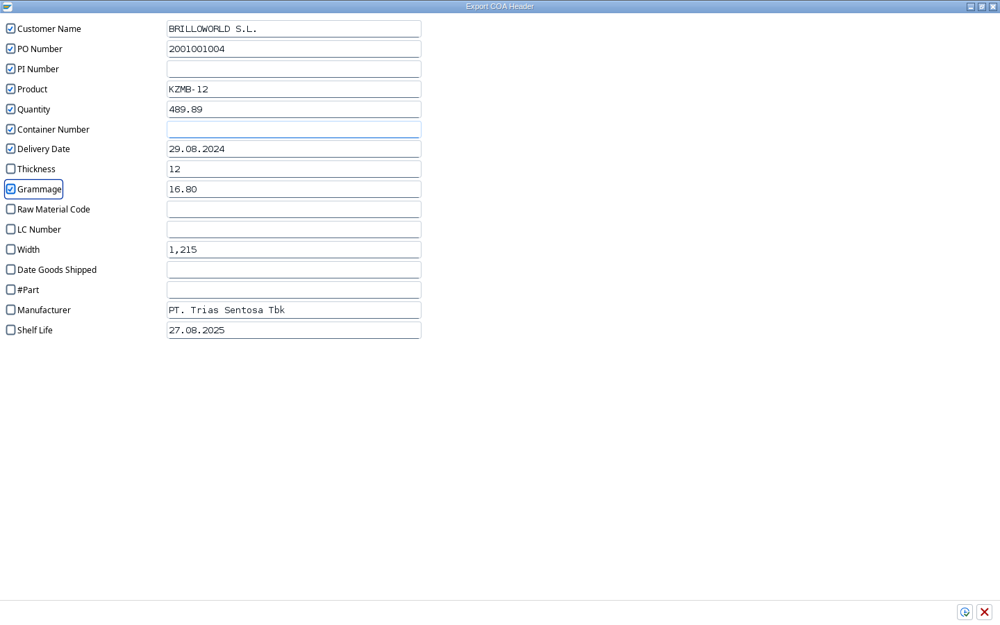
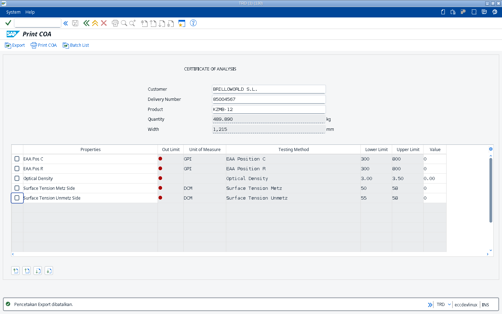
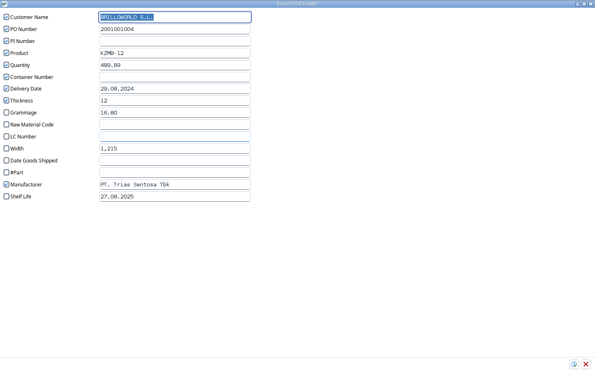

# TC-04 — Cancel tidak menimpa data

- Sistem: Sandbox New Company, client 130, TRSTDEV (27 Nov 2026)
- DO: 0085004567
- Customer (Sold-To): 1141100002 BRILLOWORLD S.L.

## Langkah
1. Di popup: lepas Thickness & Manufacturer, centang Grammage
2. Cancel > pesan 'Pencetakan Export dibatalkan'
3. Print COA lagi

## Hasil

| Diharapkan | Hasil | Isi INDX(ZC) | Status |
|---|---|---|---|
| Record tidak berubah; popup kembali ke centangan tersimpan | INDX tetap XXXXXXXX------X-; popup ulang: Thickness & Manufacturer tercentang, Grammage kosong | `XXXXXXXX------X- (tidak berubah)` | LOLOS |

Urutan pola: CUS PO PI PRD QTY CONT DDAT THK GRM RAW LC WID SHP PRT MFR LIF (X = centang)

## Screenshot

