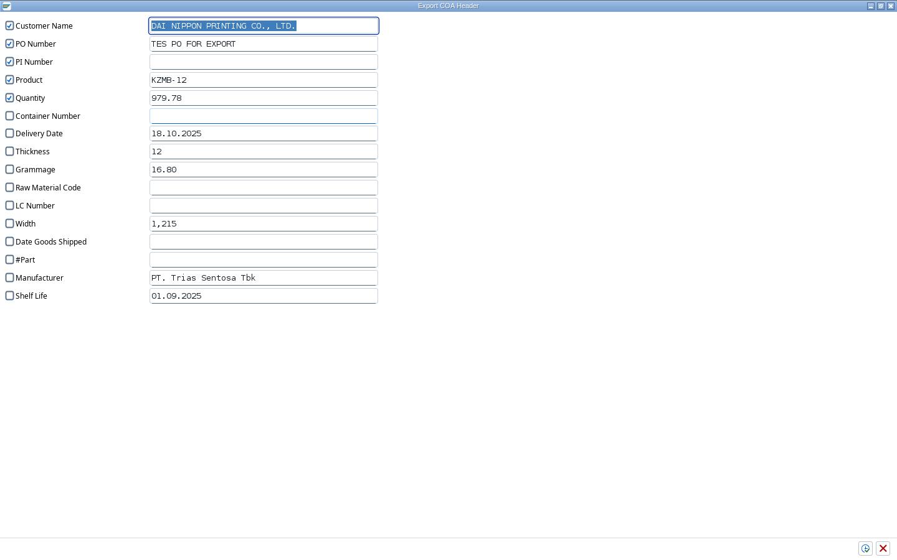
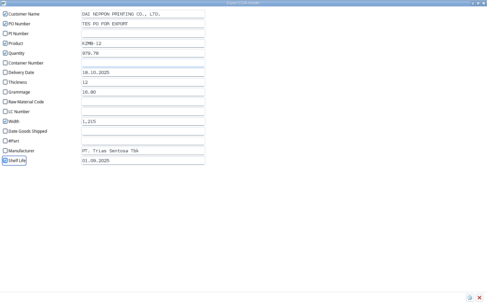

# TC-05 — Isolasi antar customer

- Sistem: Sandbox New Company, client 130, TRSTDEV (27 Nov 2026)
- DO: 0085004664
- Customer (Sold-To): 1141100066 DAI NIPPON PRINTING CO., LTD.

## Langkah
1. /nZQM002, DO 0085004664 (customer B), F8, Print > lepas centang MIC > Print COA
2. Lepas PI Number, centang Width & Shelf Life > Execute > cancel dialog print

## Hasil

| Diharapkan | Hasil | Isi INDX(ZC) | Status |
|---|---|---|---|
| Customer B tampil default (bukan centangan A); simpan B tidak mengubah A | Popup B default; INDX B = XX-XX------X---X; A tetap XXXXXXXX------X-. Isian teks ikut DO B (PO 'TES PO FOR EXPORT', Delivery Date 18.10.2025) | `A: XXXXXXXX------X- | B: XX-XX------X---X` | LOLOS |

Urutan pola: CUS PO PI PRD QTY CONT DDAT THK GRM RAW LC WID SHP PRT MFR LIF (X = centang)

## Screenshot

