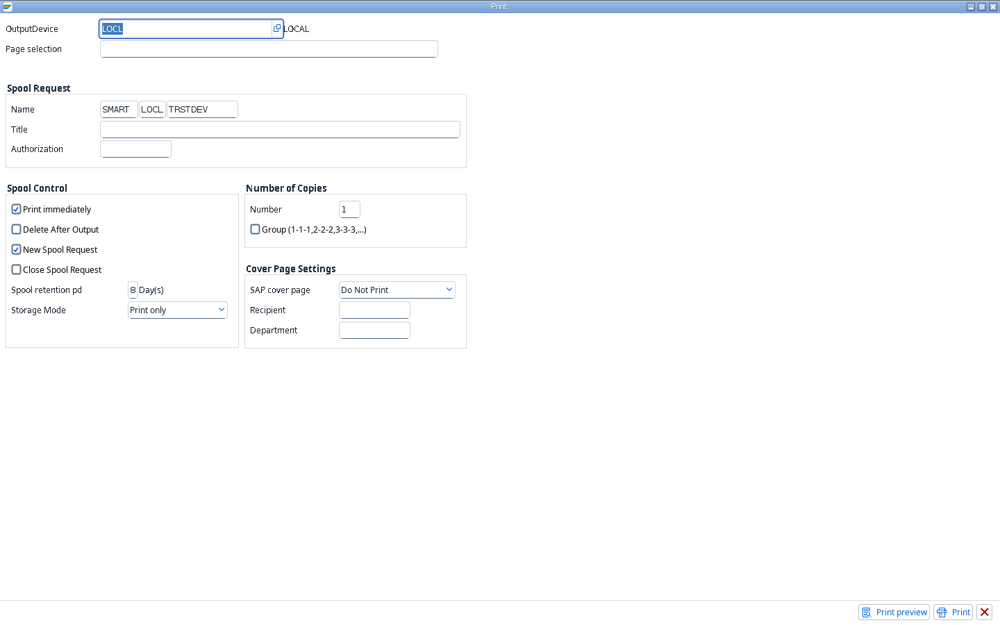

# TC-06 — Regresi DO domestik

- Sistem: Sandbox New Company, client 130, TRSTDEV (27 Nov 2026)
- DO: 0085000699 (ZDLF)
- Customer (Sold-To): 1141000328 VODA INDONESIA, PT.

## Langkah
1. /nZQM002, DO 0085000699, F8, Print > lepas centang MIC > Print COA

## Hasil

| Diharapkan | Hasil | Isi INDX(ZC) | Status |
|---|---|---|---|
| Popup header tidak muncul, langsung dialog print ZQMF_COA | Langsung dialog Print (LOCL); tidak ada popup; tidak ada record INDX baru | `Tidak ada record baru` | LOLOS |

Urutan pola: CUS PO PI PRD QTY CONT DDAT THK GRM RAW LC WID SHP PRT MFR LIF (X = centang)

## Screenshot

