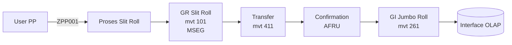
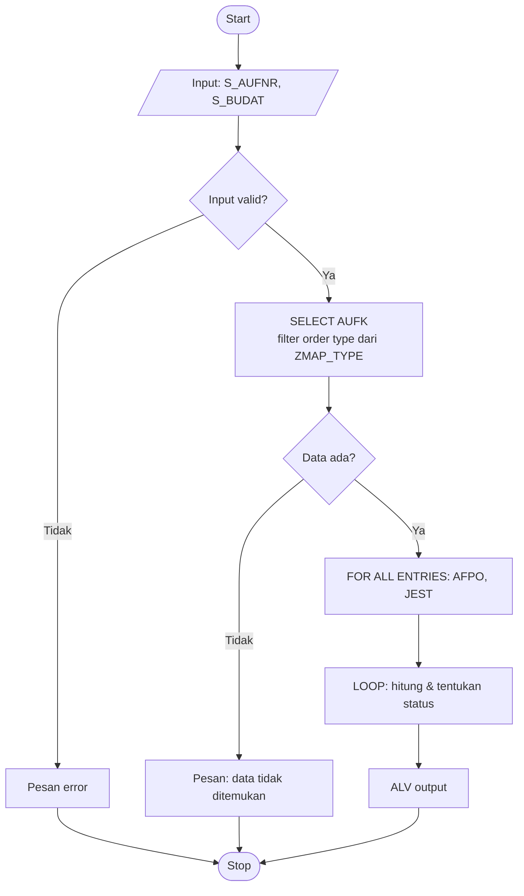

# Template Flow (Mermaid)

Setiap Day wajib menghasilkan **2 flow**:

| Flow | Pertanyaan yang dijawab | Untuk siapa |
|---|---|---|
| **A. Flow Bisnis** | Siapa melakukan apa, di TCODE mana, data apa yang terbentuk? | Manager / user bisnis |
| **B. Flow Program** | Program membaca apa, memutuskan apa, menghasilkan apa? | Developer / reviewer |

Tulis flow dalam format **Mermaid** di file `.md`. Mermaid adalah teks yang otomatis menjadi diagram.

## Cara melihat diagram

- **VS Code:** pasang extension *Markdown Preview Mermaid Support*, lalu buka preview (`Ctrl+Shift+V`).
- **Tanpa install:** salin isi blok ke editor Mermaid online. Jangan menempelkan data sensitif (nama customer, harga).
- **draw.io / Visio:** boleh, simpan sebagai gambar di folder kerja Anda.

Prompt AI: *"Buatkan flowchart Mermaid dari penjelasan berikut. Gunakan bentuk belah ketupat untuk keputusan, dan beri label TCODE/tabel di setiap langkah."*

## Contoh A — Flow Bisnis

## Contoh B — Flow Program

## Checklist Flow

- [ ] Flow A memakai istilah bisnis + TCODE, bisa dipahami tanpa membaca kode.
- [ ] Flow B memuat input, setiap tabel yang dibaca, setiap keputusan (IF/CASE), dan output.
- [ ] Setiap keputusan punya dua cabang (Ya/Tidak).
- [ ] Jalur error / data kosong digambarkan.
- [ ] Flow B cocok dengan kode program (cek silang dengan AI).
